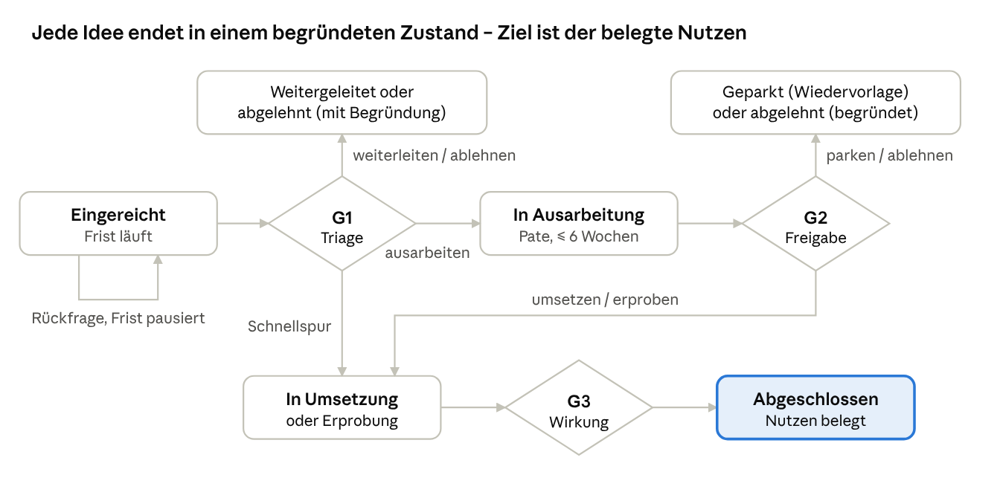
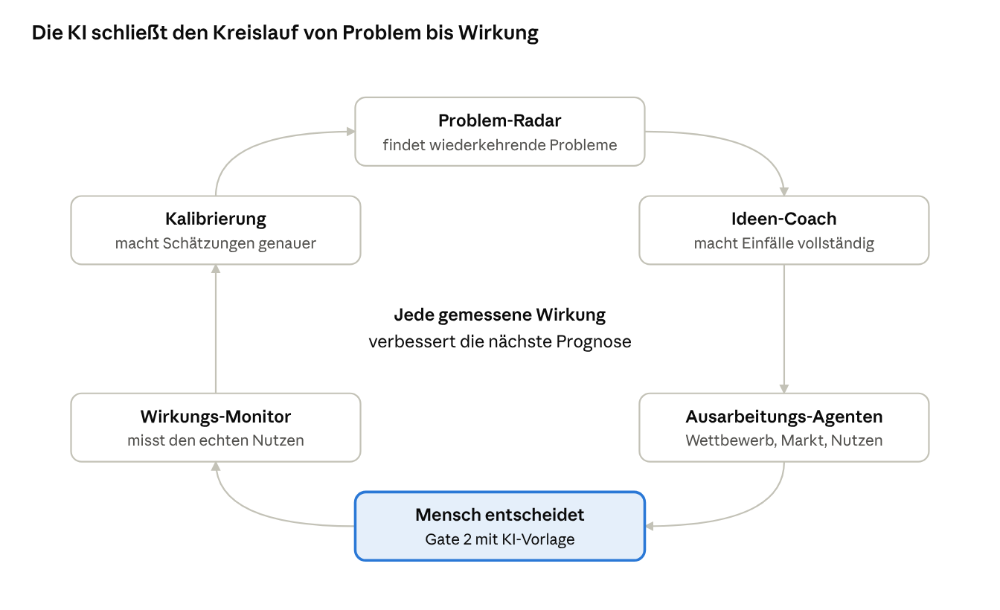
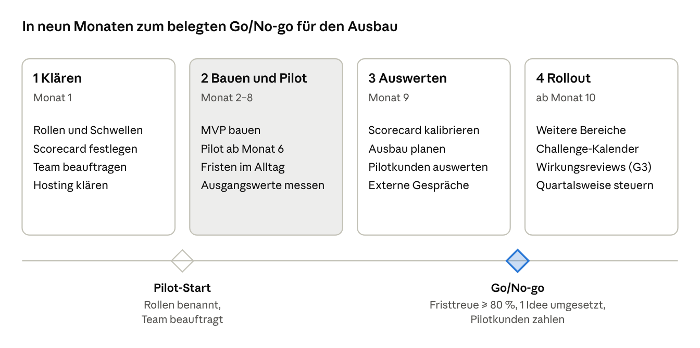
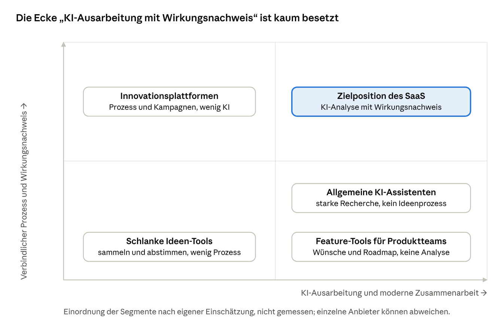

# Produktkonzept Ideenportal – intern & SaaS

12.10.2026 · Version 3 · Product Owner · Umsetzungsstand 13.10.2026

Aus dem Konzept „Vom Einfall zur Wirkung“ entsteht ein Produkt für Innovations- und Strategieteams, das ohne ServiceNow funktioniert: eine eigenständige, mandantenfähige Web-App, die intern und bei externen Kunden parallel aus demselben Code läuft. ServiceNow und Jira sind Konnektoren. Die Rechte an der Software sind geklärt. Release 1 bis 4 sind gebaut, soweit es ohne bezahlte Dienste und echte Nutzer:innen geht; das Modul Vorschlagswesen wartet auf die Segmententscheidung (Stand 13.10.2026, `docs/arbeitspakete.md`). Die Umsetzung steht im Umsetzungskonzept Ideenportal (Release 0–4).

- **Kernversprechen:** Das Ideenportal ist ein Entscheidungs- und Wirkungssystem für Ideen: Antwortgarantie, belegte Vorlagen, nachgemessene Wirkung – gebaut für Mitbestimmung und DSGVO.
- **Gemeinsamer Kern:** Ideenfluss mit Schnellspur und drei Gates, Fristen-Engine, Wirkungsnachweis und eine KI-Ausarbeitung mit Qualitätsschicht (Quelle je Aussage, Korrektur je Aussage, Prüfstatus, Kalibrierung gegen den Ist-Nutzen).
- **Intern und extern parallel:** Pilot intern und bei 2–3 externen Design-Partnern nach etwa 6 Monaten, Marktstart nach etwa 15 Monaten (mit zwei Entwickler:innen).
- **Zielgruppe:** Innovations- und Strategieteams in Unternehmen mit 250–5.000 Mitarbeitenden im DACH-Raum.
- **Geschäftsmodell:** fokussiertes DACH-Unternehmen mit 30–80 Kunden, finanziert über Bootstrap, Förderung oder einen strategischen Partner, kein Risikokapital.

## Änderungen in Version 3

Grundlage sind der Review V3 und seine Einarbeitung in [docs/05-review-v3/](../05-review-v3/): [einarbeitung.md](../05-review-v3/einarbeitung.md) (verbindliche Leitentscheidungen und Story-Zuordnung), [review-markt-wettbewerb.md](../05-review-v3/review-markt-wettbewerb.md) und [review-produkt-technik.md](../05-review-v3/review-produkt-technik.md).

1. **Positionierung neu:** Entscheidungs- und Wirkungssystem statt „KI, die ausarbeitet“. KI-Ausarbeitung ist 2026 Marktstandard und bleibt Funktion, nicht Überschrift.
2. **KI-Qualitätsschicht und Vertrauensregeln:** Autor:innen sehen keinen KI-Spur-Vorschlag, der eingebaute Anbieter liefert keine Zahlen, „Quelle verlinkt“ wird von „geprüft“ unterschieden (P-05, P-20, P-21).
3. **Zielgruppe geschärft:** Innovations- und Strategieteams, 250–5.000 Mitarbeitende, DACH. Produktteams nur als Modul für Bestandskunden.
4. **Marktgröße korrigiert:** Gartner-Zahl als Obergrenze, Bottom-up-Rechnung für DACH als Hauptargument; Konsolidierung im Markt berücksichtigt.
5. **Neuer Abschnitt „Wettbewerb und Feature-Abgleich“** mit 12 Wettbewerbern, Lücken und Antwort im Backlog.
6. **Neuer Abschnitt „Einsatzfelder“:** Problembörse, Nachhaltigkeit, Kostensenkung, Hackathons; Vorschlagswesen als Modul nach Segmententscheidung.
7. **Produktkern ergänzt:** Crowd-Bewertung, Challenge-Phasen, Teams- und Slack-App, Firmen-Login und SCIM, Rollen je Bereich, Mehrsprachigkeit, API und Webhooks, Durchlaufzeit-Kennzahlen, Datenschutz-Nachweis je Analyse, Muster-Betriebsvereinbarung, Trendradar.
8. **Mitbestimmung geschärft:** Portal gilt als technische Einrichtung nach BAG 2022; Muster-Betriebsvereinbarung wird Produktbestandteil.
9. **Pakete, Preise und Geschäftsmodell neu:** Challenge-Paket, Team, Business in zwei Stufen, Enterprise, Modul Vorschlagswesen; Ziel-ARPA 22.000–25.000 €; Design-Partner zahlen; Partnerkanal und Teams Store.
10. **Release 3 neu geschnitten:** Firmen-Login, SCIM, Teams-App und API zuerst. Vor Demo und Pilot werden Sicherheit, Betrieb und die drei KI-Vertrauensrisiken behoben, dann folgt ein Klicktest mit 7–8 Personen.

## Gemeinsamer Produktkern

Beide Varianten teilen Vision, Module und Datenmodell. Sie unterscheiden sich in Zielgruppe, Betrieb und Geschäftsmodell.

**Vision:** Jede gute Idee erreicht nachweisbar Wirkung, und jede Idee bekommt eine Antwort.

**Problem, das gelöst wird:** Portale sammeln Ideen, aber sie aktivieren, priorisieren und realisieren sie nicht. Es fehlt Rückmeldung, Gremien werden zum Engpass, und der Nutzen bleibt unbelegt.

**Produktprinzipien** (aus dem Konzept übernommen): proportional statt einheitlich, Strategie zieht und Basis drückt, jede Idee bekommt eine Antwort, Ideengeber:in bleibt an Bord, Wirkung zählt statt Menge.

### Kernmodule

| Modul | Kernfunktion | Prozessphase | Release |
| --- | --- | --- | --- |
| Einreichung | Geführtes Formular, Dublettensuche, vertraulich oder anonym; dialogischer KI-Coach | Einreichen | 1 (Coach 2) |
| Community | Kommentieren, unterstützen, Co-Autor:innen, Startseite mit Feed | Einreichen, Ausarbeiten | 1 |
| Triage-Board | Kanban nach Spur, Fristen-Ampel, Weiterleiten mit Zielkanal; KI-Vorschlag nur für Triage, Gremium und Pate | Gate 1 | 1 (KI 2) |
| Entscheidung | Entscheidung an Gate 2 mit Begründung und Owner; Sitzungsmodul; einseitige Vorlage | Gate 2 | 1 (Sitzung 2) |
| Schnellspur und Umsetzung | Übergabe, Umsetzungsstatus, Abschluss mit Ist-Nutzen, Wiedervorlage | Umsetzen | 1 |
| Ideen-Steckbrief | Gemeinsames Bearbeiten, Scorecard, KI-Entwurf; eigene Seite mit Reitern | Ausarbeiten | 2 |
| KI-Analyse | Wettbewerb, Markt und Business Case, Bausteine je Ideentyp einstellbar; Patente erst mit Patentdatenbank | Ausarbeiten | 2 |
| Experimente | Hypothese, Messgröße, Ergebnis | Umsetzen | 2 |
| Wirkungsreview | Plan gegen Ist; Controlling-Bestätigung; automatische Messung | Gate 3 | 2 (Bestätigung 3, Messung 4) |
| Challenges | Einfache Challenge; Teams, Jury, Phasen, Crowd-Bewertung | Anregen | 1 (voll 2) |
| Dashboard und Portfolio | Ideenfluss, Fristtreue, Durchlaufzeit, Nutzen, Zufriedenheit; Portfolio-Board | laufend | 1 (Portfolio 2) |
| Anerkennung und Prämien | Nennung, Erfolgsgeschichten; Prämienregeln im Modul Vorschlagswesen | Anerkennen | 2 (Prämien 3) |
| Externe Beteiligung | Kunden und Partner reichen ein, Feature-Wünsche mit Abstimmung; Modul für Bestandskunden | Einreichen | 3 |
| Anmeldung und Integrationen | Eigene Konten mit Zwei-Faktor; Firmen-Login und SCIM; Teams, Slack, Jira, ServiceNow, Azure DevOps, offene API | Umsetzen | 1 (eigene Konten), 3 (Firmen-Login, Konnektoren) |
| Abgrenzung | Erkennt Meldungen, Beschwerden, Störungen und leitet weiter | Einreichen | 1 (KI-Erkennung 2) |

**Stand 13.10.2026:** Alle Kernmodule sind gebaut, einschließlich Controlling-Bestätigung (R3-33), automatischer Messung (R4-04), externer Beteiligung (R3-19 bis R3-21), Firmen-Login, SCIM und Konnektoren (getestet gegen Attrappen). Nicht gebaut sind die Prämienregeln des Moduls Vorschlagswesen (Epic Z).

### Ergänzungen in Version 3

Die Ergänzungen schließen Lücken gegenüber dem Marktstandard und machen das Kernversprechen messbar. Story-IDs nach [einarbeitung.md](../05-review-v3/einarbeitung.md).

| Modul | Kernfunktion | Release | Story | Prio |
| --- | --- | --- | --- | --- |
| Antwortgarantie | Zusage je Mandant (z. B. erste Rückmeldung in 10 Arbeitstagen) mit Erfüllungsquote der letzten 90 Tage auf der Startseite | 1 (Nacharbeit) | R1-46 | Soll |
| Crowd-Bewertung | Bewertung nach Kriterien je Challenge (z. B. Nutzen, Machbarkeit); eine Stimme je Person; Mittelwert und Streuung; nie Auswertung je bewertender Person | 2 | R2-51 | Muss |
| Challenge-Phasen | Sammeln, Bewerten, Ausarbeiten, Jury, Ergebnis mit Terminen; Vorlagen für Ideenwettbewerb, Nachhaltigkeit, Kostensenkung | 2 | R2-52 | Soll |
| Gamification | Punkte und Abzeichen nur je Challenge, abschaltbar, keine Auswertung je Person | 2 | R2-53 | Kann |
| Durchlaufzeit-Kennzahlen | Median und 90. Perzentil je Phase, Zeitreihen, Ausgangswert als Linie im Dashboard | 2 (Nacharbeit) | R2-41 | Muss |
| Datenschutz-Nachweis je Analyse | Gesendete Suchanfragen ohne Firmenbezug, Anbieter, Region, Modell, Kosten; als PDF; für Datenschutz und Betriebsrat lesbar | 2 (Nacharbeit) | R2-42 | Muss |
| Portfolio-Board | Portfolio nach Phase, Themenfeld und Horizont | 2 | R2-08 | Muss (bisher Soll) |
| Firmen-Login und SCIM | OIDC (Entra ID zuerst), Gruppen → Rollen; SCIM-Provisionierung für Entra ID und Okta | 3 (Anfang) | R3-26, R3-27 | Muss |
| Teams- und Slack-App | Benachrichtigen, Einreichen, Rückfragen beantworten; Teams-App im Teams Store | 3 (Anfang) | R3-16 | Muss |
| API und Webhooks | API-Tokens je Mandant, OpenAPI-Beschreibung, Webhooks mit Signatur | 3 (Anfang) | R3-17 | Muss |
| Suche und Dubletten | Volltextsuche, Paginierung, semantische Dubletten mit pgvector | 3 | R3-28 | Muss |
| Rollen je Bereich | Triage, Gremium, Aufgaben und Dashboard je Bereich oder Themenfeld | 3 | R3-29 | Soll |
| Mehrsprachigkeit | Textkatalog (R2-50), Oberfläche Deutsch und Englisch (R3-22), KI-Übersetzung von Inhalten, Original bleibt (R3-30) | 2–3 | R2-50, R3-22, R3-30 | Soll, R3-22 Muss |
| Betriebsrat und Muster-BV | Leserolle Betriebsrat, KI-Funktionen einzeln abschaltbar, Muster-Betriebsvereinbarung aus der Konfiguration des Mandanten | 3 | R3-12 | Muss (bisher Soll) |
| Modul Vorschlagswesen | Fachgutachten mit Frist, Kommission, Einspruch; Prämienregeln nach Betriebsvereinbarung, HR-Freigabe, Payroll-Export; QR- und Kiosk-Einreichung; Benchmark-Kennzahlen | 3 | R3-35 bis R3-38 | Soll (Muss bei Segment BVW) |
| Trendradar | Themenfelder × Horizont × Reifegrad; KI ordnet Signale und Ideen zu; keine eigene Signal-Datenbank | 4 | R4-11 | Soll |

**Stand 13.10.2026:** Alle Ergänzungen sind gebaut außer dem Modul Vorschlagswesen (R3-35 bis R3-38, nur als Paketschalter angelegt). Stand je Story in `docs/release-<n>/umsetzungsstand.md`.

### Datenmodell (Kernobjekte)

| Objekt | Wichtige Felder | Beziehungen |
| --- | --- | --- |
| Idee | Titel, Problem, Lösung (bei Ideentyp „Problem“ optional), Nutzenhypothese, Ideentyp, Themenfeld, Bereich, Status, Spur, Vertraulichkeit | gehört zu Challenge (optional), hat Ideengeber:innen, Pate, Kommentare |
| Person & Rolle | Name, Organisationseinheit, Rollen (Ideengeber:in, Pate, Triage, Gremium, Admin, Betriebsrat), optional je Bereich | an vielen Ideen beteiligt |
| Bewertung | Kriterium, Gewicht, Wert 1–5, Begründung, bewertende Rolle (Jury, Gremium, Crowd) | gehört zu Idee und Gate oder Challenge |
| Entscheidung | Gate, Ergebnis, Begründung, Owner, Datum, Wiedervorlage | gehört zu Idee |
| Frist | Typ, Start, Soll, Pausen (Rückfrage), Eskalationsstufe | gehört zu Idee und Phase |
| Umsetzung | Kanal (Linie, Projekt, Backlog, Experiment), externe Referenz, Status | gehört zu Idee |
| Nutzen | Art (Euro, Stunden, Qualität, Umsatz, CO₂, kWh), Plan, Ist, Nachweis, Bestätigt durch | gehört zu Umsetzung |
| Challenge | Frage, Sponsor, Phasen mit Terminen, Themenfeld, eigenes Formular, Bewertungskriterien, optional Zielwert | hat viele Ideen |

### Status-Logik

Eine Rückfrage hält die Frist an. Jeder Endzustand außer „Abgeschlossen“ braucht eine Begründung, die die Ideengeberin automatisch erhält.

## KI-Konzept: Die KI arbeitet vor, Menschen prüfen und entscheiden

Die KI übernimmt den Großteil der Ausarbeitung: Recherche, Wettbewerbsanalyse, Marktpotenzial, Business Case, Risikoprüfung und Entscheidungsvorlage. Pate und Ideengeberin prüfen, korrigieren und ergänzen, statt bei null anzufangen. Entscheidungen an den Gates bleiben beim Menschen.

**Einordnung:** KI-Ausarbeitung ist 2026 Marktstandard. ITONICS, Qmarkets, Wazoku, HYPE und Ideanote bieten Scoring, Business-Case-Entwürfe und Marktrecherche an. Das Ideenportal unterscheidet sich nicht durch die Ausarbeitung, sondern durch ihre Qualitätsschicht: Jede Aussage hat eine Quelle oder ist als Schätzung markiert, jede Aussage ist korrigierbar, jeder Baustein hat einen Prüfstatus, und jede Prognose wird gegen den bestätigten Ist-Nutzen nachgemessen. Der Kreislauf aus Ausarbeiten, Umsetzen, Messen und Lernen bleibt das Ziel; die Kalibrierung ist der Teil, den kein geprüfter Wettbewerber hat.

### Qualitätsschicht

| Baustein | Was er leistet | Story | Release |
| --- | --- | --- | --- |
| Quelle je Aussage | Jede Aussage ist belegt (Quelle mit Abrufdatum), Annahme oder Schätzung (mit Konfidenz) | Bestand | 2 |
| Quellenprüfung | Quelle erreichbar, Zitat im Seitentext enthalten; Seitenabruf statt nur Suchtreffer-Snippet; monatliche Stichprobe | R2-46 | 2 (Nacharbeit) |
| Korrektur je Aussage | Pate und Ideengeberin korrigieren einzelne Aussagen; die KI rechnet abhängige Werte neu | Bestand | 2 |
| Prüfstatus je Baustein | ungeprüft, geprüft oder korrigiert mit Person und Datum; Gate-2-Vorlage zeigt den Status; Bewertung „hilfreich?“ | R2-44 | 2 (Nacharbeit) |
| Einseitige Gate-2-Vorlage | Höchstens eine Seite; jede Zahl führt per Klick zur Quelle oder Annahme | R2-43 | 2 (Nacharbeit) |
| Kalibrierung gegen Ist-Nutzen | Prognose gegen Ist je Ideentyp; Trefferband früherer Prognosen in der Gremiumsvorlage; ab 20 abgeschlossenen Ideen | R4-07 | 4 (Muss) |
| Anonymisierte Websuche | Suchanfragen ohne Firmen- oder Personenbezug; vertrauliche Ideen nie an externe Dienste | Bestand | 2 |
| Datenschutz-Nachweis | Je Analyse sichtbar, was an welchen Anbieter in welcher Region ging | R2-42 | 2 (Nacharbeit) |

### Vertrauensregeln

Vor Demo und Pilot werden drei Vertrauensrisiken behoben (Leitentscheidung 4 in [einarbeitung.md](../05-review-v3/einarbeitung.md)):

1. **KI ist nie die erste Antwort (P-05, R2-39):** Triage-Vorschlag und Rückmeldungsentwurf sehen nur Triage, Gremium und Pate. Autor:innen sehen die Kurzanalyse ohne Spur-Vorschlag. Die erste Entscheidung kommt immer von einem Menschen.
2. **Keine Platzhalter mit Zahlen (P-20, R2-40):** Ohne eingerichtetes KI-Modell liefert der eingebaute Anbieter Struktur, Leitfragen und Rechenformeln, aber keine Beträge oder Marktzahlen. Ein Banner weist auf das fehlende Modell hin. Die Demo zeigt echte Ergebnisse eines budgetierten Modells.
3. **„Quelle verlinkt“ ist nicht „geprüft“ (P-21, R2-46):** Bis die Quellenprüfung läuft, heißt eine Aussage mit Suchtreffer „Quelle verlinkt“. „Geprüft“ steht nur dort, wo Quelle und Zitat geprüft sind oder ein Mensch den Baustein freigegeben hat. Diese Unterscheidung gilt auch für Vertrieb und Marketing.

### KI über den ganzen Ideenzyklus

| Phase | KI-Funktion | Was sie tut | Freigabe | Release |
| --- | --- | --- | --- | --- |
| Anregen | Problem-Radar | Wertet Tickets, Kundenfeedback und Beschwerden aus, erkennt wiederkehrende Probleme, schlägt Challenges vor | Entwurf | 4 |
| Anregen | Strategie-Übersetzer | Leitet aus Strategie und Zielen Themenfelder und Challenge-Fragen ab | Entwurf | 2 |
| Anregen | Trend-Scout und Trendradar | Beobachtet Markt, Technologie und Wettbewerb, ordnet Signale und Ideen im Radar zu | Vorschlag | 4 |
| Einreichen | Ideen-Coach | Dialog per Text, Sprache, Foto oder Screenshot; fragt nach Ursache und Nutzen | Entwurf | 2 |
| Einreichen | Dubletten und Verwandte | Findet ähnliche Ideen und frühere Versuche, lokales Modell | Vorschlag | 1 (semantisch 3) |
| Einreichen | Abgrenzungserkennung | Erkennt Meldungen, Beschwerden und Störungen und schlägt den richtigen Kanal vor | Vorschlag | 2 |
| Einreichen | Übersetzung | Übersetzt Ideen und Kommentare, Original bleibt sichtbar | Entwurf | 3 |
| Community | Diskussions-Assistent | Fasst Diskussionen zusammen, zeigt Konsens und Einwände | Entwurf | 2 |
| Triage | Triage-Agent | Prüft Vollständigkeit, schlägt Spur mit Begründung vor; nur für Triage, Gremium, Pate sichtbar | Entwurf | 2 |
| Triage | Fristen-Agent | Erinnert, eskaliert, pausiert die Frist bei Rückfragen | Handeln mit Info | 1 |
| Ausarbeiten | Recherche-Agent | Kurzanalyse für jede Idee, Vollanalyse bei Ausarbeitung; Websuche je Ideentyp einstellbar | Entwurf | 2 |
| Ausarbeiten | Wettbewerbsanalyse | Produktideen: Wettbewerber; interne Ideen: fertige Lösungen, Open Source, Vorgehen anderer Unternehmen | Entwurf | 2 |
| Ausarbeiten | Marktanalyse | Produktideen: TAM, SAM, SOM (Soll, nur Produktideen); interne Ideen: Lösungsmarkt, Benchmarks, interner Hebel | Entwurf | 2 |
| Ausarbeiten | Patentrecherche | Patente und Stand der Technik; standardmäßig aus, bis eine Patentdatenbank (EPO OPS, Lens.org) angebunden ist | Entwurf | 2 |
| Ausarbeiten | Business-Case-Copilot | Nutzen, Kosten, Amortisation, Sensitivität | Entwurf | 2 |
| Ausarbeiten | Risiko- und Compliance-Check | Datenschutz, KI-Verordnung, Sicherheit, Recht, Arbeitnehmererfindung | Vorschlag | 2 |
| Ausarbeiten | Experiment-Designer | Hypothese, kleinster Test, Erfolgskriterien | Entwurf | 2 |
| Ausarbeiten | Aufwandsschätzung | Schätzt aus ähnlichen, bereits umgesetzten Ideen | Entwurf | 4 |
| Gate 2 | Vorlage und Advocatus Diaboli | Einseitige Vorlage, Pre-Mortem, stärkste Gegenargumente, Trefferband früherer Prognosen | Entwurf | 2 (Trefferband 4) |
| Umsetzung | Umsetzungspaket | Projektsteckbrief und User Stories für Jira, ServiceNow oder Azure DevOps | Entwurf | 3 |
| Umsetzung | Wirkungs-Monitor | Holt Kennzahlen aus angebundenen Systemen, vergleicht vorher und nachher | Entwurf | 4 |
| Lernen | Kalibrierung | Vergleicht Prognosen mit dem Ist und verbessert Schätzungen | Automatisch, protokolliert | 4 |
| Steuerung | Frag dein Portfolio | Beantwortet Fragen in Alltagssprache zu allen Ideen | Antwort | 3 |
| Steuerung | Erfolgsgeschichten | Entwirft Beiträge über umgesetzte Ideen | Entwurf | 2 |
| SaaS | Einrichtungs-Assistent | Schlägt Spuren, Schwellen und Scorecard vor | Entwurf | 3 |
| SaaS | KI-gestützter Import | Bereinigt alte Ideen und ordnet Themenfelder zu | Entwurf | 4 (R4-12, bisher R3-04) |

Gestrichen: Portfolio-Simulator und Konsistenz-Check (R4-09, R4-10). Beide haben keine Datenbasis, der Konsistenz-Check liegt zudem nah an einer Bewertung von Personen.

### So übernimmt die KI die Ausarbeitung

1. Nach Gate 1 startet der Recherche-Agent automatisch.
2. Er erstellt einen vollständigen Steckbrief-Entwurf:
   1. Problem und Ursache
   2. Lösung und Varianten
   3. Wettbewerb und bestehende Lösungen
   4. Marktpotenzial oder interner Hebel
   5. Business Case mit Spannen und Sensitivität
   6. Aufwand, Risiken und Compliance-Hinweise
   7. Vorschlag für ein Experiment und offene Fragen
3. Jede Aussage ist markiert: belegt (mit Quelle und Abrufdatum), Annahme oder Schätzung (mit Konfidenz).
4. Pate und Ideengeberin prüfen, korrigieren, setzen den Prüfstatus je Baustein und beantworten die offenen Fragen. Ändern sie eine Annahme, rechnet die KI Business Case und Marktpotenzial neu.
5. Der Advocatus Diaboli sucht die stärksten Gegenargumente, dann entsteht die einseitige Vorlage für Gate 2.

Ziel ist, die Ausarbeitung von bis zu 6 Wochen auf 1–2 Wochen zu verkürzen. Das ist eine Hypothese. Der Pilot misst sie mit den Durchlaufzeit-Kennzahlen (R2-41) gegen den Ausgangswert.

### Wettbewerbsanalyse und Marktpotenzial

**Für jede Idee:** Jede Idee bekommt nach der Einreichung eine Kurzanalyse auf einer Seite, ausgearbeitete Ideen eine Vollanalyse. Bei Produkt- und Kundenideen sind das Wettbewerber und die Marktgröße (TAM, SAM, SOM). Bei internen Ideen sind es fertige Lösungen, Open Source und das Vorgehen anderer Unternehmen, der Markt dieser Lösungen mit Preisen, der interne Hebel und die Frage, ob die eigene Lösung vermarktbar wäre. Websuche und Bausteine sind je Ideentyp einstellbar (R2-45). Standard: interne Ideen ohne Websuche in der Kurzanalyse, Patente aus. So entsteht bei kleinen internen Ideen keine unnötige Prüflast.

| Baustein | Was die KI liefert | Wie die Qualität gesichert wird |
| --- | --- | --- |
| Wettbewerbsmatrix | Anbieter × Kriterien (Funktionen, Preise, Zielgruppe, Stärken, Schwächen) | Jede Angabe mit Quelle und Abrufdatum |
| Positionierungskarte | Wo die Idee im Vergleich steht und welche Lücke sie schließt | Achsen und Einordnung editierbar |
| Kaufen oder bauen | Ob es schon eine fertige Lösung gibt und was sie kosten würde | Hinweis, wenn Preise nur auf Anfrage sind |
| Marktgröße | Top-down aus Studien und Bottom-up aus Kundenzahl × Preis | Zwei Methoden, Abweichung sichtbar, Spannen statt Punktwerte |
| Interner Hebel | Rechnung aus internen Daten (z. B. Ticketvolumen, Prozesszeiten) | Datenquelle verlinkt, Annahmen editierbar |
| Aktualität | Neue Recherche bei Wiedervorlage und vor Gate 2 | Änderungen gegenüber dem letzten Stand markiert |

**Quellen:** Websuche, Unternehmensseiten, Preislisten, Bewertungsportale, Patentdatenbanken und öffentliche Marktstudien. Lizenzierte Markt- und Unternehmensdatenbanken sind optional und kosten Geld.

**Grenzen:** Zahlen aus Marktstudien schwanken stark. Für den eigenen Markt reichen die Studien von 1,8 bis 11 Mrd. US-Dollar (Teil B); deshalb zählt die Bottom-up-Rechnung mehr. Die KI ersetzt keine Gespräche mit Kunden und keine Prüfung durch Recht, Datenschutz oder Patentfachleute.

### Freigabestufen für KI-Agenten

| Stufe | Die KI darf | Beispiele |
| --- | --- | --- |
| Vorschlag | Zeigen, nichts speichern | Dubletten, Mitstreiter, Trends |
| Entwurf | Erstellen; ein Mensch gibt frei | Steckbrief, Wettbewerbsanalyse, Marktpotenzial, Rückmeldung an Ideengebende |
| Handeln mit Info | Aktionen mit geringem Risiko selbst ausführen, protokolliert und rückgängig machbar | Erinnerungen, Frist pausieren, Recherche starten |
| Nie | Entscheiden, ablehnen, Personen bewerten, Prämien festlegen | Gates, Ablehnungen, Auswertungen über Mitarbeitende |

### Technische Bausteine

- **KI-Gateway:** modellunabhängig, EU-Hosting oder eigenes Modell, Kostenlimit pro Mandant, Kostenschätzung vor dem Aufruf, Fairness zwischen Mandanten (R2-49), kleine Modelle für einfache Aufgaben.
- **Wissensbasis:** alle Ideen, Entscheidungen und Ergebnisse durchsuchbar, mit Prüfung der Zugriffsrechte.
- **Werkzeuge für Agenten:** Websuche mit Seitenabruf, Konnektoren (Tickets, ServiceNow, Jira, Kennzahlen), Rechner für Business Case und Marktgröße.
- **Qualitätsmessung:** Testsatz als Freigabe-Tor, Quellenprüfung, Stichproben, Prüfstatus und Bewertung durch Nutzer:innen, Vergleich von Prognose und Ist.
- **Protokoll und Nachweis:** jede KI-Aktion nachvollziehbar mit Eingabe, Quelle und Freigabe; Datenschutz-Nachweis je Analyse.

### KI-Risiken und Leitplanken

| Risiko | Leitplanke |
| --- | --- |
| Erfundene Zahlen und Quellen | Quellenpflicht, Abrufdatum, Quellenprüfung (R2-46), Schätzungen sichtbar markiert, Stichproben |
| Scheinpräzision durch Platzhalter | Eingebauter Anbieter ohne Zahlen, Banner bei fehlendem Modell (R2-40) |
| KI-Vorschlag prägt die Antwort an Ideengebende | Spur-Vorschlag und Rückmeldungsentwurf nur für Triage, Gremium, Pate (R2-39) |
| Manipulation über Inhalte (Prompt-Injection in Ideentexten oder Webseiten) | Agenten mit minimalen Rechten; keine Aktion aufgrund fremder Inhalte ohne Freigabe; abgerufene Seiten begrenzt und eingezäunt |
| Blindes Vertrauen in die KI | Advocatus Diaboli, Konfidenzangaben, Prüfstatus je Baustein, Trefferband früherer Prognosen, Entscheidung immer beim Menschen |
| Bewertung von Personen | Nie; sonst fällt das System nach der EU-KI-Verordnung in die Hochrisiko-Kategorie für Beschäftigung |
| Vertrauliche Ideen in externen Suchen | Vertrauliche Ideen nur intern recherchieren; Suchanfragen ohne Firmen- oder Personenbezug; Datenschutz-Nachweis je Analyse |
| Kosten laufen aus dem Ruder | Limits pro Idee und Mandant, Kostenschätzung vor dem Aufruf, Vollanalyse nur nach Gate 1 |

### Ausbau nach Releases

- **Release 1:** Dublettensuche, regelbasierte Fristen und Abgrenzung (gebaut).
- **Release 2:** KI-Gateway, Ideen-Coach, Triage-Agent, Recherche-Agent, Wettbewerbs- und Marktanalyse, Business Case, Gremiumsvorlage, Abgrenzungserkennung (gebaut). Nacharbeit vor dem Pilot: Vertrauensregeln (R2-39, R2-40), einseitige Vorlage (R2-43), Datenschutz-Nachweis (R2-42), Prüfstatus (R2-44), Bausteine je Ideentyp (R2-45), Quellenprüfung (R2-46).
- **Release 3:** semantische Dubletten mit pgvector, KI-Übersetzung, Einrichtungs-Assistent, Frag dein Portfolio, Umsetzungspaket (gebaut).
- **Release 4:** Problem-Radar, Trend-Scout mit Trendradar, Wirkungs-Monitor, Kalibrierung mit Trefferband, KI-gestützter Import, Qualitäts-Dashboard (gebaut; Kalibrierung mit Testdaten geprüft, echte Werte erst ab 20 abgeschlossenen Ideen).

## Einsatzfelder

Der Kern (Einreichen → Triage mit Frist → Ausarbeiten mit KI → Entscheiden → Umsetzen → Wirkung) trägt mehrere Einsatzfelder. Die drei günstigsten (Nachhaltigkeit, Kostensenkung, Hackathons) stärken das Versprechen „Wirkung belegen“ und brauchen wenig Aufwand. Details: Review Teil 1, Abschnitt 7, und Teil 2, Abschnitt 6.

| Einsatzfeld | Nutzen | Stand / Release | Priorität |
| --- | --- | --- | --- |
| Innovations- und Ideenmanagement | Kernstrecke mit Antwortgarantie, belegter Vorlage und Wirkungsnachweis | gebaut (Release 1–2) | Kern |
| Problembörse | Beobachtungen ohne Lösung gehen nicht verloren; Triage macht daraus eine Challenge; Vorstufe zum Problem-Radar | **gebaut** (R3-31): Art „Problem“ mit optionaler Lösung, Lösungsvorschläge der Community, Triage macht daraus eine Challenge oder führt mit einer Idee zusammen, KI-Kurzanalyse mit Ursachenfragen statt Wettbewerb | Soll |
| Nachhaltigkeit (ESG) | CO₂- und kWh-Einsparung je Challenge, Export für den Nachhaltigkeitsbericht; hohe Sichtbarkeit bei geringem Aufwand | **gebaut**: CO₂ (R1-32); Vorlage „Nachhaltigkeit“ mit kWh, Nutzenart kWh mit Umrechnungsfaktoren je Mandant (kg CO₂ und € je kWh), Wirkung je Challenge nach Nutzenart, ESG-Export (CSV), Einsparung in der Erfolgsgeschichte (R3-32) | Soll |
| Kostensenkungsprogramme | Challenge mit Zielwert, Fortschritt gegen Ziel, Controlling-Bestätigung; CFO als zweiter Käufer | **gebaut** (R3-33, ersetzt R4-05): Zielwert mit Nutzenart und Zeitraum je Challenge, Rolle „Controlling“ oder benannte Person bestätigt oder korrigiert jeden Ist-Nutzen mit Kommentar, Fortschritt und Dashboard „bestätigt gegen geschätzt“ | Soll |
| Hackathons und Ideenwettbewerbe | Einstieg für Innovationsabteilungen, oft mit Eventbudget; führt zur Jahreslizenz | **gebaut**: Teams, Jury, Rangliste (R2-35); Phasen (R2-52); Hackathon-Modus mit Einreichfenster und Sperre, Pitch-Reihenfolge, Publikumsvoting (eine Stimme je Person, getrennt von der Jury), Teamseite und kombinierter Rangliste nach Gewichtung (R3-34); Challenge-Paket (R3-39) | Soll, Hackathon-Modus Kann |
| Betriebliches Vorschlagswesen (Modul) | Größter DACH-Markt; Fristen-Engine und Wirkungsnachweis treffen die Schmerzpunkte (lange Gutachten, sinkende Umsetzungsquote); Migrationschance durch das Ende von id-Force und die Ausmusterung von HLP Release 3 (R3-35 bis R3-38); **nicht gebaut, offene Segmententscheidung nach 10 Interviews** mit Industriekunden (Interviewleitfaden liegt in `docs/release-0/business/`) | Soll (Muss bei Segment BVW) |
| Kundenfeedback und Feature-Wünsche | Wünsche von Kunden mit Entscheidung und Wirkung verbinden; nur für Bestandskunden, nicht als Einstieg (Canny, Productboard, Jira Product Discovery sind günstiger) | **gebaut** (R3-19 bis R3-21): externe Konten je Challenge mit Einwilligungsprotokoll, Moderation, Feature-Wünsche mit Abstimmung und öffentlicher Statusseite | Soll, Modul |
| Open Innovation | Ideen von Kunden, Partnern und Hochschulen mit Einwilligung zu Nutzungsrechten je Challenge | Grundlage **gebaut** (R3-19 mit Einwilligung zu Nutzungsrechten je Challenge); aktives Angebot frühestens Release 4, über Partner | Kann |
| Lieferanten-Innovation | Einkauf als weiterer Käufer in Automotive und Maschinenbau | nicht geplant; nur auf Nachfrage von Industriekunden | Kann |

**Ausdrücklich nicht:**

- **Start-up-Scouting:** Enterprise-Standard bei HYPE, ITONICS, Qmarkets und Wazoku, aber mit eigenen Datenbanken, die nicht einholbar sind. Verwässert den Kern.
- **Bürgerbeteiligung:** Dafür gibt es Open-Source-Standards (Consul, Decidim), die man nicht schlägt. Internes Ideenmanagement in Behörden wird frühestens nach Release 4 betrachtet.

## Teil A – Interner Einsatz

Der interne Einsatz ist kein eigenes System, sondern der erste Mandant der gemeinsamen Web-App. Der interne Pilot startet zusammen mit 2–3 externen Design-Partnern nach etwa 6 Monaten.

### Produktziele (12 Monate nach Start)

| Ziel | Messgröße | Zielwert (Startannahme) |
| --- | --- | --- |
| Jede Idee bekommt eine Antwort | Erste Rückmeldung in ≤ 10 Arbeitstagen (Antwortgarantie) | ≥ 90 % der Ideen |
| Schneller ausarbeiten | Dauer von Gate 1 bis Gate 2 (Median, R2-41) | 1–2 Wochen (Hypothese) |
| Schneller entscheiden | Durchlaufzeit von der Einreichung bis Gate 2 | ≤ 60 Tage |
| Mehr umsetzen | Umgesetzte Ideen im Verhältnis zu freigegebenen | ≥ 60 % |
| Breite Beteiligung | Mitarbeitende mit Idee, Kommentar oder Mitarbeit pro Jahr | ≥ 15 % (ambitioniert; Median im deutschen Vorschlagswesen 10,4 %) |
| Wirkung belegen | Ideen mit bestätigtem Nutzen an Gate 3 | Ausgangswert im Pilot messen |

### Personas

| Persona | Ziel | Schmerz heute | Was das Produkt liefert |
| --- | --- | --- | --- |
| Ideengeberin (Sachbearbeitung) | Verbesserung schnell loswerden und sehen, was passiert | Idee verschwindet, keine Antwort | Geführte Einreichung, Status in Echtzeit, Rückmeldung mit Frist, Einreichen aus Teams |
| Ideen-Pate (Fachexperte) | Gute Ideen ohne viel Aufwand entscheidungsreif machen | Kein Zeitbudget, Formulare ohne Struktur | Strukturierter Steckbrief, KI-Entwurf mit Prüfstatus, klare Timebox, Mitarbeit der Ideengeberin |
| Triage-Team (Ideenmanagement) | Überblick behalten und Fristen halten | Excel-Listen, Nachfassen per E-Mail | Board mit Fristen-Ampel, Dublettenhinweis, Crowd-Bewertung, Rollen je Bereich |
| Gremiumsmitglied (Bereichsleitung) | Gut vorbereitet entscheiden, wenig Termine | Unreife Vorlagen, Statusrunden | Einseitige Vorlagen mit Quelle je Zahl, max. 5 Ideen je Termin, Entscheidung dokumentiert |
| Sponsor (Führungskraft) | Sichtbare Erfolge ohne zusätzliche Kosten | Kein Budget, wenig Zeit | Kleiner Pilot, schnelle Ergebnisse, belegter Nutzen als Argument für mehr |
| IT-Betrieb und IT-Sicherheit | Sicherer, wartbarer Betrieb | Schatten-IT ohne Verantwortliche | Container, Firmen-Login und SCIM, Monitoring, Doku, klare Zuständigkeit |
| Betriebsrat und Datenschutz | Verarbeitung prüfen und regeln | Protokolle und Auswertungen, die Einzelpersonen zeigen könnten | Leserolle, KI-Funktionen einzeln abschaltbar, Datenschutz-Nachweis je Analyse, Muster-Betriebsvereinbarung |

### MVP-Umfang

Das MVP (Release 1) deckt die Strecke von der Einreichung bis zur Umsetzung mit Ist-Nutzen ab und läuft intern und extern. Release 1 und 2 sind gebaut.

- **Im MVP:** geführte Einreichung, Dublettensuche, Kommentare, Triage mit Fristen, Weiterleiten, Schnellspur, Entscheidung an Gate 2, Umsetzung mit Ist-Nutzen, einfache Challenge, Dashboard, eigene Konten mit Selbstregistrierung und Einladungslink, öffentliche Demo, Abgrenzung.
- **Nicht im MVP:** KI-Coach und KI-Analysen (Release 2), Steckbrief und Gremiumssitzung (Release 2), Firmen-Login (jetzt R3-26 am Anfang von Release 3), Konnektoren, Abrechnung.
- **Vor Demo und Pilot (Nacharbeit):** Rate-Limits (R1-44), verschlüsselte Zwei-Faktor-Geheimnisse und Sicherheits-Header (R1-45), Monitoring und Alarme für Fristen-Jobs (R1-05), die drei Vertrauensregeln der KI (R2-39, R2-40, R2-46), Durchlaufzeit-Kennzahlen (R2-41), Datenschutz-Nachweis (R2-42), einseitige Gate-2-Vorlage (R2-43). Danach Klicktest mit 7–8 Personen und manuelle Prüfung der Barrierefreiheit.

### User Stories

Alle User Stories mit Akzeptanzkriterien, Schätzung und Priorität stehen im Umsetzungskonzept (Abschnitte 10–13). Version 3 ergänzt 35 Stories und ersetzt oder streicht 5; die Zuordnung steht in [einarbeitung.md](../05-review-v3/einarbeitung.md).

### Technische Umsetzung (unabhängig von ServiceNow)

Empfohlen ist eine eigenständige Web-App von Anfang an. Ein Pilot auf ServiceNow wäre schneller gestartet, müsste für das Zielprodukt aber komplett neu gebaut werden.

| Option | Was es ist | Vorteil | Haken | Bewertung |
| --- | --- | --- | --- | --- |
| Eigenständige Web-App von Anfang an | Eigene Anwendung, intern auf einer VM oder in einer Firmen-Cloud betrieben | Ein Code für intern und extern, keine Plattformlizenzen, volle Kontrolle | Betrieb, Sicherheit und Anmeldung selbst lösen; mehr Aufwand im MVP | empfohlen, umgesetzt |
| Erst ServiceNow, später neu bauen | Scoped App als Pilot, danach Neuentwicklung | Schneller Start auf vorhandener Plattform | Doppelte Arbeit; eigene Tabellen brauchen meist App-Engine-Rechte ([Redress Compliance](https://redresscompliance.com/servicenow-app-engine-licensing-explained)) | entfällt |
| Fertiges Standardtool kaufen | Spezialisierte Ideenmanagement-Software | Sofort nutzbar | Kein Budget, kein eigenes Produkt | entfällt |

**Technik:** TypeScript (Node.js) für Oberfläche und Server, PostgreSQL mit Row-Level-Security, Auslieferung als Container (ADR 0001). Das läuft intern auf einer kleinen VM und unverändert in einer EU-Cloud. Firmen-Login per OpenID Connect folgt mit R3-26 (Entra ID zuerst), SCIM mit R3-27.

**KI:** Die Dublettensuche läuft über eine günstige Ähnlichkeitssuche, ab Release 3 semantisch mit pgvector (R3-28). Der KI-Dienst ist über eine austauschbare Schnittstelle angebunden: ein EU-gehosteter Anbieter oder ein selbst betriebenes offenes Modell. So entsteht keine Abhängigkeit von einem Anbieter, und Daten bleiben auf Wunsch im Haus.

**Bauregeln, damit die App extern taugt:**

1. Mandantenfähig ab dem ersten Tag: jede Tabelle mit Mandanten-Kennung, auch wenn es intern nur einen Mandanten gibt.
2. Schwellen, Fristen, Gewichte, Themenfelder und Texte als Einstellungen, nichts fest im Code.
3. Keine firmenspezifischen Namen oder Daten im Code; alle Texte im Textkatalog (R2-50), damit Englisch und weitere Sprachen ohne Umbau folgen.
4. Schnittstelle zuerst: Oberfläche und Integrationen nutzen dieselbe API, mit API-Tokens, OpenAPI und Webhooks (R3-17).
5. Tests, Installationsanleitung, Monitoring sowie Sicherheits- und Datenschutzdoku von Anfang an.

**Rolle von ServiceNow:** nur noch als Integration. Freigegebene Ideen können über die Schnittstelle als Demand oder Projekt an ServiceNow übergeben werden. Für ServiceNow-Kunden ist das Portal die Stufe „vor dem Demand“, kein Ersatz für Strategic Portfolio Management.

### Architektur (logisch, werkzeugneutral)

- **Oberfläche:** Web, mobil nutzbar, barrierearm; Microsoft Teams und Slack als zweite Oberfläche.
- **Workflow-Kern:** Status, Spuren, Fristen mit Pausen und Eskalation, Rollen und Rechte, optional je Bereich.
- **Datenbank:** relational, mandantenfähig, mit Änderungshistorie.
- **Anmeldung:** Firmen-Login per OpenID Connect je Mandant mit SCIM-Provisionierung, dazu eigene Konten mit Zwei-Faktor-Anmeldung.
- **Suche:** Volltext plus semantischer Index für Dubletten.
- **KI-Dienst:** austauschbare Modellanbindung, Protokollierung, Datenschutz-Nachweis, kein Training mit Kundendaten.
- **Integrationen:** Benachrichtigungen per E-Mail, Teams und Slack, Konnektoren (Jira, ServiceNow, Azure DevOps), API-Tokens und Webhooks.
- **Reporting:** Auswertungen nur aggregiert und erst ab 5 Personen.
- **Betrieb:** Container; intern auf einer VM, extern in einer EU-Cloud; Health-Check mit Job-Alter, Warteschlange und Mail-Rückstau, Alarm per Mail oder Webhook.

### Mitbestimmung und Betriebsvereinbarung

Das Portal protokolliert Zugriffe und KI-Aktionen. Nach der Rechtsprechung des Bundesarbeitsgerichts (2022, zu Microsoft 365) genügt die objektive Eignung zur Überwachung, damit Software eine technische Einrichtung nach § 87 Abs. 1 Nr. 6 BetrVG ist. Ein Ideenportal berührt zudem Nr. 12 (betriebliches Vorschlagswesen). Wo ein Betriebsrat besteht, ist der Einsatz ohne Betriebsvereinbarung unzulässig. Betriebsräte fordern typischerweise: keine Einzelauswertung, Löschfristen für Protokolle, kein Zugriff der Führungskraft auf Einzeldaten, Einspruchsverfahren und eine Testphase mit Auswertung. Keine Rechtsberatung.

| Baustein | Was er leistet | Story |
| --- | --- | --- |
| Leserolle Betriebsrat | Einsicht in Rollen, Rechte, Auswertungen, aktive KI-Funktionen und Zugriffe; KI-Funktionen einzeln abschaltbar | R3-12 (Muss) |
| Muster-Betriebsvereinbarung | Anwaltlich geprüfte Vorlage, aus der Konfiguration des Mandanten befüllt (KI-Funktionen, Protokolle, Löschfristen, Auswertungen, Einspruch); Duldungsvereinbarung für den Pilot als zweite Vorlage | R3-12 (Muss) |
| Datenschutz-Nachweis je Analyse | Zeigt je KI-Analyse Suchanfragen, Anbieter, Region und Modell | R2-42 (Muss) |
| Rollentrennung in Protokollen | Betriebsrat sieht Zugriffe; Führungskräfte sehen nie Einzeldaten | Bestand, R3-12 |
| Gamification | Nur je Challenge, abschaltbar, keine Auswertung je Person | R2-53 (Kann) |

**Intern:** Die Annahme bleibt eine Organisation ohne Betriebsrat. Das Produkt wird trotzdem so betrieben, als gäbe es einen: Auswertungen ohne Personenbezug, transparente Kriterien, Löschfristen. Die Datenschutz-Grundverordnung gilt unabhängig davon. Die meisten externen Zielkunden haben einen Betriebsrat; der interne Mandant ist der Testfall für die Vorlagen.

### Roadmap

Der Go/No-go nach Monat 9 entscheidet über den weiteren Ausbau. Die externen Design-Partner laufen von Anfang an parallel.

### Business Case (Rechenbeispiel)

Die Zahlen sind ein Rechenbeispiel für eine Organisation mit 2.000 Mitarbeitenden. Jeder Wert ist eine Annahme und muss im Pilot gemessen werden.

| Position | Annahme | Wert pro Jahr |
| --- | --- | --- |
| Beteiligte | 15 % von 2.000 | 300 Personen |
| Ideen | 1,3 Ideen pro beteiligter Person | ca. 400 Ideen |
| Umgesetzt | 25 % (Schnellspur und Gate 2) | ca. 100 Ideen |
| Nutzen je umgesetzter Idee | 3.000 € im Mittel, sehr ungleich verteilt | ca. 300.000 € |
| Kosten Ideenmanagement | 0,75 FTE | ca. 60.000–70.000 € |
| Kosten Werkzeug und Betrieb | VM intern, Anteil an KI- und Suchkosten | ca. 5.000–15.000 € |
| Zeit von Paten und Gremium | ca. 1.500 Stunden | ca. 75.000 € |

Der Business Case hängt fast ganz an zwei Annahmen: der Realisierungsquote und dem mittleren Nutzen je Idee. Die Annahme von 3.000 € liegt zwischen Median (1.728 €) und Mittelwert (4.353–7.262 €) deutscher Studien und ist vertretbar. Die Verteilung ist stark schief: Wenige Ideen bringen den Großteil. Ein Pilot mit 5 entschiedenen Ideen kann den Mittelwert deshalb nicht belegen; das Go/No-go-Kriterium misst stattdessen bestätigten Nutzen gegen die Pilotkosten. Die Beteiligung von 15 % liegt über dem Median des deutschen Vorschlagswesens (10,4 %) und ist ohne Prämien ambitioniert.

### Vorgehen und Ressourcen

- **Bau:** eine gemeinsame Web-App für intern und extern, gebaut von zwei Entwickler:innen mit UX in Teilzeit und dir als Product Owner (Umsetzungskonzept, Szenario B). Release 1 und 2 sind gebaut.
- **Aufwand:** Version 3 umfasst 146 Stories mit 752 Story Points; Release 1 und 2 (bis R2-38) sind gebaut, offen sind rund 396 Story Points, also etwa 396 Personentage mit Puffer. Details im Umsetzungskonzept.
- **Reihenfolge:** zuerst Nacharbeit vor dem Pilot (Sicherheit, Betrieb, KI-Vertrauen), dann Klicktest, dann Pilot; Release 3 beginnt mit Firmen-Login, SCIM, Teams-App und API.
- **Intern:** eine VM oder Container-Umgebung der IT und der Firmen-Login; die IT gibt den Betrieb nach einem Sicherheitsreview frei.
- **Extern:** Betrieb in einer EU-Cloud, 2–3 Design-Partner ab dem Pilot.
- **Früh Nutzen zeigen:** nach 3 Monaten Pilotbetrieb Go/No-go mit Fristtreue, bestätigtem Nutzen, Zufriedenheit und Zahlungsbereitschaft der Design-Partner.

### Erfolgsmessung und Go/No-go nach dem Pilot

- [ ] Fristtreue ≥ 80 % intern und bei den Design-Partnern
- [ ] Mindestens 5 Ideen an Gate 2 entschieden
- [ ] Mindestens 2 Ideen mit bestätigtem Nutzen ≥ 10.000 € oder Summe des bestätigten Nutzens ≥ Pilotkosten
- [ ] Zufriedenheit der Ideengebenden ≥ 4 von 5
- [ ] Datenschutz und IT-Sicherheit haben freigegeben
- [ ] Mindestens 2 Design-Partner sind bereit, nach dem Pilot den regulären Paketpreis zu zahlen

## Intern und extern parallel

Intern und extern werden parallel gebaut: Der interne Einsatz ist der erste Mandant, die Design-Partner sind die nächsten. Der frühere Stufenplan von intern nach extern entfällt; den Ablauf zeigt der Releaseplan im Umsetzungskonzept.

### Rechte an der Software

Wer die Rechte am Code hält, wie Einnahmen verteilt werden und wer Vertragspartei der Kunden ist, muss vor dem ersten externen Pilotvertrag schriftlich festgehalten sein. Eine Rechtsform (GmbH oder UG) ist spätestens mit dem ersten zahlenden Kunden nötig. Als Vertriebsweg ist zusätzlich ein Partnermodell möglich: Ein ServiceNow-Partner übernimmt Vertrieb und Betrieb gegen Lizenzgebühr. Keine Rechtsberatung.

### Rolle von ServiceNow im externen Produkt

- **Konnektor, kein Fundament:** Freigegebene Ideen gehen als Demand oder Projekt an ServiceNow. Das Produkt funktioniert auch ohne.
- **Microsoft zuerst:** Die Teams-App im Teams Store kommt vor dem ServiceNow Store. Sie erreicht den Mittelstand breiter und hat die geringere Hürde.
- **Weitere Konnektoren:** Jira und Azure DevOps in Release 3.
- **Optional später:** den Konnektor im ServiceNow Store anbieten. Dafür sind das Technology Partner Program und eine Zertifizierung von etwa 3–5 Wochen nötig ([Metron Labs](https://hub.metronlabs.com/how-to-get-your-app-published-on-the-servicenow-store/)).

## Teil B – Marktfähiges SaaS

Das SaaS richtet sich an Innovations- und Strategieteams im DACH-Raum, die Ideen schneller entscheiden und den Nutzen gegenüber der Geschäftsführung belegen müssen. Es verkauft das Ergebnis, nicht die Methode: eine Antwort in garantierter Frist, eine belegte Vorlage und einen nachgemessenen Nutzen. Die KI-Ausarbeitung ist dabei Werkzeug.

**Einordnung:** Intern und extern laufen parallel aus demselben Code. Der interne Einsatz ist der erste Mandant, 2–3 externe Design-Partner folgen mit dem Pilot. Sie zahlen einen symbolischen Preis und prüfen, was intern nicht prüfbar ist: Zahlungsbereitschaft und Einsatz bei Kunden mit Betriebsrat.

### Markt und Marktgröße

**Weltweit:** Gartner beziffert den Markt für Innovationsmanagement-Plattformen 2025 auf rund 2 Mrd. US-Dollar und erwartet bis 2032 über 3 Mrd. ([HYPE zu Gartner Market Guide 2025](https://www.hypeinnovation.com/news/innovation-management-in-2025-ai-is-taking-over-but-thats-not-enough)). Andere Studien reichen je nach Abgrenzung von 1,8 bis 11 Mrd. US-Dollar und sind nur als Größenordnung brauchbar. Die Gartner-Zahl gilt hier als Obergrenze.

**DACH bottom-up** (Hauptargument; Schätzungen markiert):

| Schritt | Wert | Grundlage |
| --- | --- | --- |
| Unternehmen ab 250 Mitarbeitenden in Deutschland | ca. 18.600 | [Antwort der Bundesregierung, Daten 2024](https://der-betrieb.de/?p=45501) |
| Österreich und Schweiz | ca. 3.000–3.500 | Schätzung aus Beschäftigtenanteilen |
| DACH gesamt | ca. 22.000 | Summe |
| davon mit Innovations- oder Strategieteam und Werkzeugbudget | 20–30 %, ca. 4.500–6.500 | Schätzung, in den Interviews zu prüfen |
| Erreichbares Marktvolumen (SAM) | ca. 70–100 Mio. € pro Jahr | bei 15.800 € Jahresumsatz je Kunde (Review-Rechnung) |
| Realistisch erreichbar in 5 Jahren (SOM) | ca. 1–2 Mio. € wiederkehrender Jahresumsatz | 1–2 % Marktanteil, Schätzung |

Der Markt trägt ein fokussiertes Unternehmen mit 30–80 Kunden. Für Risikokapital ist er zu klein. Das bestimmt die Finanzierung (siehe Geschäftsmodell).

**Konsolidierung:** HYPE hat HLP (2020), Viima (2021) und Planbox (2024) übernommen, innosabi ging 2026 an collaboration.ai. Gartner erwartet bis 2030 weniger als fünf dominante Anbieter. Viva Goals und Pendo Feedback wurden eingestellt. Gleichzeitig drücken Freemium-Angebote (Ideanote, Sideways 6) von unten und Plattform-KI (Microsoft Copilot, Atlassian Rovo, ServiceNow Now Assist) von der Seite. Die Mitte des Marktes steht unter Druck; der Markt belohnt Fokus statt Breite.

**Kennzahlen Ideenmanagement DACH:** Beteiligungsquote im Median 10,4 % und Einsparung 113 € je Mitarbeitendem (Kennzahlenvergleich Neckel 2024); Erstjahresnettonutzen je umgesetzter Idee im Mittel 7.262 €, 66 % der Organisationen investieren in Modernisierung, 81 % halten generative KI für hoch relevant (Deutscher Ideenmanagement Report 2026).

| Segment | Beispiele | Stärke | Lücke aus Sicht von Innovations- und Strategieteams |
| --- | --- | --- | --- |
| Innovationsplattformen | HYPE, ITONICS, Qmarkets, Brightidea, IdeaScale, Wazoku | Kampagnen, Bewertung, Portfolio, KI-Agenten, Konzernkunden | Keine verbindliche Antwortfrist, keine Kalibrierung gegen Ist; teuer und komplex für den Mittelstand |
| Schlanke Ideen-Tools | Ideanote, HYPE Boards (ex Viima), Sideways 6, Hives, Accept Mission | Schneller Start, Teams-Integration, ab ca. 3–7 US-Dollar pro Nutzer und Monat, teils kostenlos | Wenig Gate-Logik, keine Fristen, kaum Wirkungsnachweis |
| DACH-Vorschlagswesen | HYPE Improve, trideoX, target, Trevios, HCM Ideos, Innolytics | Gutachten, Prämien nach Betriebsvereinbarung, Payroll-Export | Kaum KI (außer HYPE), klassische Workflows |
| Produktmanagement-Tools | Productboard, Aha!, Jira Product Discovery, Canny | Feature-Wünsche, Priorisierung, Roadmap; KI-Wettbewerbsrecherche (Productboard Spark) | Auf Produktfeatures begrenzt; keine internen Ideen, keine Fristen |
| Plattform-KI | Microsoft 365 Copilot, Atlassian Rovo, ServiceNow Now Assist | Ideen-Intake und Zusammenfassung ohne Zusatztool | Keine Ideen-Logik: keine Fristen, Gates oder Wirkung |

Die Zielposition verbindet, was heute getrennt ist: den Prozess der Innovationsplattformen, die Recherchekraft der KI mit Qualitätsschicht, Fristen und Wirkungsnachweis – und ein Design für Mitbestimmung und DSGVO.

### Wettbewerb und Feature-Abgleich

Kompakter Stand der Recherche vom 10.–12.10.2026. Vollständige Profile von 26 Anbietern, Feature-Matrix und Quellen: [review-markt-wettbewerb.md](../05-review-v3/review-markt-wettbewerb.md), Abschnitte 2–4. Preise Dritter sind Listenpreise oder Schätzungen.

| Anbieter | Segment, Sitz | KI 2026 | Preisniveau | Bedeutung für das Ideenportal |
| --- | --- | --- | --- | --- |
| [HYPE Innovation](https://www.hypeinnovation.com/news/introducing-hype-12-a-unified-intelligent-and-modular-platform-for-enterprise-innovation) | Enterprise, Bonn; inkl. HYPE Boards, Planbox, HLP | Coach, Clustering, Evaluator Summary, Trend Generator, MCP; Agenten angekündigt | ab ca. 16.000 USD/Jahr (Schätzung) | Breitester Wettbewerber; einziger mit Innovationsplattform und vollem Vorschlagswesen; für den Mittelstand zu groß |
| [ITONICS](https://www.itonics-innovation.com/news/prism-ai) | Mittelstand bis Konzern, Nürnberg | Prism AI: Multi-Agenten, Business-Case-Strukturierung, Patente, Wettbewerb | ab ca. 500 USD/Monat, Module auf Anfrage | Direktester Wettbewerber für die KI-Ausarbeitung; stärkste Foresight-Daten |
| [Qmarkets](https://www.qmarkets.net/resources/news/introducing-iris/) | Enterprise, Israel | Iris Score, Custom Agents, Horizon Landscape-Reports mit Evidenz; KI abschaltbar | ca. 40.000 €+/Jahr (Schätzung) | Crowd-Bewertung, KVP-Modul, SCIM |
| [Wazoku](https://www.wazoku.com/wazoku-ai/) | Enterprise und Public Sector, London | Agent Jen, Expected Value, Deep Research | 15.000 USD je Admin und Jahr | Open Innovation führend; Einstieg hoch |
| [Ideanote](https://ideanote.io/pricing) | Kleinteams bis Enterprise, Kopenhagen | Konfigurierbare Agenten, Scoring, Übersetzung, 23+ Sprachen | kostenlos bis 10 Nutzer, ab 6–7 USD/Nutzer | Preisanker nach unten |
| [Accept Mission](https://www.acceptmission.com/) | Mittelstand und Enterprise, Rotterdam | Agenten, Business Case Builder, Copilot-Anbindung; KI einzeln abschaltbar | modular, auf Anfrage | Nächster Wettbewerber im DACH-Mittelstand mit Microsoft 365 |
| [Sideways 6](https://www.sideways6.com/pricing) | Große Frontline-Belegschaften, London | Ähnliche Ideen, Kategorisierung, Priorisierung | kostenlos bis 10 Nutzer, dann 3 USD/Nutzer | Teams-Integration als Kernstärke |
| [Hives](https://www.hives.co/pricing) | KMU bis Mid-Market, Stockholm | Zusammenfassungen, Dubletten, Trends | 695 / 1.495 / 1.995 € pro Monat | Direkter Preisanker für die Pakete |
| [trideoX](https://brainstorm-gmbh.de/trideo/) | Vorschlagswesen, fertigungsnah, München | Im Aufbau | 250–480 €/Monat + 4.990–15.000 € einmalig | Tiefste Prämienlogik; Preisanker für das Modul Vorschlagswesen |
| [Productboard](https://www.productboard.com/blog/introducing-spark-ai-product-management-agent/) / [Jira Product Discovery](https://www.atlassian.com/software/jira/product-discovery/pricing) | Produktteams | Spark: Wettbewerbsrecherche je Wunsch; Rovo-Agenten | ab 19 USD bzw. 10 USD je Nutzer, Free-Stufen | Grund, Produktteams nicht als Einstiegssegment zu wählen |
| [Microsoft 365 Copilot](https://www.microsoft.com/en-us/microsoft-365-copilot/pricing) | Jedes M365-Unternehmen | Agent Builder, Copilot Studio; kein Ideenprodukt | 30 USD/Nutzer/Monat | Ersetzt einfache Ideenboxen; Portal muss in Teams leben und mehr liefern |
| [ServiceNow SPM](https://www.servicenow.com/products/innovation-management.html) | Großunternehmen mit ServiceNow | Now Assist: Dubletten, Demand-Zusammenfassung, Agenten | nicht öffentlich | Portal als Stufe „vor dem Demand“, Konnektor statt Konkurrenz |

**Differenzierung:** Bei keinem der 26 geprüften Anbieter gefunden wurden: eine verbindliche Antwortfrist je Idee mit Pause, Eskalation und Vertretung; die Kalibrierung von Prognosen gegen den Ist-Nutzen; ein Datenschutz-Nachweis je KI-Analyse; die Abgrenzung zu Meldekanälen nach dem Hinweisgeberschutzgesetz; eine Betriebsrats-Leserolle als Produktfunktion. Bei der KI-Ausarbeitung ist das Ideenportal nicht allein, aber mit Quelle und Korrektur je Aussage und anonymisierter Websuche strenger als alle dokumentierten Angebote. Der Vorsprung ist nicht patentierbar und in 1–2 Jahren kopierbar. Verteidigbar ist er über Daten (Kalibrierung aus abgeschlossenen Ideen) und Referenzen.

**Feature-Lücken und Antwort im Konzept** (Lücken-IDs aus dem Review, Story-IDs aus [einarbeitung.md](../05-review-v3/einarbeitung.md)):

| Lücke | Antwort | Release | Prio |
| --- | --- | --- | --- |
| L-01 Challenges ohne Phasen | Challenge-Phasen mit Terminen und Vorlagen (R2-52); Hackathon-Modus (R3-34) | 2, 3 | Soll, Kann |
| L-02 Keine Crowd-Bewertung nach Kriterien | Crowd-Bewertung je Challenge (R2-51) | 2 | Muss |
| L-03 Gamification nur Badge | Gamification nur je Challenge, abschaltbar (R2-53) | 2 | Kann |
| L-04 Portfolio nur Soll | Portfolio-Board (R2-08) | 2 | Muss |
| L-05 Teams spät, Slack fehlt | Teams- und Slack-App, Teams Store, Anfang Release 3 (R3-16) | 3 | Muss |
| L-06 Firmen-Login zurückgestellt, SCIM fehlt | OIDC mit Entra ID (R3-26), SCIM (R3-27), Anfang Release 3 | 3 | Muss |
| L-07 Nur Deutsch, keine Inhaltsübersetzung | Textkatalog (R2-50), Deutsch und Englisch (R3-22), KI-Übersetzung (R3-30) | 2–3 | Soll, R3-22 Muss |
| L-08 Kein Trendradar | Leichtes Trend- und Technologieradar ohne eigene Signal-Datenbank (R4-11) | 4 | Soll |
| L-09 Keine Benchmark-Kennzahlen | Kennzahlen nach Zentrum Ideenmanagement (R3-38) | 3 | Soll |
| L-10 Kein Gutachterprozess, keine Prämien | Modul Vorschlagswesen (R3-35, R3-36) | 3 | Soll, Muss bei Segment BVW |
| L-11 Keine Shopfloor-Einreichung | QR- und Kiosk-Einreichung ohne Konto (R3-37) | 3 | Soll |
| L-12 Analysebausteine nicht wählbar | Websuche und Bausteine je Ideentyp (R2-45); TAM/SAM/SOM auf Soll (R2-26) | 2 | Soll |
| L-13 Kein Datenschutz-Nachweis | Datenschutz-Nachweis je KI-Analyse (R2-42) | 2 | Muss |
| L-14 Keine Muster-Betriebsvereinbarung | Leserolle und Muster-BV aus der Konfiguration (R3-12) | 3 | Muss |
| L-15 Kein Programm mit Zielwert | Nachhaltigkeits-Challenge (R3-32), Challenge mit Zielwert und Controlling-Bestätigung (R3-33) | 3 | Soll |
| Integrationen ohne Einstieg (P-16) | API-Tokens, OpenAPI, Webhooks (R3-17) | 3 | Muss |

**Bewusst nicht geschlossen:** Start-up-Scouting, eigene Signal-Datenbank (ITONICS hat über 500 Mio. Signale; nicht einholbar), öffentliches Kundenportal als Einstieg (Canny, Productboard), Prediction Markets, eigene Mobile-App (responsive Oberfläche genügt im Mittelstand).

### Zielsegment und idealer Kunde

- **Primär:** Leitung Innovation, Strategie oder Ideenmanagement in Unternehmen mit 250–5.000 Mitarbeitenden im DACH-Raum, mit oder ohne Betriebsrat.
- **Branchen zum Start:** Industrie, Energie, Versicherungen, Gesundheitswirtschaft. Ob Industrie Zielbranche bleibt, hängt an der Segmententscheidung zum Vorschlagswesen: Ohne Prämienlogik ist das Produkt dort kaum verkaufbar.
- **Sekundär (ab Release 3, als Modul):** Vorschlagswesen und KVP in denselben Unternehmen (HR oder Ideenmanagement als Käufer), nach der Segmententscheidung; Produktteams für Feature-Wünsche nur als Modul für Bestandskunden.
- **Nicht aktiv:** Konzerne über 20.000 Mitarbeitende mit laufender HYPE- oder ITONICS-Installation, US-Markt, öffentliche Verwaltung vor Release 4, Hochschulen (nur als kostenlose Referenz).
- **Käufer und Mitentscheider:** Leitung Innovation oder Strategie, Chief Digital Officer; mitentscheidend sind IT, Datenschutz und, wo vorhanden, der Betriebsrat. Bei Kostensenkungsprogrammen kommt der CFO als zweiter Käufer hinzu.
- **Auslöser für den Kauf:** ein Innovationsprogramm unter Erfolgsdruck, zu viele unbeantwortete Ideen, das Management verlangt einen Nutzennachweis, oder ein Altsystem läuft aus (id-Force, HLP).

### Positionierung

**Für** Innovations- und Strategieteams in Unternehmen ab 250 Mitarbeitenden im deutschsprachigen Raum, die Ideen schneller entscheiden und den Nutzen gegenüber der Geschäftsführung belegen müssen, **ist** das Ideenportal das Entscheidungs- und Wirkungssystem für Ideen: Jede Idee bekommt in einer garantierten Frist eine Antwort, eine KI-Vorlage mit Quelle je Zahl und nach der Umsetzung einen bestätigten Nutzen. **Anders als** Innovationsplattformen aus den USA, Großbritannien und Israel ist es für Mitbestimmung, DSGVO und Betriebsvereinbarung gebaut. **Anders als** KI-Assistenten und Office-Werkzeuge misst es, ob die Prognose gestimmt hat, und lernt daraus.

Drei Botschaften und ein Fundament:

1. **Antwortgarantie:** erste Rückmeldung in 10 Arbeitstagen, sichtbar für alle (Fristen-Engine mit Pause, Eskalation und Vertretung; R1-46).
2. **Belegte Vorlagen:** jede Zahl mit Quelle oder als Schätzung markiert, Korrektur je Aussage, Prüfstatus, Vorlage auf einer Seite (R2-43, R2-44, R2-46).
3. **Nachgemessene Wirkung:** Ist-Nutzen, Controlling-Bestätigung, Kalibrierung mit Trefferband, öffentliche Benchmark (R3-33, R4-07, R3-40).
4. **Fundament – gebaut für Mitbestimmung und DSGVO:** EU-Hosting, anonymisierte Websuche, vertrauliche Ideen nie extern, Datenschutz-Nachweis je Analyse, Betriebsrats-Leserolle, Muster-Betriebsvereinbarung, keine Bewertung von Personen, Abgrenzung zu Meldekanälen.

„KI, die ausarbeitet“ bleibt Funktion, nicht Überschrift, weil es 2026 jeder Anbieter sagt.

### Produktumfang und Pakete

| Paket | Für | Umfang |
| --- | --- | --- |
| Challenge-Paket | Einstieg, eine Challenge über 8 Wochen | Challenge mit Phasen und Jury, Crowd-Bewertung, Ergebnisbericht, Export; Angebot zur Übernahme in eine Jahreslizenz (R3-39) |
| Team | ein Team, bis 500 Mitarbeitende | Kernstrecke mit Fristen und Antwortgarantie, Kurzanalyse je Idee, 5 Vollanalysen pro Monat, Steckbrief, Gate 2, Umsetzung mit Ist-Nutzen, Dashboard, eigene Konten oder Firmen-Login, Teams-App |
| Business | bis 1.000 oder bis 2.500 Mitarbeitende | dazu 20 bzw. 40 Vollanalysen pro Monat, Challenges in Phasen, Wirkungsreview, Programme mit Zielwert, Jira und Azure DevOps, Betriebsrats-Rolle, Muster-Betriebsvereinbarung, SCIM |
| Enterprise | ab 2.500 Mitarbeitende, mehrere Gesellschaften | dazu ServiceNow-Konnektor, eigene KI-Modelle, Problem-Radar, erweiterte Audits, SLA 99,9 % |
| Modul Vorschlagswesen | Business und Enterprise | Fachgutachten, Kommission, Prämienregeln, HR-Freigabe, Payroll-Export, Benchmark-Kennzahlen, QR- und Kiosk-Einreichung |

### Preismodell (Vorschlag)

Abgerechnet wird nach Zahl der Mitarbeitenden, nicht nach aktiven Nutzern. So entsteht kein Anreiz, die Beteiligung klein zu halten.

| Paket | Preis (Vorschlag) | Bezug zum Markt |
| --- | --- | --- |
| Challenge-Paket | 2.500 € einmalig (8 Wochen) | unter den Pauschalanbietern; Lead für die Jahreslizenz |
| Team | 590 € pro Monat | Hives Core 695 €, trideoX Custom ab 480 € plus Einmalkosten, InnovationCast ab 499 USD |
| Business | 1.490 € (bis 1.000 MA) / 2.490 € (bis 2.500 MA) pro Monat | Band der Pauschalanbieter 1.500–2.000 €; Trevios ab 850 €; Enterprise-Suiten ab ca. 16.000–40.000 € pro Jahr |
| Enterprise | ab 3.990 € pro Monat, Staffel je weitere 1.000 Mitarbeitende | deutlich unter HYPE und Qmarkets (Schätzung 40.000 €+), vergleichbar mit Wazoku (15.000 USD je Admin) |
| Modul Vorschlagswesen | +490 € (Business) / +990 € (Enterprise) pro Monat | trideoX 250–480 € plus 5.000–15.000 € einmalig; target und HCM auf Anfrage |
| KI-Kontingent | Vollanalysen je Paket enthalten (Team 5, Business 20 bzw. 40 pro Monat); Zukauf nach Verbrauch | deckt Kosten für Modelle und Websuche (ca. 1,45 € je Idee) |
| Einführung | 7.500–20.000 €, Pflicht ab Business | Workshop zu Prozess und Scorecard, Betriebsrats-Unterlagen, Import, Zielkanäle; Wazoku nimmt 5.450–12.000 USD |
| Design-Partner | 250 € pro Monat im Pilot | symbolischer Preis statt 0 €; Gegenleistung Referenz, Fallstudie, Benchmark-Teilnahme |

**Ziel-ARPA:** 22.000–25.000 € Jahresumsatz je Kunde. Jahresvorauszahlung ist Standard. Die Preise sind Arbeitshypothesen. Geprüft werden sie in 10–15 Kundengesprächen mit Preisfragen nach dem Van-Westendorp-Verfahren je Paket.

**Preisblatt im Produkt (Stand Release 3):** Die Pakete stehen als Katalog im Code (`server/src/lib/plans.ts`) und unter Einstellungen › Paket. Funktionen je Paket: Team mit Firmen-Login und Slack/Teams; Business und Enterprise zusätzlich API, Webhooks, SCIM, Konnektoren, externe Beteiligung, Feature-Wünsche und Crowd-Bewertung; Challenge-Paket mit externer Beteiligung und Crowd-Bewertung, 10 Vollanalysen für die Laufzeit. KI-Kontingent Enterprise: 80 Vollanalysen pro Monat; Enterprise-Staffel +500 € je weitere angefangene 1.000 Mitarbeitende über 5.000 (Annahme). Testphase: 30 Tage, 5 Vollanalysen. Rechnungen entstehen als Entwurf; ein Zahlungsanbieter ist noch nicht gewählt (offen).

### Go-to-Market

1. **Design-Partner zu bezahltem Preis:** Zielliste mit 25–30 Kontakten abarbeiten, 3 Design-Partner zu 250 € pro Monat gewinnen. Das eigene Unternehmen ist der erste Mandant.
2. **Partnerkanal zuerst:** 3–5 Innovations- und Ideenmanagement-Beratungen im DACH-Raum mit 20 % Provision; sie bringen Erfahrung mit Betriebsräten mit. Anlaufstellen der Zielgruppe sind Koblank, das Neckel-Netzwerk und das Zentrum Ideenmanagement.
3. **Microsoft Teams Store:** Die Teams-App erscheint vor dem ServiceNow Store. Größere Reichweite im Mittelstand, geringere Hürde.
4. **Challenge-Paket als Einstieg:** Kunden mit kleinem Budget starten mit einer Challenge zum Festpreis und wechseln in die Jahreslizenz.
5. **Inhalte statt Kaltakquise:** öffentliche Benchmark „Wie lange wartet eine Idee?“, Muster-Betriebsvereinbarung als Download gegen Kontakt, Beispiel-Vollanalysen zu öffentlichen Ideen, Teilnahme am Kennzahlenvergleich, später eine öffentliche Benchmark-Seite über alle Mandanten (R3-40).
6. **Migrationsangebote:** Import plus Einführungspaket zum Festpreis für Kunden von IBYKUS id-Force (Weiterentwicklung endet 31.12.2025) und HLP (wird in HYPE überführt); allgemein Import aus Excel und anderen Ideen-Tools.
7. **Nicht tun:** US-Markt, Freemium für Einzelnutzer, Feature-Wunsch-Portal als Einstieg, Start-up-Scouting.

### Compliance und Vertrauen

- **Datenschutz:** Hosting in der EU, Vertrag zur Auftragsverarbeitung, Liste der Unterauftragnehmer einschließlich KI- und Suchanbietern, Lösch- und Aufbewahrungskonzept, geprüfte Vorlage für die Datenschutz-Folgenabschätzung, Datenschutz-Nachweis je KI-Analyse (R2-42).
- **Mitbestimmung bei Kunden mit Betriebsrat:** Das Portal ist eine technische Einrichtung nach § 87 Abs. 1 Nr. 6 BetrVG (BAG 2022 zu Microsoft 365) und berührt Nr. 12 ([WEKA](https://www.weka.de/betriebsrat-personalrat/ideenmanagement-so-bestimmt-der-betriebsrat-mit/), [CMS](https://cms.law/de/deu/legal-updates/ki-transformation-und-betriebsrat-mitbestimmung-richtig-gestalten)). Das Produkt liefert Leserolle, Muster-Betriebsvereinbarung und Duldungsvereinbarung für den Pilot (R3-12), Auswertungen erst ab 5 Personen und einzeln abschaltbare KI-Funktionen. Der Verkaufszyklus verlängert sich dadurch um 2–4 Monate (Schätzung).
- **KI-Regulierung:** Kennzeichnung von KI-Inhalten, keine Bewertung von Personen. Damit liegt das System außerhalb von Anhang III Nr. 4 der EU-KI-Verordnung. Die Hochrisiko-Pflichten sind nach dem Digital Omnibus auf den 2. Dezember 2027 verschoben (Verordnung (EU) 2026/1744 laut Kommentar; Veröffentlichung im Amtsblatt vor Verwendung prüfen). Ein Prüfvermerk kommt in R3-11.
- **Geistiges Eigentum:** Nutzungsrechte an Ideen externer Einreichender per Einwilligung je Challenge (R3-19), Prüfschritt für Arbeitnehmererfindungen, Patentrecherche als Hinweis, nicht als Freigabe.
- **Abgrenzung:** Das Portal ist kein Meldekanal nach dem Hinweisgeberschutzgesetz (Umsetzungskonzept, Abschnitt 6).
- **Sicherheit:** Rate-Limits, verschlüsselte Zwei-Faktor-Geheimnisse und Sicherheits-Header vor Demo und Pilot (R1-44, R1-45); Penetrationstest vor dem Marktstart; Sicherheitskonzept nach ISO 27001 als Ziel.

### Geschäftsmodell

**Ziel:** ein fokussiertes DACH-Unternehmen mit 30–80 Kunden und 1–2 Mio. € wiederkehrendem Jahresumsatz, das über Partner verkauft. Kein Risikokapital-Plan.

**Finanzierung:** Bootstrap, öffentliche Förderung (z. B. EXIST, Landesprogramme) oder Beteiligung eines strategischen Partners, etwa als Szenario „Partner finanziert Release 1–2 gegen Beteiligung“. Welche Variante gilt, ist offen.

**Rechenbeispiel** (Annahmen, nur Größenordnung):

| Kunden | Jahresumsatz bei Ziel-ARPA 22.000–25.000 € |
| --- | --- |
| 30 | ca. 0,66–0,75 Mio. € |
| 50 | ca. 1,1–1,25 Mio. € |
| 80 | ca. 1,76–2,0 Mio. € |

**Stand Finanzmodell (Version 3, 12.10.2026):** Das Modell ([finanzmodell.md](../release-0/business/finanzmodell.md)) ist neu gerechnet: Bottom-up-Markt DACH (ca. 22.000 Unternehmen ab 250 MA, davon 4.500–6.500 erreichbar), neue Pakete (Team 590 €, Business 1.490 € bzw. 2.490 €, Enterprise ab 3.990 € je Monat; Lizenzumsatz je Neukunde ca. 23.800 € im Jahr), Churn 15 %, Vertriebsbudget 2.000–3.000 € je Monat, Partnerprovision 20 %, Jahresvorauszahlung und Design-Partner zu 250 € je Monat. Ergebnis im Basisszenario: ARR nach 36 Monaten ca. 776.000 €, Break-even im Monat 35, Finanzierungsbedarf ca. 0,58 Mio. € (pessimistisch Monat 54 und ca. 0,9 Mio. €, optimistisch Monat 23). Ab Marktstart gerechnet bleibt der Break-even bei rund 25 Monaten wie in Version 2: Der höhere Umsatz je Kunde wird von Vertriebskosten, Provision und höherem Churn aufgezehrt. Die erwarteten „8–10 Monate früher“ treten damit nicht ein. KI-Kosten bleiben bei ca. 1,45 € je Idee (ca. 2 % des Umsatzes). Alle Zahlen sind Schätzungen.

**Engpass Neukunden:** Ein Neukunde pro Monat setzt etwa 10–15 qualifizierte Gespräche pro Monat voraus (Abschlussquote 7–10 %, Schätzung). Ohne Vertriebsbudget und Partnerkanal ist das pessimistische Szenario das wahrscheinliche.

## Vergleich und Empfehlung

Intern und extern laufen parallel aus demselben Code. Bewusst angehalten wird an drei Stellen: nach der Nacharbeit mit dem Klicktest, beim Go/No-go nach 3 Monaten Pilotbetrieb (etwa Monat 9) und vor dem Marktstart (etwa Monat 15).

| Kriterium | Interner Einsatz | Externe Kunden (SaaS) |
| --- | --- | --- |
| Ziel | Wirkung von Ideen in der eigenen Organisation belegen | Wiederkehrender Umsatz mit 30–80 Innovations- und Strategieteams im DACH-Raum |
| Investition | Anteil am gemeinsamen Bau; intern nur VM, Firmen-Login und KI-Kosten | Release 0–4 bisher ca. 420.000–600.000 € bei angenommenen Tagessätzen, dazu die Stories aus Version 3, Vertriebs- und Partnerbudget, Betrieb |
| Zeit bis zum Nutzen | Pilot nach ca. 6 Monaten, Go/No-go nach ca. 9 Monaten | Design-Partner nach ca. 6 Monaten, Marktstart nach ca. 15 Monaten; Break-even im Basisszenario im Monat 35 (Finanzmodell Version 3) |
| Wichtigster Erfolgsfaktor | Fristen einhalten, Zeit für Paten, verlässliche KI-Vorlagen | Zahlende Design-Partner, Teams-App und Firmen-Login, Vertrauen in die Vorlagen, Lösung für die Mitbestimmung |
| Werkzeug | Eigene Web-App, intern betrieben | Dieselbe Web-App, mandantenfähig in einer EU-Cloud |
| Größtes Risiko | Pilot zeigt keine messbare Wirkung | Zu wenige zahlende Kunden; Plattform-KI und Freemium drücken die Mitte des Marktes |

**Empfehlung:** Das Produkt hat eine Marktchance unter drei Bedingungen: Die Überschrift wechselt auf Antwortgarantie, belegte Vorlagen und nachgemessene Wirkung; das Produkt lebt in Microsoft Teams und hat Firmen-Login; das Geschäftsmodell passt zu einem kleinen, konsolidierenden Markt. Kein drittes Jahr Konzeptpflege ohne zahlende Kunden.

### Risiken je Variante

| Bereich | Risiko | Gegenmaßnahme |
| --- | --- | --- |
| Beide | Rechtevereinbarung nur mündlich, Vertragspartei offen | Schriftlich festhalten vor dem ersten externen Pilotvertrag; Rechtsform spätestens mit dem ersten zahlenden Kunden |
| Beide | Budget reicht nicht für den parallelen Bau | Nacharbeit und Release 3-Anfang priorisieren, weiteres Release 3 an zahlende Design-Partner koppeln; Förderung oder Partner-Beteiligung klären |
| Beide | Produkt nie mit echten Nutzer:innen getestet | Klicktest mit 7–8 Personen vor weiterem Ausbau; Barrierefreiheit manuell prüfen |
| Beide | KI-Vorlagen verspielen Vertrauen (Platzhalter, Snippet-Belege, sichtbarer KI-Spur-Vorschlag) | Vertrauensregeln vor Demo und Pilot (R2-39, R2-40, R2-46); „Quelle verlinkt“ statt „geprüft“ in allen Texten |
| Intern | Interne Wünsche verdrängen das Produkt | Keine firmenspezifische Logik im Code, jede Besonderheit als Einstellung |
| Intern | IT gibt den internen Betrieb nicht frei | IT früh einbinden, Sicherheits-Nacharbeit (R1-44, R1-45), Monitoring (R1-05), Sicherheitsreview vor dem Pilot |
| Intern | Paten haben keine Zeit für die Prüfung | Kurzanalyse vorn, einseitige Vorlage, Bausteine je Ideentyp, höchstens 2 Ideen je Pate, Timebox 6 Wochen |
| Intern | Datenschutz wird ohne Betriebsrat übersehen | Datenschutzbeauftragte früh einbinden, Folgenabschätzung, Betrieb wie mit Betriebsrat |
| Extern | Plattform-KI von Microsoft, Atlassian und ServiceNow ersetzt einfache Ideenboxen | Im Teams Store präsent sein; mehr liefern als Intake und Zusammenfassung: Fristen, Gates, Wirkung; ServiceNow-Konnektor „vor dem Demand“ |
| Extern | Etablierte Anbieter haben bereits KI-Ausarbeitung und mehr Daten | Nicht über KI positionieren, sondern über Antwortgarantie, Qualitätsschicht, Kalibrierung und Mitbestimmung |
| Extern | Konsolidierung und Freemium drücken die Mitte des Marktes | Fokus auf DACH und Mittelstand, Challenge-Paket als günstiger Einstieg, Partnerkanal |
| Extern | Mitbestimmung verlängert den Verkaufszyklus um 2–4 Monate | Muster-Betriebsvereinbarung und Duldungsvereinbarung für den Pilot, Partner mit Betriebsrats-Erfahrung, Datenschutz-Nachweis |
| Extern | Zu wenige Neukunden ohne Vertriebskanal | Vertriebsbudget und Partnerprovision im Modell, Design-Partner zu bezahltem Preis, Jahresvorauszahlung |
| Extern | Churn höher als geplant | Sensitivität mit 15 %; Bindung über Gremiumsagenda, Jira- und ServiceNow-Übergabe, Mehrjahresverträge |
| Extern | KI- und Suchkosten drücken die Marge | KI-Kontingent je Paket, Kostenlimit je Idee, Kostenschätzung vor dem Aufruf, Zukauf nach Verbrauch |
| Extern | Kunden verlangen Sicherheitsnachweise | Penetrationstest vor dem Marktstart, Sicherheitskonzept nach ISO 27001 |

### Nächste Schritte

- [ ] Rechtevereinbarung und Vertragspartei der Kunden schriftlich festhalten
- [ ] Finanzierung klären: Bootstrap, Förderung oder Partner-Beteiligung
- [ ] Interview-Leitfaden um Preisfragen je Paket (Van-Westendorp) und die Hypothese „Antwortgarantie ist kaufentscheidend“ ergänzen
- [ ] 25–30 Kontakte ansprechen, 3 Design-Partner zu 250 € pro Monat gewinnen
- [ ] 10 Interviews mit Industriekunden; danach Segmententscheidung Vorschlagswesen
- [ ] Nacharbeit vor Demo und Pilot: Sicherheit (R1-44, R1-45), Betrieb (R1-05), KI-Vertrauen (R2-39, R2-40), Messung und Nachweis (R2-41, R2-42, R2-43)
- [ ] Klicktest mit 7–8 Personen und manuelle Barrierefreiheitsprüfung
- [ ] Finanzmodell mit Bottom-up-DACH, neuen Preisen, Churn 15 % und Vertriebsbudget neu rechnen
- [ ] Pilot intern und bei den Design-Partnern; Go/No-go nach 3 Monaten Pilotbetrieb
- [ ] Release 3 mit Firmen-Login, SCIM, Teams-App und API beginnen

## Annahmen, offene Fragen und Quellen

**Annahmen:** Erster Mandant im deutschsprachigen Raum; die meisten externen Zielkunden haben einen Betriebsrat. Zielgruppe sind Innovations- und Strategieteams mit 250–5.000 Mitarbeitenden. Intern und extern werden parallel aus demselben Code gebaut; Release 1 und 2 sind gebaut. Die Rechte an der Software sind mündlich geklärt. ServiceNow ist nur ein Konnektor. Rechenbeispiel intern mit 2.000 Mitarbeitenden. Alle Zielwerte, Aufwände, Preise, Marktanteile, Tagessätze und Kosten sind Arbeitshypothesen; Schätzungen sind als solche markiert. Rechtliche Aussagen sind keine Rechtsberatung.

**Offene Fragen:**

- **Segment Vorschlagswesen:** Wird das Modul gebaut (Stories auf Muss) oder Industrie aus den Zielbranchen gestrichen? Entscheidung nach 10 Interviews.
- **Finanzierung:** Bootstrap, Förderung oder Partner-Beteiligung? Wird ein Team oder eine Agentur beauftragt?
- **Pilotkunden:** Welche 3 Design-Partner zahlen 250 € pro Monat?
- Haben 20–30 % der DACH-Unternehmen ab 250 Mitarbeitenden ein Innovationsteam mit Werkzeugbudget?
- Landen Innovations- und Produktteams in einem Prozess (Hypothese H7), und ist die Antwortgarantie kaufentscheidend (Hypothese H8)?
- Wer ist Vertragspartei der Kunden, und wann wird eine Gesellschaft gegründet?
- Wie groß ist die eigene Organisation (für den internen Business Case)?
- Kann die IT eine VM oder Container-Umgebung und den Firmen-Login bereitstellen?
- Welches KI-Modell und welcher Suchanbieter sind datenschutzrechtlich freigegeben?

**Quellen** (Review V3, abgerufen 10.–12.10.2026; vollständige Liste in [review-markt-wettbewerb.md](../05-review-v3/review-markt-wettbewerb.md), Abschnitt 10):

- [Gartner Market Guide for Innovation Management Platforms (Abstract, 11.08.2025)](https://www.gartner.com/en/documents/6825434)
- [HYPE zu Gartner Market Guide 2025 – Marktgröße ca. 2 Mrd. USD, Konsolidierung](https://www.hypeinnovation.com/news/innovation-management-in-2025-ai-is-taking-over-but-thats-not-enough)
- [Antwort der Bundesregierung: Unternehmen nach Größenklassen (Daten 2024)](https://der-betrieb.de/?p=45501) · [Drucksache 21/7502](https://dserver.bundestag.de/btd/21/075/2107502.pdf) · [WKO KMU-Statistik 2024](https://www.wko.at/statistik/wgraf/2025-28-kmu-2024.pdf)
- [Kennzahlenvergleich Ideenmanagement 2024 (Neckel)](https://www.hartmut-neckel.de/blog/kennzahlenvergleich-ideenmanagement-2024-ergebnisse-1/) · [Zentrum Ideenmanagement: Report 2026](https://www.zentrum-ideenmanagement.de/aktuelles/report-2026) · [Ideenmanagement-Studie 2023](https://repository.iu.org/server/api/core/bitstreams/f7058899-092e-4a24-ada6-1d45aee9d904/content)
- Wettbewerber: [HYPE 12](https://www.hypeinnovation.com/news/introducing-hype-12-a-unified-intelligent-and-modular-platform-for-enterprise-innovation) · [HYPE übernimmt Planbox](https://www.hypeinnovation.com/news/hype-innovation-acquires-planbox-bolstering-leadership-in-strategic-innovation-management) · [ITONICS Prism](https://www.itonics-innovation.com/news/prism-ai) · [Qmarkets Iris](https://www.qmarkets.net/resources/news/introducing-iris/) · [Wazoku AI](https://www.wazoku.com/wazoku-ai/) · [Ideanote Preise](https://ideanote.io/pricing) · [Accept Mission](https://www.acceptmission.com/) · [Sideways 6 Preise](https://www.sideways6.com/pricing) · [Hives Preise](https://www.hives.co/pricing) · [trideoX](https://brainstorm-gmbh.de/trideo/) · [Productboard Spark](https://www.productboard.com/blog/introducing-spark-ai-product-management-agent/) · [Jira Product Discovery Preise](https://www.atlassian.com/software/jira/product-discovery/pricing) · [M365 Copilot Preise](https://www.microsoft.com/en-us/microsoft-365-copilot/pricing) · [ServiceNow Innovation Management](https://www.servicenow.com/products/innovation-management.html) · [IBYKUS id-Force](https://www.ibykus.de/portfolio/produkte/id-force-ideenmanagement/)
- [Hives: Idea Management Software Pricing 2026](https://www.hives.co/guides/idea-management-software-pricing/)
- [trusted.de: Ideenmanagement-Software im Vergleich 2026](https://trusted.de/ideenmanagement)
- Mitbestimmung und Recht: [WEKA: Ideenmanagement – so bestimmt der Betriebsrat mit](https://www.weka.de/betriebsrat-personalrat/ideenmanagement-so-bestimmt-der-betriebsrat-mit/) · [CMS: KI-Transformation und Betriebsrat](https://cms.law/de/deu/legal-updates/ki-transformation-und-betriebsrat-mitbestimmung-richtig-gestalten) · [Taylor Wessing: KI als Arbeitsmittel (24.06.2026)](https://www.taylorwessing.com/de/insights-and-events/insights/2026/06/ki-als-arbeitsmittel-warum-die-mitbestimmung-frueh-mitdenken) · [Böckler: Betriebsvereinbarungen Vorschlagswesen](https://www.boeckler.de/fpdf/HBS-005561/p_mbf_bvd_betriebl_vorschlagswesen.pdf) · [Gibson Dunn: EU AI Act Omnibus (27.05.2026)](https://www.gibsondunn.com/eu-ai-act-omnibus-agreement-postponed-high-risk-deadlines-and-other-key-changes/)
- [Redress Compliance: ServiceNow App Engine Licensing 2026](https://redresscompliance.com/servicenow-app-engine-licensing-explained)
- [Metron Labs: How to get your app published on the ServiceNow Store](https://hub.metronlabs.com/how-to-get-your-app-published-on-the-servicenow-store/)
- [§ 69b UrhG (lxgesetze.de)](https://lxgesetze.de/urhg/69b)
