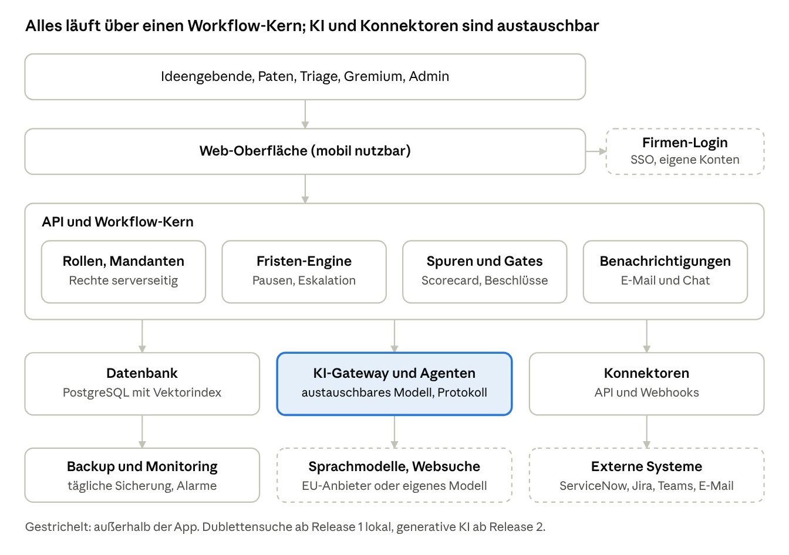
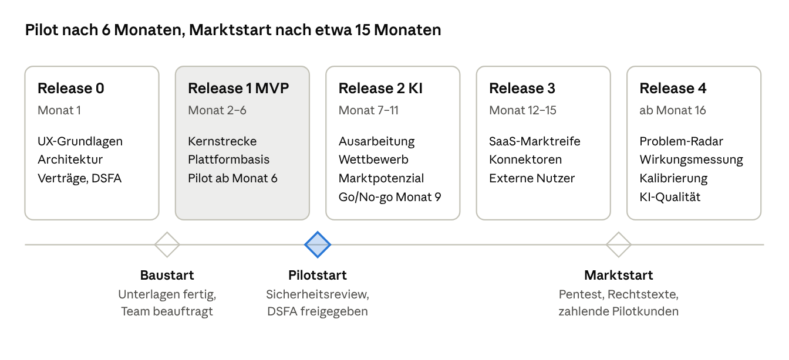

# Umsetzungskonzept Ideenportal

Oct 12, 2026 · Product Owner · Version 3 · Umsetzungsstand 13.10.2026

Das Ideenportal wird als eigenständige, mandantenfähige Web-App gebaut, die intern und bei externen Pilotkunden läuft. Zielgruppe sind Innovations- und Strategieteams in Unternehmen mit 250–5.000 Mitarbeitenden im DACH-Raum. Release 1 und 2 sind gebaut. Der Backlog umfasst 26 Epics mit 146 User Stories und 752 Story Points; offen sind davon rund 396 Story Points. Mit 0,8 Personentagen je Story Point und 25 % Puffer entspricht ein Story Point etwa einem Personentag. Grundlage ist das Produktkonzept Ideenportal – intern & SaaS.

| Release | Inhalt | Stories | Story Points (Muss) | Personentage mit Puffer (ca.) |
| --- | --- | --- | --- | --- |
| 0 – Grundlagen | UX-Grundlagen, Architekturentscheidungen, Datenschutz, Verträge | – | – | erledigt bis auf Klicktest und manuelle Barrierefreiheitsprüfung |
| 1 – MVP | Kernstrecke bis zur Umsetzung mit Ist-Nutzen, SaaS-Plattformbasis, Abgrenzung, Onboarding | 45 | 177 (165) | gebaut; offen 13 (R1-05, R1-44 bis R1-46) |
| 2 – KI-Ausarbeitung | Steckbrief, Gremium, Experimente, Gate 3, KI-Gateway, Analysen für alle Ideen, Challenges; neu: Pilotreife (Epic X) | 53 | 251 (170) | R2-01 bis R2-38 gebaut; offen 59 (R2-39 bis R2-53) |
| 3 – Firmenfähigkeit und Marktreife | Firmen-Login, SCIM, Teams-App, API, Suche, Mehrsprachigkeit, Abrechnung, Sicherheit, Konnektoren, externe Einreichende, Einsatzfelder, Modul Vorschlagswesen | 39 | 248 (158) | 248 (davon 24 nur bei Segment Vorschlagswesen) |
| 4 – Lernendes System | Problem-Radar, Trendradar, Wirkungsmessung, Kalibrierung, KI-Qualität | 9 | 76 (42) | 76 |
| Gesamt |  | 146 | 752 (535) | offen ca. 396 |

**Empfehlung:** Erst härten, dann pilotieren, dann firmenfähig machen. Mit zwei Entwickler:innen, UX in Teilzeit und dir als Product Owner startet der Pilot nach Phase 1 in etwa 3 Wochen. Release 3 Teil 1 („Firmenfähig“) ist nach rund 4–5 Monaten fertig, der Marktstart folgt nach etwa 9–10 Monaten. Ablauf und Exit-Kriterien stehen in Abschnitt 4. Die Umrechnung in Personentage wird nach Phase 1 kalibriert.

**Umsetzungsstand (13.10.2026):** Der Code aller Phasen ist gebaut, soweit er ohne bezahlte Dienste und echte Nutzer:innen geht (Arbeitspakete AP-01 bis AP-28 außer AP-23, Stand je Paket in `docs/arbeitspakete.md`, je Story in `docs/release-<n>/umsetzungsstand.md`). Kein Exit-Kriterium der Phasen 1–5 ist damit erfüllt: Alle verlangen Nutzer:innen, Kunden oder externe Prüfungen (Klicktest, Barrierefreiheitsprüfung, Ausgangswerte, Pilot und Go/No-go, Entra-ID-Test, Teams Store, anwaltliche Prüfung, Pentest, zahlende Kunden). Diese Punkte liegen beim Product Owner (Liste am Ende von `docs/arbeitspakete.md`). Das Modul Vorschlagswesen (Epic Z) ist nicht gebaut und wartet auf die Segmententscheidung.

### Änderungen in Version 3 (12.10.2026)

Version 3 setzt das Review V3 um (Produkt und Technik, Markt und Wettbewerb; Zuordnung in `docs/05-review-v3/einarbeitung.md`).

- **Stand berücksichtigt:** Release 1 und 2 sind gebaut. Neue Stories zu Release 1 und 2 sind Nacharbeit auf dem gebauten Stand.
- **Implementierungsvorgehen neu:** fünf Phasen mit Ziel, Inhalt, Dauer und Exit-Kriterium (Abschnitt 4). Vor Demo und Pilot kommen Sicherheit, Betrieb und die KI-Vertrauensrisiken.
- **35 neue Stories, 3 neue Epics:** X Pilotreife (Release 2), Y Einsatzfelder und Z Modul Vorschlagswesen (Release 3). Die Spalte „Alt“ nennt die Quelle (V-xx, M-xx).
- **Release 3 neu geschnitten:** Firmen-Login (R3-26 ersetzt R1-08), SCIM, Teams-App und API zuerst. R3-12 enthält jetzt die Muster-Betriebsvereinbarung und ist Muss.
- **Neu geschätzt:** R1-05, R3-12, R3-16, R3-17, R3-19, R3-22, R4-07. R2-08 wird Muss, R2-26 Soll.
- **Bereinigt:** R3-24 durch R3-36 und R4-05 durch R3-33 ersetzt, R3-04 als R4-12 nach Release 4 verschoben, R4-09 und R4-10 gestrichen (Anhang, Abschnitt 15).
- **Zielgruppe geschärft:** Innovations- und Strategieteams zuerst; Produktteams und Vorschlagswesen als Module.
- **Risiken ergänzt:** Segment Vorschlagswesen, Mitbestimmung, Plattform-KI, Validierungsschuld, Betrieb (Abschnitt 14).

### Änderungen in Version 2 (12.10.2026)

Version 2 setzt die Entscheidungen nach dem Fable-Review um: intern und extern parallel bauen, Rechte an der Software geklärt, Zielgruppe Innovations- und Produktteams, Wettbewerbs- und Marktanalyse für alle Ideen.

- **Neue Struktur:** Release 0 (Grundlagen) bis Release 4 statt Stufe 1–4. „Release“ meint immer einen Lieferumfang, „Phase“ immer einen Schritt im Ideenfluss.
- **SaaS-Basis vorgezogen:** Mandantentrennung mit Row-Level-Security, eigene Konten mit MFA, CI/CD, Audit-Log und Datenexport liegen jetzt in Release 1.
- **Funktionslücken geschlossen:** 30 Lücken mit Lösung und Story (Abschnitt 7), darunter Umsetzung und Ist-Nutzen nach Gate 2 schon im MVP.
- **Abgrenzung ergänzt:** Hinweisgeberschutz, Störungen, Beschwerden und Arbeitsschutz (Abschnitt 6).
- **KI für alle Ideen:** Kurz- und Vollanalyse mit Wettbewerb und Markt auch für interne Ideen (Abschnitt 8).
- **Bereinigt:** Widersprüche aufgelöst, zwei Stories geparkt, eine ersetzt, Schätzungen korrigiert (z. B. Mandantentrennung 3 → 8, Recherche-Agent 8 → 13, Konnektoren einzeln geschätzt). Zuordnung alt zu neu im Anhang.
- **Schätzung konservativer:** 0,8 Personentage je Story Point plus 25 % Puffer statt 0,5.

## 1 Ziel, Rahmen und Begriffe

Ziel ist ein Ideenportal für Innovations- und Strategieteams, das intern und bei externen Kunden aus demselben Code läuft und seinen Nutzen belegt.

- **Rahmen:** Rechte an der Software geklärt; intern und extern werden parallel gebaut; das Produkt funktioniert ohne ServiceNow, ServiceNow ist ein Konnektor.
- **Zielgruppe:** Innovations- und Strategieteams in Unternehmen mit 250–5.000 Mitarbeitenden im DACH-Raum; sie bestimmt Funktionsumfang, Vorlagen und Prioritäten. Produktteams (Feature-Wünsche) und betriebliches Vorschlagswesen kommen als Module dazu.
- **Prozess:** Ideenfluss mit Schnellspur und drei Gates aus dem Produktkonzept; alle Schwellen und Fristen sind Einstellungen je Mandant.
- **KI:** Release 1 nutzt nur ein lokales Modell für die Dublettensuche; ab Release 2 bekommt jede Idee eine Wettbewerbs- und Marktanalyse (Abschnitt 8).
- **Begriffe:** „Release 0–4“ ist ein Lieferumfang. „Phase“ ist ein Schritt im Ideenfluss (Anregen, Einreichen, Ausarbeiten, Umsetzen, Anerkennen). „Gate 1–3“ ist ein Entscheidungspunkt.
- **Schätzung:** Story Points nach Fibonacci (1, 2, 3, 5, 8, 13); 0,8 Personentage je Story Point plus 25 % Puffer für Pilotbetrieb und Nacharbeit. Dadurch entspricht ein Story Point etwa einem Personentag inklusive Puffer.
- **Priorität:** Muss (gehört ins Release), Soll (wenn Kapazität da ist), Kann (nachrangig).

## 2 Lösungsarchitektur

Die App ist ein mandantenfähiger Workflow-Kern mit einer Datenbank. KI, Websuche und Konnektoren hängen an austauschbaren Schnittstellen, damit weder ein KI-Anbieter noch ServiceNow zur Abhängigkeit wird. Intern und extern läuft dasselbe Container-Image.

| Baustein | Vorschlag | Begründung | Alternative |
| --- | --- | --- | --- |
| Oberfläche | Web-App (z. B. React oder Vue), responsiv | Verbreitet, mobil nutzbar, viele Entwickler:innen | Serverseitig gerenderte Seiten |
| Server | TypeScript (Node.js) oder Python | Große Auswahl an Bibliotheken, auch für KI | Java oder .NET |
| Datenbank | PostgreSQL mit Row-Level-Security und Vektorerweiterung (pgvector) | Mandantentrennung in der Datenbank; eine Datenbank für Daten und semantische Suche | Separater Suchdienst |
| Dublettensuche | Lokal betriebenes Open-Source-Modell für Textähnlichkeit, Index je Mandant | Keine laufenden Kosten, Daten bleiben im Haus | API eines EU-Anbieters bei Bedarf an mehr Leistung |
| KI und Websuche | KI-Gateway mit austauschbaren Modellen und Suchanbietern, Anonymisierung der Suchanfragen | Keine Abhängigkeit, Kosten und Datenschutz steuerbar | Direkte Anbindung eines Anbieters (nicht empfohlen) |
| Anmeldung | OpenID Connect oder SAML je Mandant plus eigene Konten mit MFA | Unternehmen mit und ohne eigenen Login abgedeckt | Externer Identitätsdienst |
| Fristen und Jobs | Job-Queue mit Datenbanksperren | Keine doppelte Ausführung bei mehreren Instanzen | Eigene Workflow-Engine |
| Auslieferung | CI/CD mit Staging, Geheimnisverwaltung, Abhängigkeits-Scan | Jede Änderung geprüft; sichere Auslieferung für beide Umgebungen | – |
| Betrieb | Container intern auf einer VM und extern in einer EU-Cloud | Ein Image für beide Welten | Kubernetes, falls vorhanden |

Der Technikstack ist ein Vorschlag. Die endgültige Wahl wird in Release 0 als Architekturentscheidung dokumentiert, abgestimmt mit dem Team und der internen IT.

## 3 Vorgehen und Team

Gearbeitet wird agil in Inkrementen von 2 Wochen. Jedes Inkrement endet mit einer lauffähigen Version auf Staging, die interne und externe Pilotnutzer:innen sehen. Ab Release 1 laufen interne und externe Mandanten parallel.

### Rollen

| Rolle | Aufgabe | Besetzung (Vorschlag) |
| --- | --- | --- |
| Product Owner | Backlog, Prioritäten, Abnahme, Kontakt zu Pilotkunden | du |
| Entwicklung | Bau, Tests, Auslieferung | 2 Entwickler:innen (Team oder Agentur) |
| UX | Nutzerwege, Skizzen, Tests mit Nutzer:innen | Teilzeit, Schwerpunkt Release 0 bis 2 |
| Betrieb | Betrieb intern und in der EU-Cloud, Bereitschaft | Entwicklungsteam mit benannter Vertretung; intern mit der IT abgestimmt |
| Fachpaten | Prüfen Abläufe und Texte, testen jedes Inkrement | 1–2 Personen intern, je eine Person bei jedem Pilotkunden |
| IT-Sicherheit und Datenschutz | Sicherheitsreview, Folgenabschätzung, KI-Freigabe | Ansprechpersonen intern; Kanzlei für Rechtstexte |

### Definition of Ready

- Story im Format „Als … möchte ich …, damit …“
- Akzeptanzkriterien testbar formuliert
- Geschätzt und vom Product Owner priorisiert
- Abhängigkeiten bekannt

### Definition of Done

- Akzeptanzkriterien erfüllt und vom Product Owner abgenommen
- Automatische Tests für Kernlogik (Fristen, Rechte, Mandantentrennung)
- Keine firmenspezifischen Werte im Code; neue Einstellungen dokumentiert
- Rechte serverseitig geprüft, keine bekannten Sicherheitslücken
- Bei KI-Funktionen: Kennzeichnung, Protokoll und Testfälle vorhanden
- Doku und Changelog aktualisiert

### Kapazitätsszenarien

Die Tabelle zeigt ab Version 3 den Restaufwand. Release 1 und 2 sind gebaut; gezählt wird nur die Nacharbeit.

| Szenario | Kapazität | Nacharbeit R1 und R2 (72 SP) | Release 3 (248 SP) | Release 4 (76 SP) | Gesamt (396 SP) |
| --- | --- | --- | --- | --- | --- |
| A – eine Person Vollzeit | 5 Personentage pro Woche | ca. 14 Wochen | ca. 50 Wochen | ca. 15 Wochen | ca. 1,5 Jahre |
| B – zwei Entwickler:innen (empfohlen) | 10 Personentage pro Woche | ca. 7 Wochen | ca. 25 Wochen | ca. 8 Wochen | ca. 9–10 Monate |
| C – drei Entwickler:innen | 15 Personentage pro Woche | ca. 5 Wochen | ca. 17 Wochen | ca. 5 Wochen | ca. 6–7 Monate |

Werte mit 25 % Puffer. Ohne Modul Vorschlagswesen (24 SP) sinkt Release 3 um gut 2 Wochen in Szenario B. Bei angenommenen Tagessätzen von 700–1.000 € kostet der Restaufwand rund 280.000–400.000 €, davon Release 3 rund 175.000–250.000 €; die Tagessätze sind eine Annahme und durch Angebote zu ersetzen. Empfohlen ist Szenario B.

## 4 Releaseplan und Implementierungsvorgehen Version 3

Release 1 und 2 sind gebaut. Der Pilot startet deshalb nicht mehr nach 6 Monaten, sondern nach Phase 1, also in etwa 3 Wochen. Mit Szenario B ist Release 3 Teil 1 nach rund 4–5 Monaten fertig, der Marktstart folgt nach etwa 9–10 Monaten (gerechnet ab Beginn von Phase 1).

Das Diagramm zeigt noch den Plan aus Version 2. Maßgeblich sind ab Version 3 die Phasen unten.

### Implementierungsvorgehen Version 3

Fünf Phasen, jede mit Exit-Kriterium. Eine Phase gilt erst als abgeschlossen, wenn ihr Exit-Kriterium erfüllt ist. Dauern gelten für Szenario B.

**Phasenstand 13.10.2026:**

| Phase | Code | Exit-Kriterium |
| --- | --- | --- |
| 1 Härtung | gebaut (AP-01 bis AP-04) | offen: Klicktest, Screenreader-Test, Ausgangswerte, Sicherheitsreview mit der IT (AP-05) |
| 2 Pilot mit Nacharbeit | gebaut (AP-06 bis AP-09); Business-Unterlagen fertig (AP-10) | offen: Pilot, Interviews, Go/No-go |
| 3 Firmenfähig | gebaut (AP-11 bis AP-16), Lasttest mit 10.000 Ideen lokal bestanden | offen: Entra ID bei einem Pilotkunden, Teams Store, anwaltliche Prüfung der Muster-BV |
| 4 Marktreife | gebaut (AP-17 bis AP-22, AP-24, AP-25 ohne externen Pentest); Epic Z nicht gebaut | offen: Pentest, Zahlungsanbieter, Rechtstexte geprüft, zahlende Kunden, Segmententscheidung |
| 5 Lernendes System | gebaut (AP-26 bis AP-28), mit Testdaten geprüft | offen: Kalibrierung mit echten 20 abgeschlossenen Ideen, Anbindung echter Ticketsysteme |

| Phase | Ziel | Inhalt | Dauer (ca.) | Exit-Kriterium |
| --- | --- | --- | --- | --- |
| 1 Härtung vor Demo und Pilot | Sicherheit, Betrieb und KI-Vertrauen auf Pilotniveau | R1-44, R1-45, R1-05, R2-39, R2-40, R2-41, R2-42, R2-43 (26 SP); Klicktest mit 7–8 Personen; manuelle Barrierefreiheitsprüfung; Doku an Code angleichen | 2–3 Wochen | Alle Stories abgenommen; Sicherheitsreview mit der IT ohne offenen kritischen Befund; Klicktest ausgewertet, kritische Befunde als Stories eingeplant; Screenreader-Test der Kernstrecke ohne Blocker; Ausgangswerte erhoben |
| 2 Pilot mit Nacharbeit | Wirkung im Pilot belegen und Bedienbarkeit verbessern | Restliche X-Stories R2-44 bis R2-50; R2-51, R2-52; R1-46; R2-08 als Muss abnehmen; R2-24 umstellen (Patente standardmäßig aus); Befunde aus dem Klicktest (zusammen ca. 41 SP plus Befunde) | Pilot 3 Monate, Entwicklung ca. 4–5 Wochen davon | Go/No-go (siehe unten) |
| 3 Release 3 Teil 1 „Firmenfähig“ | Was jeder Firmenkunde verlangt, vor den ersten zahlenden Pilotkunden | R3-26, R3-27, R3-16, R3-17, R3-28, R3-22, R3-12 (65 SP) | ca. 7 Wochen, kann im 2. und 3. Pilotmonat beginnen | Anmeldung mit Entra ID und SCIM bei einem Pilotkunden; Teams-App im Teams Store eingereicht; OpenAPI veröffentlicht; Lasttest mit 10.000 Ideen bestanden; Oberfläche DE/EN; Muster-Betriebsvereinbarung anwaltlich geprüft |
| 4 Release 3 Teil 2 „Marktreife“ | Verkaufsfähigkeit und Einsatzfelder | Restliche Stories aus Release 3 (P, Q, R, S, T), Epic Y Einsatzfelder; Epic Z nur nach positiver Segmententscheidung (10 Interviews); R2-53 bei Kapazität | ca. 16 Wochen, mit Epic Z ca. 18–19 Wochen | Penetrationstest ohne offenen kritischen Befund; Abrechnung und Selbstregistrierung live; Rechtstexte geprüft; mindestens 2 zahlende Kunden; Entscheidung zum Modul Vorschlagswesen dokumentiert |
| 5 Release 4 „Lernendes System“ | Wirkung messen, Prognosen kalibrieren | Alle 9 Stories aus Release 4 (76 SP); Kalibrierung R4-07 erst ab 20 abgeschlossenen Ideen | ca. 8 Wochen | Datenquelle für Problem-Radar angebunden; erster Abweichungsbericht Prognose gegen Ist; KI-Qualitäts-Dashboard im Betrieb |

### Go/No-go nach dem Pilot

Nach 3 Monaten Pilotbetrieb entscheiden Product Owner, Sponsor und Pilotkunden über den weiteren Ausbau. Go heißt: alle Muss-Kriterien erfüllt.

- [ ] Summe des bestätigten Nutzens ≥ Pilotkosten, oder mindestens 2 Ideen mit bestätigtem Nutzen ≥ 10.000 €
- [ ] Fristtreue ≥ 80 % intern und bei den Pilotkunden (erste Rückmeldung in der Frist)
- [ ] Zufriedenheit der Ideengebenden ≥ 4 von 5 (R1-35)
- [ ] Durchlaufzeit Einreichung bis Gate 2 im Median besser als der Ausgangswert und ≤ 60 Tage (R2-41)
- [ ] Mindestens 5 Ideen an Gate 2 entschieden
- [ ] Datenschutz und IT-Sicherheit haben freigegeben
- [ ] Mindestens 2 Pilotkunden sind bereit, nach dem Pilot zu zahlen

Bei No-go: Ursachen auswerten, Phase 3 anhalten, Pilot gezielt verlängern oder beenden (Ablauf im Einführungsplan).

### Arbeitsweise

- **Inkremente:** weiter 2 Wochen, jedes Inkrement endet lauffähig auf Staging. Phasen bestehen aus ganzen Inkrementen.
- **Definition of Done:** bleibt unverändert (Abschnitt 3).
- **Textkatalog-Pflicht:** Neue Stories ab R2-50 legen alle Texte für Oberfläche, Serverfehler und Mails im Textkatalog an. Sonst wird Release 3 teurer.
- **Bei Berührung aufteilen:** Große Dateien werden nicht in einem eigenen Umbau zerlegt, sondern aufgeteilt, wenn eine Story sie ohnehin ändert.
- **Evidenz vor Ausbau:** Kritische Befunde aus Klicktest und Pilot gehen vor neue Funktionen.
- **Kalibrierung:** Nach Phase 1 wird die Umrechnung von Story Points in Personentage mit dem Ist geprüft.

### Teamannahme

Geplant wird mit Szenario B: zwei Entwickler:innen, UX in Teilzeit, du als Product Owner. UX trägt in Phase 1 und 2 Klicktest, Erststart und Steckbrief-Umbau. Für die Muster-Betriebsvereinbarung (R3-12), die Rechtstexte (R3-11) und den Penetrationstest (R3-09) wird externe Hilfe eingekauft. Release 1 und 2 sind schneller entstanden, als die Schätzung annimmt. Ob das für Release 3 trägt, zeigt die Kalibrierung nach Phase 1.

### Abhängigkeiten

- Phase 1 vor Demo und Pilot; Klicktest vor dem weiteren Ausbau.
- R2-42 (Datenschutz-Nachweis) braucht die Leserolle aus R3-12 erst für die Ansicht des Betriebsrats; der Nachweis selbst kommt in Phase 1.
- R2-50 (Textkatalog) vor R3-22 (DE/EN) und R3-30 (Übersetzung von Inhalten).
- R3-26 (Firmen-Login) vor R3-27 (SCIM); R3-17 (API und Tokens) vor R3-16 (Teams- und Slack-App) und den Konnektoren R3-13 bis R3-15.
- R3-05 (Abrechnung) vor R3-39 (Challenge-Paket); R2-52 (Challenge-Phasen) vor R3-32 bis R3-34.
- Epic Z erst nach der Segmententscheidung; R3-36 braucht R1-32 (Ist-Nutzen).
- R4-07 erst ab 20 abgeschlossenen Ideen; R4-01 und R4-04 brauchen eine angebundene Datenquelle.

## 5 Qualität, Sicherheit, Datenschutz und Betrieb

Diese Punkte gelten für alle Stufen und sind Teil der Definition of Done.

- **Tests:** automatische Tests für Fristenberechnung, Rechte und Mandantentrennung; End-to-End-Test der Kernstrecke vor jedem Release.
- **KI-Qualität:** Testsatz mit mindestens 30 Ideen; kein Agent geht ohne bestandene Mindestwerte live (R2-12).
- **Sicherheit:** Bedrohungsmodell aus Release 0; Rechte serverseitig; Abhängigkeits-Scan in der Pipeline; Sicherheitsreview vor dem Pilotstart; externer Penetrationstest vor dem Marktstart.
- **Datenschutz:** Folgenabschätzung vor Release 2; Lösch- und Aufbewahrungsfristen; Auskunft und Export je Person; Bereichsauswertungen erst ab 5 Personen; Auftragsverarbeitung auch mit KI- und Suchanbietern; vertrauliche Ideen nie in externe Dienste.
- **Betrieb:** tägliche Backups mit monatlich getesteter Wiederherstellung, zentrale Logs, Alarme, benannte Vertretung.
- **Barrierefreiheit:** WCAG 2.1 AA; automatischer Check je Release, manueller Test der Kernstrecke.
- **Abgrenzung:** Das Portal ist kein Meldekanal nach dem Hinweisgeberschutzgesetz (Abschnitt 6).

## 6 Abgrenzung

Das Portal ist für Ideen da, nicht für Meldungen, Störungen oder Beschwerden. Das Produkt erkennt solche Anliegen, leitet sie zum richtigen Kanal und speichert sie nicht als Idee. Wichtigster Punkt ist die Abgrenzung zum Hinweisgeberschutz: Das Portal ersetzt keine Meldestelle nach dem Hinweisgeberschutzgesetz (HinSchG), auch nicht über die anonyme Einreichung.

| Anliegen | Gehört ins Portal? | Richtiger Kanal | So löst es das Produkt |
| --- | --- | --- | --- |
| Verbesserungs-, Innovations- und Produktideen | ja | Ideenportal | Normaler Ideenfluss |
| Hinweise auf Rechtsverstöße oder Fehlverhalten | nein | Interne Meldestelle nach HinSchG des jeweiligen Unternehmens | Pflicht-Bestätigung und Begriffserkennung beim Absenden (R1-18), KI-Erkennung (R2-20); Link zur Meldestelle; bei Abbruch wird nichts gespeichert; Triage kann fälschlich eingereichte Inhalte löschen (R1-28) |
| IT-Störungen und Service-Anfragen | nein | Service Desk (z. B. ServiceNow) | Weiterleiten an Zielkanal mit Rückmeldung (R1-28) |
| Kundenbeschwerden | nein, nur die daraus entstehende Verbesserungsidee | Beschwerdemanagement | Weiterleiten (R1-28); wiederkehrende Beschwerden als Muster im Problem-Radar (R4-01) |
| Arbeitsschutz, Unfälle, Beinahe-Unfälle | nein | Meldesystem für Arbeitssicherheit | Begriffserkennung (R1-18), Weiterleiten (R1-28) |
| Persönliche Anliegen an HR oder Führung | nein | HR oder Führungskraft | Hinweis in der FAQ (R1-38), Weiterleiten |
| Laufende Projektanforderungen und Fehler | nein | Projekt-Backlog (z. B. Jira) | Das Portal endet mit der Übergabe (R1-31, R3-13, R3-14) |

**Regeln für das Produkt:**

1. Jeder Mandant hinterlegt seine Zielkanäle mit Link und Ansprechperson (R1-28). Ohne hinterlegte Meldestelle zeigt das Portal einen allgemeinen Hinweis.
2. Texte, die als mögliche Meldung erkannt werden, gehen nie an externe KI- oder Suchdienste.
3. Das Portal wird in Texten, Hilfe und Vertrieb nie als Meldekanal beschrieben. „Anonym“ heißt nur: anonym gegenüber der Community.
4. Die Abgrenzung steht in der FAQ (R1-38), im Formular (R1-18) und in den Rechtstexten (R3-11).

## 7 Lösungen für die Funktionslücken

Alle Lücken aus dem Fable-Review sind als Stories im Backlog gelöst. Die kritischen Lücken (Umsetzung und Nutzen nach Gate 2) liegen in Release 1, damit schon der Pilot Wirkung belegen kann.

| Lücke | Lösung | Story |
| --- | --- | --- |
| Freigegebene Ideen haben keine Umsetzungsverfolgung | Umsetzung wird bei „Umsetzen“ oder „Erproben“ automatisch angelegt, mit Owner, Kanal, Termin, Fortschritt | R1-31 |
| Ist-Nutzen wird nur in der Schnellspur erfasst | Abschluss jeder Umsetzung mit Nutzenart, Wert und Nachweis; Wirkungsreview in Release 2 | R1-32, R2-07 |
| Gate 2 fehlt im MVP | Entscheidung erfassen ohne Sitzungsmodul | R1-30 |
| Zufriedenheit wird nicht erhoben | Ein-Klick-Abfrage nach jeder Rückmeldung | R1-35 |
| Pilot startet leer | Import aus CSV und Excel | R1-39 |
| Keine Challenge im Pilot | Einfache Challenge in Release 1 | R1-34 |
| Vertretung fehlt | Vertretung und Abwesenheit je Rolle | R1-11 |
| Wiedervorlagen werden vergessen | Automatische Rückkehr geparkter Ideen | R1-33 |
| „Erproben“ ohne Verfolgung | Experiment mit Hypothese, Messgröße und Ergebnis | R2-06 |
| Weiterleiten ohne Ziel | Zielkanäle je Mandant, Rückmeldung an die Ideengeberin | R1-28 |
| Anhänge ohne Virenprüfung | Virenprüfung und getrennte Ablage | R1-13 |
| Bereichsauswertungen können Personen erkennbar machen | Gruppen unter 5 Personen werden zusammengefasst | R1-37 |
| Kein Onboarding | Rundgang, Beispielideen, Hilfe, FAQ | R1-38 |
| Mobile Nutzung nur als Absicht | Mobile Bedienung als Akzeptanzkriterium der Kernaufgaben | R1-12, R1-16, R1-21, R1-27 |
| Barrierefreiheit ohne Zielniveau | WCAG 2.1 AA mit Prüfung je Release | R1-42 |
| Kein durchgängiges Audit-Log | Protokoll aller Entscheidungen, Fristen, Einstellungen, Rollen | R1-06 |
| Kein Login ohne Firmen-IdP | Eigene Konten mit MFA | R1-09 |
| Kein CI/CD und keine Staging-Umgebung | Pipeline, Staging, Geheimnisverwaltung, Abhängigkeits-Scan | R1-02 |
| Mandantentrennung zu dünn | Row-Level-Security und getrennte Suchindizes | R1-03, R1-19 |
| Mailversand nicht geplant | Versanddienst mit Vorlagen | R1-07 |
| Benachrichtigungen ohne Konzept | Matrix aus Release 0, einstellbar | R1-36 |
| Keine Startseite | Startseite „Meine Ideen“ mit Feed und Challenges | R1-22 |
| Keine Einreichung im Namen anderer | Delegierte Einreichung mit Bestätigung | R1-17 |
| Nur vertraulich, nicht anonym | Anonym gegenüber der Community | R1-14 |
| KI-Aussagen nicht korrigierbar | Korrektur je Aussage mit Rückfluss in die Qualitätsmessung | R2-15 |
| Websuche nicht datenschutzfest | Suchanfragen ohne Firmen- und Personenbezug | R2-14 |
| Kein Portfolio-Blick für Innovationsteams | Portfolio-Board nach Phase, Themenfeld, Horizont | R2-08 |
| Externe können nicht einreichen | Rolle „Externe:r“, Moderation | R3-19, R3-21 |
| Keine Feature-Wünsche von Kunden | Abstimmung und öffentliche Status-Seite | R3-20 |
| Keine Patentrecherche | Recherche zu Patenten und Stand der Technik | R2-24 |

## 8 KI-Analyse für alle Ideen

Jede Idee bekommt eine Wettbewerbs- und Marktanalyse, auch interne Ideen. Der Inhalt passt sich der Art der Idee an, die Ideengeberin beim Einreichen wählt (R1-12). Damit die Analysen Paten und Gremium entlasten statt belasten, gibt es zwei Tiefen: eine Kurzanalyse für jede Idee direkt nach der Einreichung und eine Vollanalyse, sobald eine Idee ausgearbeitet wird (R2-22).

| Analyse | Produkt- oder Kundenidee | Interne Idee | Story |
| --- | --- | --- | --- |
| Wettbewerb | Wettbewerber und Ersatzprodukte | Anbieter fertiger Lösungen, Open Source, Vorgehen anderer Unternehmen | R2-23 |
| Markt | Gesamt-, erreichbarer und realistischer Markt (TAM, SAM, SOM) | Markt der fertigen Lösungen mit Preisen, Benchmarks, interner Hebel, Vermarktungspotenzial der eigenen Lösung | R2-26, R2-27 |
| Kaufen, bauen oder Prozess ändern | Partner oder Lizenz gegen Eigenentwicklung | Standardwerkzeug gegen Eigenbau gegen Prozessänderung | R2-25 |
| Patente | Schutzrechte Dritter und eigene Schutzmöglichkeiten | Schutzrechte Dritter bei der eigenen Lösung | R2-24 |
| Business Case | Umsatz, Marge, Amortisation | Einsparung, Zeit, Qualität, Amortisation | R2-28 |

| Tiefe | Wann | Umfang | Nutzen |
| --- | --- | --- | --- |
| Kurzanalyse | Automatisch nach jeder Einreichung | Eine Seite: wichtigste 3 Wettbewerber oder Lösungen, grobe Marktgröße oder Hebel, Empfehlung | Grundlage für die Triage (R2-18), auch für die Schnellspur |
| Vollanalyse | Bei Spur „Ausarbeiten“, aktualisiert vor Gate 2 | Alle Bausteine der Tabelle oben mit Quellen | Steckbrief-Entwurf (R2-31) und Gremiumsvorlage (R2-33) |

**Leitplanken:** Jede Zahl hat eine Quelle oder ist als Schätzung markiert (R2-11). Vertrauliche Ideen werden nur intern recherchiert, Websuchen laufen ohne Firmen- und Personenbezug (R2-14). Kein Agent geht live, bevor er den Testsatz besteht (R2-12). Die Zusammenfassung steht vorn, Details sind aufklappbar, damit die Prüflast klein bleibt (R2-31).

## 9 Release 0 – Grundlagen vor dem Bau

Release 0 liefert in 3–4 Wochen die Unterlagen, ohne die ein Team oder eine Agentur nur ins Blaue schätzen kann. Aufwand rund 25–35 Personentage, verteilt auf Product Owner, UX und Architektur. Release 0 hat keine Stories, sondern Ergebnisse.

### Produkt und UX

- [ ] Drei Nutzerwege (Journeys): Ideengeberin, Triage-Team, Pate; dazu einer für externe Einreichende
- [ ] Navigationsstruktur (Start, Ideen, Challenges, Meine Aufgaben, Board, Gremium, Portfolio, Dashboard, Einstellungen)
- [ ] Skizzen der Hauptbildschirme: Startseite, Einreichung, Idee mit Status, Triage-Board, Steckbrief mit Analysen, Gremiumsansicht, Dashboard
- [ ] Papiertest mit 2–3 Personen je Nutzerweg, intern und bei einem Pilotkunden
- [ ] Benachrichtigungsmatrix (Ereignis × Rolle × Kanal × Tonalität)
- [ ] Textvorlagen für Rückmeldungen (Schnellspur, Ausarbeiten, Weiterleiten, Ablehnen)
- [ ] Liste der mobilen Kernaufgaben und Prüfplan Barrierefreiheit (WCAG 2.1 AA)

### Prozess und Pilot

- [ ] Pilotbereich intern und 2–3 externe Pilotkunden benannt
- [ ] Scorecard mit Ankerbeispielen je Skalenstufe
- [ ] Schwellen für Schnellspur und Delegation
- [ ] Zielkanäle für die Abgrenzung je Pilot (Meldestelle, Service Desk, Arbeitssicherheit, HR)
- [ ] Ausgangswerte vor dem Pilot: heutige Antwortzeit, Realisierungsquote, Zufriedenheit
- [ ] Kommunikations- und Einführungsplan inklusive Rolle der Führungskräfte

### Technik, Sicherheit und Datenschutz

- [ ] Architekturentscheidungen dokumentiert: Technik, Mandantenmodell (Row-Level-Security), Anmeldung, Job-Queue, KI-Gateway, Suchanbieter
- [ ] Datenflussdiagramm: welche Daten an welchen Dienst gehen
- [ ] Bedrohungsmodell: Prompt-Injection, Datenleck zwischen Mandanten, Rechteausweitung, Anhänge
- [ ] Datenschutz-Folgenabschätzung (Entwurf), Verzeichnis der Verarbeitungen, Rechtsgrundlagen ohne Betriebsvereinbarung
- [ ] KI-Testsatz mit 30 Beispielideen (intern und Produkt) und erwarteten Ergebnissen
- [ ] Skelett des Betriebshandbuchs (Deployment, Backup und Wiederherstellung, Updates, Bereitschaft)

### Business

- [ ] Finanzmodell SaaS korrigiert (Kunden und Team je Jahr, Break-even, Finanzierungsbedarf)
- [ ] Leitfaden für 10–15 Gespräche mit Innovations- und Produktteams
- [ ] Vertrag mit der Agentur oder dem Team: Rechte am Code, eigenes Repository, Abnahme gegen Akzeptanzkriterien

## 10 Backlog Release 1 – MVP-Kernstrecke und Plattformbasis

Release 1 bringt die komplette Kernstrecke von der Einreichung bis zur Umsetzung mit Nutzennachweis. Es läuft vom ersten Tag an intern und bei externen Pilotkunden, deshalb gehören Mandantentrennung, eigene Konten und Betriebsgrundlagen schon hierher. Umfang: 9 Epics, 45 Stories, 177 Story Points (165 davon Muss). Release 1 ist gebaut; offen sind R1-05 sowie die Nacharbeit R1-44 bis R1-46 aus Version 3. Der Firmen-Login (bisher R1-08) liegt jetzt als R3-26 in Release 3. Die Spalte „Alt“ verweist auf die Story-ID aus Version 1 oder auf den Vorschlag aus dem Review V3 (V-xx, M-xx).

### A Plattform und Betrieb

| ID | Story | Akzeptanzkriterien | SP | Prio | Alt |
| --- | --- | --- | --- | --- | --- |
| R1-01 | Als Betreiber möchte ich die App aus demselben Container-Image intern und in einer EU-Cloud betreiben, damit intern und extern derselbe Code läuft. | Start mit einem Befehl; Konfiguration über Umgebungsvariablen; Health-Check-Endpunkt | 3 | Muss | S1-01 |
| R1-02 | Als Entwickler möchte ich automatische Tests und Auslieferung (CI/CD), eine Staging-Umgebung, eine Verwaltung für Geheimnisse und einen Scan der Abhängigkeiten, damit jede Änderung geprüft und sicher ausgeliefert wird. | Pipeline mit Tests und Scan bei jedem Commit; Staging mit Testdaten; keine Geheimnisse im Code; kritische Lücken blockieren die Auslieferung | 5 | Muss | neu |
| R1-03 | Als Betreiber möchte ich Mandanten in der Datenbank strikt trennen (Row-Level-Security), damit kein Kunde Daten eines anderen sieht. | Mandantenkontext in jeder Anfrage; Datenbankregeln verhindern Zugriff über Mandanten hinweg; automatischer Test mit zwei Mandanten | 8 | Muss | S1-04 |
| R1-04 | Als Admin möchte ich Fristen, Schwellen, Themenfelder, Spuren und Texte je Mandant einstellen, damit nichts fest im Code steht. | Einstellungsseite je Mandant; Änderung ohne Neustart wirksam; Standardwerte aus dem Produktkonzept | 5 | Muss | S1-05 |
| R1-05 | Als Betreiber möchte ich tägliche Backups sowie Kennzahlen und Alarme für Jobs, KI-Warteschlange und Mail-Outbox, damit keine Daten verloren gehen und ein stiller Ausfall der Fristen-Engine auffällt. | Health-Endpunkt liefert Alter des letzten Job-Laufs, Queue-Länge, ältesten Job und Outbox-Rückstau; Alarm per Mail oder Webhook bei Überschreiten von Schwellen; Logs ohne Ideentexte (Test); Backup täglich, Restore-Test dokumentiert; Staging als zweiter Render-Dienst | 5 | Muss | S1-06, V-03 |
| R1-06 | Als Admin möchte ich ein lückenloses Protokoll aller Entscheidungen, Fristenänderungen, Einstellungen und Rollenänderungen, damit alles nachvollziehbar ist. | Wer, wann, was, vorher und nachher; nicht änderbar; Export für Prüfungen | 5 | Muss | neu |
| R1-07 | Als Betreiber möchte ich E-Mails über einen konfigurierbaren Versanddienst mit Vorlagen verschicken, damit Benachrichtigungen zuverlässig ankommen. | Firmen-Mailrelay oder Versanddienst je Mandant; Vorlagen in DE; Bounce-Behandlung | 3 | Muss | neu |
| R1-44 | Als Betreiber möchte ich Rate-Limits für Anmeldung, Registrierung, Passwort-Reset und Demo-Login, damit Credential Stuffing und Massenregistrierung ins Leere laufen. | Limit je IP und je Konto; Antwort 429 mit Wartezeit; Ereignis im Audit-Log; Test mit 20 Fehlversuchen | 3 | Muss | V-01 |
| R1-45 | Als Betreiber möchte ich TOTP-Geheimnisse verschlüsselt speichern, CSP- und HSTS-Header setzen und Mails zu vertraulichen Ideen ohne Titel im Betreff senden, damit die offenen Punkte des Bedrohungsmodells geschlossen sind. | TOTP-Geheimnis mit SECRET_KEY verschlüsselt, Migration für den Bestand; CSP ohne unsafe-inline und HSTS gesetzt; Betreff bei vertraulichen Ideen nur „Idee #Nr“; npm audit mit Stufe high ohne Befund in der Pipeline | 3 | Muss | V-02 |

### B Anmeldung und Rollen

| ID | Story | Akzeptanzkriterien | SP | Prio | Alt |
| --- | --- | --- | --- | --- | --- |
| R1-09 | Als Nutzer ohne Firmen-Login (Pilotkunde, Gast) möchte ich ein eigenes Konto mit Zwei-Faktor-Anmeldung, damit ich das Portal sicher nutzen kann. | Einladung per E-Mail; Passwort-Reset; MFA verpflichtend für Admins; Sperre nach Fehlversuchen | 8 | Muss | neu |
| R1-10 | Als Admin möchte ich Rollen vergeben (Ideengeber:in, Pate, Triage, Gremium, Umsetzer:in, Admin), damit jede Person nur sieht und darf, was sie braucht. | Zuweisung direkt oder über Gruppen; Rechte serverseitig geprüft; Änderungen im Protokoll | 5 | Muss | S1-03 |
| R1-11 | Als Nutzerin mit einer Rolle möchte ich eine Vertretung und Abwesenheiten hinterlegen, damit Fristen und Eskalationen nicht ins Leere laufen. | Vertretung je Rolle; Abwesenheit mit Zeitraum; Aufgaben und Eskalationen gehen in der Zeit an die Vertretung | 3 | Muss | neu |

### C Einreichen

| ID | Story | Akzeptanzkriterien | SP | Prio | Alt |
| --- | --- | --- | --- | --- | --- |
| R1-12 | Als Ideengeberin möchte ich meine Idee in einem geführten Formular erfassen (Problem, Idee, Nutzen, Themenfeld, Art: intern oder Produkt/Kunde), damit sie vollständig ist. | Höchstens 4 Schritte; Pflichtfelder mit Hilfetexten; Entwurf speicherbar; auf dem Smartphone vollständig bedienbar | 5 | Muss | S1-07 |
| R1-13 | Als Ideengeberin möchte ich Bilder oder Dateien anhängen, damit ich das Problem zeigen kann. | Bis 10 MB je Datei; erlaubte Typen; Virenprüfung vor dem Speichern; Ablage je Mandant getrennt | 3 | Soll | S1-08 |
| R1-14 | Als Ideengeberin möchte ich eine Idee als vertraulich oder anonym gegenüber der Community einreichen, damit ich auch heikle Ideen teilen kann. | Vertraulich: nur Triage und Pate sehen sie; anonym: Name für alle außer Triage verborgen; Hinweis, dass anonym kein Meldekanal ist | 5 | Muss | S1-09 |
| R1-15 | Als Ideengeberin möchte ich Co-Autor:innen hinzufügen, damit wir gemeinsam einreichen. | Personensuche; Benachrichtigung; gleiche Rechte an der Idee | 2 | Soll | S1-10 |
| R1-16 | Als Ideengeberin möchte ich Status, Restfrist, nächsten Schritt und Verlauf meiner Idee sehen, damit ich nicht nachfragen muss. | Statusleiste; Restfrist in Arbeitstagen; Verlauf aller Entscheidungen mit Begründung; mobil lesbar | 3 | Muss | S1-11 |
| R1-17 | Als Führungskraft möchte ich eine Idee im Namen einer Kollegin einreichen, damit Ideen aus Teamrunden nicht verloren gehen. | Ideengeberin wird als Urheberin eingetragen und bestätigt per Klick; Einreicher sichtbar im Verlauf | 2 | Soll | neu |
| R1-18 | Als Ideengeberin möchte ich beim Absenden einen Hinweis bekommen, wenn mein Anliegen nicht ins Portal gehört, damit ich den richtigen Kanal nutze. | Pflicht-Bestätigung „Idee, keine Meldung“; Erkennung typischer Begriffe (Verstoß, Belästigung, Störung, Beschwerde, Unfall); Link zum zuständigen Kanal; bei Abbruch wird nichts gespeichert | 5 | Muss | neu |

### D Dubletten und Community

| ID | Story | Akzeptanzkriterien | SP | Prio | Alt |
| --- | --- | --- | --- | --- | --- |
| R1-19 | Als Ideengeberin möchte ich beim Schreiben ähnliche Ideen sehen, damit ich mich anschließen kann, statt doppelt einzureichen. | Bis zu 5 ähnliche Ideen live; lokal betriebenes Modell; Suchindex je Mandant getrennt; Button „anschließen“ | 8 | Muss | S1-12 |
| R1-20 | Als Triage-Team möchte ich zwei Ideen zusammenführen, damit Diskussion und Unterstützer an einer Stelle liegen. | Kommentare und Unterstützer übernommen; beide Ideengebenden informiert; Verweis bleibt | 3 | Soll | S1-13 |
| R1-21 | Als Mitarbeiterin möchte ich Ideen kommentieren und unterstützen, damit gute Ideen Rückenwind bekommen. | Kommentare mit Antworten; ein Unterstützer-Klick je Person; Benachrichtigung an die Ideengeberin; mobil bedienbar | 5 | Muss | S1-14 |
| R1-22 | Als Mitarbeiterin möchte ich eine Startseite mit meinen Ideen, aktiven Challenges, neuen Ideen und Erfolgen sowie Filter und Suche, damit ich schnell finde, was mich interessiert. | Startseite „Meine Ideen“ und Feed; Filter nach Themenfeld, Status, Aktualität; Volltextsuche; vertrauliche Ideen ausgeblendet | 5 | Muss | S1-15 |

### E Triage und Fristen

| ID | Story | Akzeptanzkriterien | SP | Prio | Alt |
| --- | --- | --- | --- | --- | --- |
| R1-23 | Als Triage-Team möchte ich alle neuen Ideen auf einem Board mit Fristen-Ampel sehen, damit keine Idee liegen bleibt. | Spalten je Status; Ampel nach Restfrist; Sortierung nach Frist | 5 | Muss | S1-16 |
| R1-24 | Als Triage-Team möchte ich eine Spur mit Begründung wählen, damit die Ideengeberin eine verständliche Antwort bekommt. | Spuren Schnellspur, Ausarbeiten, Weiterleiten, Ablehnen; Begründung Pflicht bei Ablehnen und Weiterleiten; Textvorlagen; automatische Nachricht | 5 | Muss | S1-17 |
| R1-25 | Als System möchte ich Fristen je Prozessphase in Arbeitstagen berechnen und bei Rückfragen pausieren, damit Fristen fair sind. | Feiertagskalender je Mandant; Pause bei Rückfrage; Historie der Fristen | 5 | Muss | S1-18 |
| R1-26 | Als Ideenmanagement möchte ich bei Fristüberschreitung automatisch erinnern und eskalieren, damit Engpässe sichtbar werden. | Erinnerung 2 Tage vorher; Eskalation an die Vertretung oder Leitung; Schließen nach 15 Arbeitstagen ohne Antwort auf eine Rückfrage | 3 | Muss | S1-19 |
| R1-27 | Als Triage-Team möchte ich der Ideengeberin eine Rückfrage stellen, damit fehlende Angaben nachgeliefert werden. | Höchstens 2 Runden; Antwort im Verlauf, auch mobil; Frist pausiert | 2 | Muss | S1-20 |
| R1-28 | Als Triage-Team möchte ich eine Idee an einen festgelegten Zielkanal weiterleiten, damit die Ideengeberin weiß, wo ihr Anliegen weiterbearbeitet wird. | Zielkanäle je Mandant pflegbar (Name, Kontakt, Link); Ideengeberin erhält Ziel und Ansprechperson; Status „weitergeleitet“; optional Löschen des Inhalts | 3 | Muss | neu |
| R1-46 | Als Kunde möchte ich eine sichtbare Antwortgarantie je Mandant (z. B. erste Rückmeldung in 10 Arbeitstagen) mit laufender Erfüllungsquote auf der Startseite, damit das Versprechen des Produkts für alle sichtbar ist. | Einstellung je Mandant; Quote der letzten 90 Tage auf der Startseite; Hinweis an das Ideenmanagement bei Unterschreitung | 2 | Soll | M-17 |

### F Entscheidung, Umsetzung und Nutzen

| ID | Story | Akzeptanzkriterien | SP | Prio | Alt |
| --- | --- | --- | --- | --- | --- |
| R1-29 | Als Triage-Team möchte ich eine Idee an einen Fachbereich zur direkten Umsetzung übergeben, damit kleine Ideen ohne Gremium umgesetzt werden. | Verantwortliche Person; Zieltermin; Fachbereich bestätigt die Übernahme | 3 | Muss | S1-21 |
| R1-30 | Als Entscheider:in möchte ich eine Entscheidung an Gate 2 mit Begründung, Owner und Wiedervorlage festhalten, auch ohne Sitzungsmodul, damit freigegebene Ideen schon im MVP weiterlaufen. | Ergebnisse Umsetzen, Erproben, Integrieren, Parken, Ablehnen; Parken nur mit Datum ≤ 6 Monate; automatische Nachricht | 5 | Muss | S1-27 |
| R1-31 | Als Owner möchte ich für jede freigegebene Idee die Umsetzung pflegen (Kanal, externe Referenz, Zieltermin, Fortschritt), damit sichtbar ist, was aus Ideen wird. | Umsetzung wird bei „Umsetzen“ oder „Erproben“ automatisch angelegt; Fortschritt in Prozent oder Meilensteinen; Erinnerung bei Verzug | 5 | Muss | neu |
| R1-32 | Als Owner möchte ich eine Umsetzung mit dem Ist-Nutzen abschließen, damit Realisierungsquote und Wirkung messbar sind. | Nutzenart (Euro, Stunden, Qualität, Umsatz, CO₂), Wert, Nachweis; gilt für Schnellspur und freigegebene Ideen; Ideengeberin informiert | 3 | Muss | S1-22 |
| R1-33 | Als Ideenmanagement möchte ich geparkte Ideen zum Wiedervorlagedatum automatisch zurückbekommen, damit nichts vergessen wird. | Erinnerung zum Datum; Liste der Wiedervorlagen; Idee kehrt in Triage oder Entscheidung zurück | 2 | Muss | neu |

### G Challenges (Basis)

| ID | Story | Akzeptanzkriterien | SP | Prio | Alt |
| --- | --- | --- | --- | --- | --- |
| R1-34 | Als Sponsor möchte ich eine einfache Challenge mit Thema, Zeitraum und Ansprechperson starten, damit Ideen schon im Pilot gezielt entstehen. | Challenge auf der Startseite; Ideen werden der Challenge zugeordnet; Ende mit Zusammenfassung der Ideen | 3 | Muss | S2-25 (Teil) |

### H Rückmeldung, Messung und Einstieg

| ID | Story | Akzeptanzkriterien | SP | Prio | Alt |
| --- | --- | --- | --- | --- | --- |
| R1-35 | Als Ideengeberin möchte ich nach jeder Rückmeldung mit einem Klick bewerten, wie zufrieden ich bin, damit das Portal besser wird. | Skala 1–5, optional Kommentar; höchstens eine Abfrage pro Idee und Phase; Auswertung nur aggregiert | 2 | Muss | neu |
| R1-36 | Als Nutzerin möchte ich Benachrichtigungen nach einer festen Matrix (Ereignis, Rolle, Kanal) erhalten und selbst einstellen, damit ich informiert, aber nicht überflutet werde. | Matrix aus Release 0 umgesetzt; tägliche Zusammenfassung wählbar; E-Mail, optional Chat | 3 | Muss | S1-29 |
| R1-37 | Als Ideenmanagement möchte ich ein Dashboard mit Ideenfluss, Fristtreue, Durchlaufzeit, Realisierungsquote, Nutzen und Zufriedenheit, damit ich steuern kann. | Werte je Bereich und Zeitraum; Gruppen unter 5 Personen werden zusammengefasst; Export als CSV | 5 | Muss | S1-30 |
| R1-38 | Als neue Nutzerin möchte ich einen kurzen Rundgang, Beispielideen und Hilfetexte, damit ich ohne Schulung loslegen kann. | Rundgang beim ersten Login; 3 Beispielideen je Mandant; FAQ inklusive Abgrenzung | 3 | Muss | neu |
| R1-39 | Als Ideenmanagement möchte ich bestehende Ideen aus CSV oder Excel importieren, damit der Pilot nicht leer startet. | Feldzuordnung beim Import; Dublettenprüfung; Importprotokoll | 3 | Muss | neu |

### I Datenschutz, Barrierefreiheit und Datenhoheit

| ID | Story | Akzeptanzkriterien | SP | Prio | Alt |
| --- | --- | --- | --- | --- | --- |
| R1-40 | Als Datenschutzbeauftragte möchte ich Lösch- und Aufbewahrungsfristen umgesetzt sehen, damit die DSGVO eingehalten wird. | Fristen je Mandant konfigurierbar; Anonymisierung ausgeschiedener Personen; Auskunft und Export je Person | 5 | Muss | S1-31 |
| R1-41 | Als Nutzerin möchte ich wissen, welche Daten erfasst werden, damit ich der App vertraue. | Datenschutzhinweis je Mandant; keine personenbezogenen Auswertungen; Protokoll von Admin-Zugriffen | 2 | Muss | S1-32 |
| R1-42 | Als Nutzerin mit Einschränkung möchte ich alle Kernaufgaben barrierefrei erledigen, damit niemand ausgeschlossen wird. | Zielniveau WCAG 2.1 AA; automatischer Check in der Pipeline; manueller Test der Kernstrecke je Release | 3 | Muss | neu |
| R1-43 | Als Kunden-Admin möchte ich alle Daten meines Mandanten exportieren, damit ich nicht gebunden bin. | Vollexport als JSON und CSV; Löschung nach Vertragsende | 3 | Muss | S4-16 |

## 11 Backlog Release 2 – Ausarbeitung und KI-Analyse

Release 2 liefert das Alleinstellungsmerkmal für Innovations- und Produktteams: KI-Agenten erstellen für jede Idee Wettbewerbs- und Marktanalysen, Business Case und Entscheidungsvorlage. Dazu kommen Steckbrief, Scorecard, Gremium, Experimente und Gate 3. Umfang: 7 Epics, 53 Stories, 251 Story Points (170 davon Muss). R2-01 bis R2-38 sind gebaut. R2-39 bis R2-53 sind Nacharbeit aus Version 3 (59 Story Points, 20 davon Muss): das neue Epic X Pilotreife und drei Challenge-Stories in Epic O.

### J Ausarbeitung, Entscheidung und Wirkung

| ID | Story | Akzeptanzkriterien | SP | Prio | Alt |
| --- | --- | --- | --- | --- | --- |
| R2-01 | Als Triage-Team möchte ich einen Paten zuweisen und eine Timebox setzen, damit die Ausarbeitung Verantwortung und ein Ende hat. | Pate erhält Aufgabe; Timebox standardmäßig 6 Wochen; Warnung ab 2 aktiven Ideen pro Pate | 3 | Muss | S1-23 |
| R2-02 | Als Pate möchte ich einen strukturierten Steckbrief gemeinsam mit der Ideengeberin bearbeiten, damit die Idee entscheidungsreif wird. | Abschnitte Nutzen, Aufwand, Risiken, Betroffene, Umsetzungsweg, Analysen; Sperre je Abschnitt während der Bearbeitung; Änderungsverlauf | 5 | Muss | S1-24 |
| R2-03 | Als Pate möchte ich die Idee mit der gewichteten Scorecard bewerten, damit Ideen vergleichbar werden. | Kriterien und Gewichte je Mandant; Skala 1–5 mit Ankerbeispielen; Gesamtscore berechnet | 5 | Muss | S1-25 |
| R2-04 | Als Ideenmanagement möchte ich eine Gremiumssitzung mit Agenda aus entscheidungsreifen Ideen anlegen, damit Unterlagen rechtzeitig vorliegen. | Höchstens 5 Ideen; Versand 5 Arbeitstage vorher; Vergleichsansicht; Entscheidungen fließen in R1-30 | 5 | Muss | S1-26 |
| R2-05 | Als Bereichsleitung möchte ich Ideen unter der Delegationsschwelle selbst entscheiden, damit das Gremium entlastet wird. | Schwelle aus Einstellungen; gleiche Entscheidungsmaske; im Dashboard sichtbar | 3 | Soll | S1-28 |
| R2-06 | Als Owner möchte ich ein Experiment mit Hypothese, Messgröße, Laufzeit und Ergebnis führen, damit „Erproben“ zu einer klaren Folgeentscheidung führt. | Experiment aus dem Vorschlag (R2-30) übernehmbar; Erinnerung zum Ende; Ergebnis führt zurück an Gate 2 | 5 | Muss | neu |
| R2-07 | Als Pate möchte ich 3–6 Monate nach der Umsetzung einen Wirkungsreview durchführen (Plan gegen Ist), damit der Nutzen belegt ist. | Aufgabe automatisch zum Termin; Ergebnisse Abschließen, Skalieren, Nachsteuern, Stoppen; Bestätigung durch Sponsor | 5 | Muss | S2-27 |
| R2-08 | Als Innovationsleitung möchte ich ein Portfolio-Board aller Ideen nach Phase, Themenfeld und Innovationshorizont, damit ich das Portfolio steuern kann. | Spalten nach Prozessphase; Filter nach Horizont 1–3 und Themenfeld; Summen von Plan- und Ist-Nutzen | 5 | Muss | neu |

### K KI-Plattform

| ID | Story | Akzeptanzkriterien | SP | Prio | Alt |
| --- | --- | --- | --- | --- | --- |
| R2-09 | Als Admin möchte ich ein KI-Gateway mit austauschbarem Modell konfigurieren, damit wir nicht von einem Anbieter abhängen. | Anbieter je Mandant wählbar; EU-Hosting oder eigenes Modell; Kostenlimit je Idee und Monat | 8 | Muss | S2-01 |
| R2-10 | Als Datenschutzbeauftragte möchte ich jede KI-Aktion protokolliert sehen, damit Ergebnisse nachvollziehbar sind. | Eingabe, Modell, Quellen und Freigabe gespeichert; Aufbewahrung nach Löschkonzept; Protokolle selbst unterliegen den Löschfristen | 5 | Muss | S2-02 |
| R2-11 | Als Nutzerin möchte ich KI-Inhalte gekennzeichnet sehen und Belegtes, Annahmen und Schätzungen unterscheiden, damit ich weiß, was ich prüfen muss. | Kennzeichnung je Absatz; Quelle mit Abrufdatum; Konfidenz bei Schätzungen | 5 | Muss | S2-03 |
| R2-12 | Als Product Owner möchte ich einen KI-Testsatz und Qualitätsmessung, damit kein Agent ohne geprüfte Qualität live geht. | Testsatz mit mindestens 30 Ideen (intern und Produkt); Mindestwerte je Agent vor Freigabe; automatischer Lauf bei Modell- oder Promptänderung | 5 | Muss | S2-04 |
| R2-13 | Als IT-Sicherheit möchte ich, dass Agenten nur minimale Rechte haben und nichts aufgrund fremder Inhalte ausführen, damit Prompt-Injection keinen Schaden anrichtet. | Werkzeugrechte je Agent; Aktionen über „Handeln mit Info“ hinaus nur mit Freigabe; Test mit präparierten Ideentexten und Webseiten | 5 | Muss | S2-05 |
| R2-14 | Als Datenschutzbeauftragte möchte ich, dass Websuchen ohne Firmen- und Personenbezug laufen, damit keine vertraulichen Informationen das Haus verlassen. | Namen, Firmen und interne Begriffe werden vor der Suche entfernt; vertrauliche Ideen nur intern; Suchanbieter austauschbar mit Kostenlimit | 5 | Muss | neu |
| R2-15 | Als Pate möchte ich einzelne KI-Aussagen korrigieren oder verwerfen, damit Fehler nicht weiterwandern und die Qualität messbar besser wird. | Korrektur je Aussage mit Grund; Korrekturen fließen in die Qualitätsmessung (R2-12) | 3 | Soll | neu |

### L Ideen-Coach, Triage-KI und Abgrenzung

| ID | Story | Akzeptanzkriterien | SP | Prio | Alt |
| --- | --- | --- | --- | --- | --- |
| R2-16 | Als Ideengeberin möchte ich meine Idee im Dialog mit einem KI-Coach beschreiben, der nach Ursache und Nutzen fragt, damit ich kein Formular verstehen muss. | Dialog füllt die Formularfelder; Originaltext bleibt erhalten; Wechsel zum Formular jederzeit | 8 | Muss | S2-06 |
| R2-17 | Als Ideengeberin möchte ich per Sprache, Foto oder Screenshot einreichen, damit es auch unterwegs schnell geht. | Transkription; Bildbeschreibung als Vorschlag; mobil nutzbar | 5 | Soll | S2-07 |
| R2-18 | Als Triage-Team möchte ich, dass die KI Vollständigkeit prüft und Themenfeld und Spur mit Begründung vorschlägt, damit die Triage schneller geht. | Vorschlag mit Begründung und Konfidenz; nutzt die Kurzanalyse (R2-22); Mensch bestätigt oder ändert; Trefferquote wird gemessen | 5 | Muss | S2-11 |
| R2-19 | Als Triage-Team möchte ich einen Entwurf der Rückmeldung an die Ideengeberin, damit Antworten verständlich und wertschätzend sind. | Tonalität je Mandant; vor dem Versand editierbar | 3 | Muss | S2-12 |
| R2-20 | Als Ideengeberin möchte ich, dass die KI erkennt, wenn mein Text eher eine Meldung, Beschwerde oder Störung ist, damit ich direkt zum richtigen Kanal geleitet werde. | Erkennung vor dem Speichern; Vorschlag des Zielkanals aus R1-28; nichts wird ohne Bestätigung gespeichert; Inhalt geht nicht an externe Dienste | 3 | Muss | neu |
| R2-21 | Als Mitarbeiterin möchte ich eine Zusammenfassung langer Diskussionen mit Konsens und Einwänden, damit ich schnell einsteige. | Zusammenfassung auf Knopfdruck; Verweise auf die Kommentare | 3 | Soll | S2-09 |

### M Wettbewerbs- und Marktanalyse für alle Ideen

| ID | Story | Akzeptanzkriterien | SP | Prio | Alt |
| --- | --- | --- | --- | --- | --- |
| R2-22 | Als Triage-Team und Pate möchte ich für jede Idee automatisch eine Recherche, damit Entscheidungen auf Fakten beruhen. | Kurzanalyse (1 Seite) für jede Idee nach der Einreichung; Vollanalyse bei Spur „Ausarbeiten“; intern und im Web; Quellen; Laufzeit Kurzanalyse unter 3, Vollanalyse unter 15 Minuten | 13 | Muss | S2-13 |
| R2-23 | Als Pate möchte ich eine Wettbewerbs- und Lösungsanalyse, damit ich sehe, wer das Problem schon löst. | Produktideen: Wettbewerber und Ersatzprodukte; interne Ideen: fertige Lösungen, Open Source und Vorgehen anderer Unternehmen; Matrix mit Funktionen, Preisen, Stärken, Schwächen; jede Angabe mit Quelle | 8 | Muss | S2-14 |
| R2-24 | Als Pate möchte ich eine Recherche zu Patenten und Stand der Technik, damit wir Schutzrechte Dritter und eigene Schutzmöglichkeiten erkennen. | Standardmäßig aus, bis eine Patentdatenbank (EPO OPS oder Lens.org) angebunden ist; Treffer aus öffentlichen Patentdatenbanken mit Link; Hinweis auf Prüfung durch Patentfachleute; keine Freigabe durch die KI | 5 | Soll | neu |
| R2-25 | Als Pate möchte ich eine Positionierungskarte und eine Empfehlung „kaufen, bauen oder Prozess ändern“, damit die beste Option klar wird. | Achsen editierbar; Hinweis bei Preisen auf Anfrage; Empfehlung mit Begründung | 5 | Muss | S2-15 |
| R2-26 | Als Pate möchte ich für Produkt- und Kundenideen eine Marktgröße (TAM, SAM, SOM) top-down und bottom-up, damit ich das Potenzial einschätzen kann. | Nur für Ideentyp Produkt oder Kunde, über R2-45 abschaltbar; beide Methoden; Spannen statt Punktwerte; Abweichung sichtbar; Quellen | 8 | Soll | S2-17 |
| R2-27 | Als Pate möchte ich für interne Ideen eine Marktanalyse, damit ich Alternativen, Hebel und Vermarktungschancen kenne. | Markt der fertigen Lösungen mit Preisspannen; Benchmarks anderer Unternehmen; interner Hebel (betroffene Personen × Zeit × Häufigkeit); Einschätzung, ob die Lösung extern vermarktbar wäre | 8 | Muss | S2-18 |
| R2-28 | Als Pate möchte ich einen Business Case mit Nutzen, Kosten, Amortisation und Sensitivität, damit das Gremium fundiert entscheidet. | Drei Szenarien; Neuberechnung bei geänderter Annahme; Export | 8 | Muss | S2-19 |
| R2-29 | Als Pate möchte ich einen Risiko- und Compliance-Check, damit nichts übersehen wird. | Datenschutz, KI-Verordnung, Sicherheit, Recht, Patentfähigkeit und Arbeitnehmererfindung; Ampel; Hinweis, welche Fachstelle prüfen muss | 5 | Muss | S2-20 |
| R2-30 | Als Pate möchte ich einen Experiment-Vorschlag mit Hypothese und Erfolgskriterien, damit unsichere Ideen erst getestet werden. | Hypothese, kleinster Test, Messgröße, Dauer; Übernahme in R2-06 per Klick | 3 | Soll | S2-21 |
| R2-31 | Als Pate möchte ich einen kompletten Steckbrief-Entwurf aus allen Bausteinen, damit ich nur noch prüfe. | Eine Seite Zusammenfassung vorne, Details aufklappbar; alle Abschnitte gefüllt oder als offen markiert; offene Fragen als Aufgaben | 5 | Muss | S2-22 |
| R2-32 | Als Pate möchte ich die Analysen vor Gate 2 und bei Wiedervorlage aktualisieren lassen, damit die Vorlage aktuell ist. | Änderungen gegenüber dem letzten Stand markiert | 3 | Soll | S2-16 |

### N Gate-2-Vorlage

| ID | Story | Akzeptanzkriterien | SP | Prio | Alt |
| --- | --- | --- | --- | --- | --- |
| R2-33 | Als Gremiumsmitglied möchte ich eine KI-Vorlage, die mehrere Ideen vergleichbar verdichtet, damit ich mich in 10 Minuten vorbereiten kann. | Eine Seite je Idee; Vergleichstabelle; Quellen erreichbar | 5 | Muss | S2-23 |
| R2-34 | Als Gremiumsmitglied möchte ich die stärksten Gegenargumente und ein Pre-Mortem sehen, damit wir nicht nur bestätigen. | 3–5 Gegenargumente; Szenario „Warum ist es gescheitert?“ | 3 | Muss | S2-24 |

### O Challenges und Anerkennung

| ID | Story | Akzeptanzkriterien | SP | Prio | Alt |
| --- | --- | --- | --- | --- | --- |
| R2-35 | Als Sponsor möchte ich Challenges mit eigenem Formular, Teams und Jury-Bewertung durchführen, damit auch Hackathons und Ideenwettbewerbe laufen. | Eigene Felder; Teams als Einreichende; Jury-Scorecard; Ranking am Ende | 5 | Muss | S2-25 |
| R2-36 | Als Sponsor möchte ich aus Strategiedokumenten Challenge-Vorschläge erhalten, damit Challenges auf die Ziele einzahlen. | Upload oder Text; 3–5 Vorschläge mit Begründung | 3 | Soll | S2-26 |
| R2-37 | Als Ideenmanagement möchte ich Entwürfe für Erfolgsgeschichten, damit umgesetzte Ideen sichtbar werden. | Entwurf aus Steckbrief und Wirkungsreview; Freigabe durch die Ideengeberin | 3 | Soll | S2-28 |
| R2-38 | Als Ideengeberin möchte ich bei der Umsetzung genannt werden, damit sich Mitmachen lohnt. | Nennung auf der Erfolgsseite (abschaltbar); Urkunde oder Badge optional | 3 | Soll | S2-29 |
| R2-51 | Als Mitarbeiterin möchte ich Ideen einer Challenge nach festen Kriterien bewerten (z. B. Nutzen und Machbarkeit je 1–5), damit das Triage-Team die Schwarmmeinung sieht und nicht nur Likes. | Kriterien je Challenge einstellbar; eine Bewertung je Person; Mittelwert und Streuung im Board; nie Auswertung je bewertender Person; abschaltbar je Mandant | 5 | Muss | M-01 |
| R2-52 | Als Sponsor möchte ich eine Challenge in Phasen führen (Sammeln, Bewerten, Ausarbeiten, Jury, Ergebnis) mit Terminen, automatischen Übergängen und Vorlagen, damit Ideenwettbewerbe ohne Handarbeit laufen. | Phasenplan mit Terminen; Benachrichtigung je Übergang; Vorlagen „Ideenwettbewerb“, „Nachhaltigkeit“ und „Kostensenkung“; Hackathon-Besonderheiten liefert R3-34 | 5 | Soll | M-02 |
| R2-53 | Als Nutzerin möchte ich Punkte, Abzeichen und eine Rangliste je Challenge sehen, damit Mitmachen sichtbar wird, ohne dass die Leistung Einzelner ausgewertet wird. | Punkte für Einreichen, Kommentieren und Bewerten; Abzeichen; Rangliste nur innerhalb einer Challenge und nur mit Zustimmung der Person; nie im Dashboard je Person; kein Export je Person; Admin kann alles je Challenge abschalten | 5 | Kann | M-03 |

### X Pilotreife: Vertrauen, Messung, Bedienbarkeit

Nacharbeit aus dem Review V3 auf dem gebauten Stand. R2-39 bis R2-43 gehören in Phase 1 (vor Demo und Pilot), der Rest in Phase 2 (Abschnitt 4).

| ID | Story | Akzeptanzkriterien | SP | Prio | Alt |
| --- | --- | --- | --- | --- | --- |
| R2-39 | Als Ideengeberin möchte ich die Kurzanalyse ohne Spur-Vorschlag sehen, damit die Antwort des Triage-Teams die erste Entscheidung bleibt. | Triage-Vorschlag und Rückmeldungsentwurf nur für Triage, Gremium und Pate sichtbar; Autor:innen sehen die Kurzanalyse ohne Empfehlungsfeld; Test je Rolle | 2 | Muss | V-04 |
| R2-40 | Als Admin möchte ich, dass der eingebaute Anbieter Struktur und Fragen statt Zahlen liefert, damit niemand Platzhalter für eine Analyse hält. | Keine Beträge oder Marktzahlen aus dem eingebauten Anbieter; Felder „zu klären“ mit Leitfragen; Banner „Kein KI-Modell eingerichtet“ mit Link zu den Einstellungen; Demo-Mandant mit echtem, budgetiertem Modell oder vorab erzeugten echten Ergebnissen | 3 | Muss | V-05 |
| R2-41 | Als Innovationsleitung möchte ich Durchlaufzeiten je Phase und Zeitreihen im Dashboard sehen, damit der Pilot die Hypothese „Ausarbeitung in 1–2 Wochen“ belegt. | Median und 90. Perzentil für die Abschnitte Einreichung, Gate 1, Gate 2, Umsetzung, Gate 3; Zeitreihe je Kennzahl; Ausgangswert vor dem Pilot als Linie; Challenge-Bericht; Export | 5 | Muss | V-22 |
| R2-42 | Als Kunde möchte ich für jede KI-Analyse einen Datenschutz-Nachweis sehen (gesendete Suchanfragen ohne Firmenbezug, Anbieter, Region, Modell, Kosten), damit Datenschutz und Betriebsrat die Verarbeitung prüfen können. | Nachweis je Analyse im Protokoll; Export als PDF; sichtbar für die Leserolle Betriebsrat (R3-12); bei vertraulichen Ideen keine Ideentexte im Nachweis | 3 | Muss | M-04 |
| R2-43 | Als Gremiumsmitglied möchte ich eine Gate-2-Vorlage von höchstens einer Seite, in der jede Zahl per Klick zur Quelle oder Annahme führt, damit die Prüflast sinkt statt steigt. | Seitenlimit erzwungen; Quellenlink oder Annahme je Zahl; Konfidenz je Zahl; Lesezeit im Pilot gemessen, Ziel höchstens 10 Minuten; ergänzt R2-33 | 2 | Muss | M-18 |
| R2-44 | Als Pate möchte ich je KI-Baustein einen Prüfstatus setzen und das Ergebnis mit einem Klick als hilfreich oder nicht bewerten, damit Gremium und Product Owner wissen, was geprüft und was nützlich ist. | Status ungeprüft, geprüft oder korrigiert mit Person und Datum; Gate-2-Vorlage zeigt den Status je Baustein; Pflicht „alle geprüft“ vor Gate 2 einstellbar; Bewertung und Aufklappquote in der Qualitätsansicht | 3 | Soll | V-06 |
| R2-45 | Als Admin möchte ich Websuche und Bausteine der Analysen je Ideentyp einstellen, damit interne Kleinideen keine Wettbewerbsrecherche auslösen. | Einstellung je Ideentyp für Websuche in der Kurzanalyse und für jeden Baustein der Vollanalyse; Standard: interne Ideen ohne Websuche in der Kurzanalyse, Patente aus; Protokoll zeigt übersprungene Bausteine | 2 | Soll | V-07 |
| R2-46 | Als Product Owner möchte ich, dass das Qualitätstor Quellen prüft, damit „Belegt“ inhaltlich stimmt. | Je Quelle: URL erreichbar und Zitat im Seitentext enthalten; Anteil belegter Zahlen je Baustein als Kennzahl; Seitenabruf für höchstens 5 Treffer mit Längenbegrenzung und Einzäunung; monatliche Stichprobe von 5 Ergebnissen mit Bewertung durch einen Paten; Datenfluss-Dokument angepasst | 5 | Soll | V-08 |
| R2-47 | Als Pate möchte ich den Steckbrief auf einer eigenen Seite mit Reitern bearbeiten, damit ich den Überblick behalte. | Eigene Seite mit Reitern Zusammenfassung, Analysen, Scorecard, Experimente, Wirkung; Ideenseite zeigt Zusammenfassung und Link; mobil lesbar; automatische Barrierefreiheitsprüfung ohne Befund | 5 | Soll | V-09 |
| R2-48 | Als Triage-Mitglied, Pate oder Gremiumsmitglied möchte ich einen Erststart für meine Rolle, damit ich Ampel, Spuren und KI-Vorschläge ohne Schulung verstehe. | 3 Schritte je Rolle beim ersten Aufruf von Board, Steckbrief und Gremium; Checkliste „erste Woche“ unter „Meine Aufgaben“; Leerzustände mit nächstem Schritt und Knopf je Rolle | 3 | Soll | V-10 |
| R2-49 | Als Betreiber möchte ich KI-Fairness zwischen Mandanten und eine Kostenschätzung vor jedem Aufruf, damit kein Mandant andere blockiert und Budgets eingehalten werden. | Parallelität je Instanz konfigurierbar; Round-Robin je Mandant; Kostenschätzung aus Prompt-Länge und Token-Obergrenze vor dem Aufruf, Abbruch bei Überschreitung; Queue-Kennzahlen im Health-Endpunkt (R1-05) | 3 | Soll | V-23 |
| R2-50 | Als Entwicklerin möchte ich einen Textkatalog für Oberfläche, Serverfehler und Mails, damit Release 3 die englische Oberfläche ohne Umbau liefern kann. | Neue Stories ab R2-50 nur mit Katalog; Bestand in zwei Schritten extrahiert; Sprache je Person speicherbar; Datums- und Zahlenformate je Sprache; Übersetzung DE/EN folgt mit R3-22 | 8 | Soll | V-11 |

## 12 Backlog Release 3 – Firmenfähigkeit, Marktreife SaaS, Integrationen und Einsatzfelder

Release 3 macht das Produkt verkaufsfähig: Firmen-Login, SCIM, Teams-App, API, Selbstregistrierung, Abrechnung, Sicherheitsnachweise, Konnektoren, die Beteiligung von Kunden und Partnern sowie Einsatzfelder. Umfang: 7 Epics, 39 Stories, 248 Story Points (158 davon Muss). Gebaut wird in zwei Teilen (Abschnitt 4): Teil 1 „Firmenfähig“ mit R3-26, R3-27, R3-16, R3-17, R3-28, R3-22 und R3-12, Teil 2 „Marktreife“ mit dem Rest. Epic Z (24 Story Points) kommt nur nach positiver Segmententscheidung.

### P Mandanten, Onboarding und Abrechnung

| ID | Story | Akzeptanzkriterien | SP | Prio | Alt |
| --- | --- | --- | --- | --- | --- |
| R3-01 | Als Anbieter möchte ich neue Mandanten anlegen und mit eigenen Schlüsseln isoliert betreiben, damit Kunden sicher getrennt sind. | Anlage über die Admin-Konsole; Schlüssel je Mandant; Test gegen Datenlecks | 8 | Muss | S4-01 |
| R3-02 | Als Interessent möchte ich mich selbst registrieren und eine Testphase starten, damit ich ohne Vertriebsgespräch loslegen kann. | Registrierung mit eigenem Konto (R1-09); 30 Tage Test; Beispieldaten | 5 | Muss | S4-02 |
| R3-03 | Als Kunden-Admin möchte ich meinen Prozess beschreiben und einen KI-Vorschlag für Spuren, Schwellen und Scorecard erhalten, damit die Einrichtung schnell geht. | Vorschlag zur Freigabe; jederzeit änderbar; Vorlagen für Innovations- und Produktteams | 8 | Muss | S4-03 |
| R3-05 | Als Anbieter möchte ich Pakete nach Zahl der Mitarbeitenden abrechnen, damit das Geschäftsmodell funktioniert. | Pakete laut Produktkonzept; Rechnungen; Anbindung eines Zahlungsanbieters | 8 | Muss | S4-06 |
| R3-06 | Als Anbieter möchte ich die KI-Nutzung je Mandant messen und begrenzen, damit Kosten planbar sind. | Kontingent je Paket; Warnung bei 80 %; Zukauf möglich | 5 | Muss | S4-07 |
| R3-07 | Als Support möchte ich eine Admin-Konsole mit Status, Fehlern und Nutzung je Mandant, damit ich Kunden schnell helfe. | Zugriff auf Kundendaten nur mit Freigabe des Kunden; protokolliert | 5 | Muss | S4-08 |
| R3-26 | Als Mitarbeiterin möchte ich mich mit dem Firmen-Login meines Unternehmens anmelden (OpenID Connect, Entra ID zuerst), damit ich kein zweites Passwort brauche. | Je Mandant konfigurierbar ohne Entwickler; Name und Abteilung aus dem Verzeichnis; Gruppen werden auf Rollen abgebildet; Konten werden bei der ersten Anmeldung angelegt (Just-in-time); lokale Konten je Mandant abschaltbar; SAML nur bei Kundenbedarf als eigene Story | 8 | Muss | V-16 (ersetzt R1-08) |
| R3-27 | Als IT-Admin möchte ich Nutzer:innen und Gruppen per SCIM aus Entra ID oder Okta automatisch anlegen, ändern und deaktivieren, damit Austritte sofort wirken und keine Pflege von Hand nötig ist. | SCIM 2.0 für Users und Groups; Deaktivierung sperrt das Konto und startet die Anonymisierungsfrist; Gruppen werden auf Rollen abgebildet wie in R3-26; Test mit Entra ID | 5 | Muss | M-11 |
| R3-29 | Als Admin möchte ich Rollen je Bereich oder Themenfeld vergeben, damit mehrere Triage-Teams und Gremien in einem Mandanten arbeiten. | Bereich als Stammdatum; Rolle optional mit Geltungsbereich; Board, Aufgaben, Eskalation und Dashboard filtern danach; mandantenweite Rollen bleiben möglich; Tests für Rechte | 8 | Soll | V-14 |
| R3-39 | Als Anbieter möchte ich ein Challenge-Paket zum Festpreis anbieten (ein Mandant, eine Challenge, 8 Wochen, Jury, Ergebnisbericht), damit Kunden mit kleinem Budget einsteigen und später in eine Jahreslizenz wechseln. | Paket in der Abrechnung (R3-05); automatisches Ende mit Export; Angebot zur Übernahme in eine Jahreslizenz; Kennzahl Konversionsrate | 3 | Soll | M-13 |

### Q Sicherheit, Recht und Betrieb

| ID | Story | Akzeptanzkriterien | SP | Prio | Alt |
| --- | --- | --- | --- | --- | --- |
| R3-08 | Als Kunde möchte ich Hosting in der EU, Verschlüsselung, einen Vertrag zur Auftragsverarbeitung und eine Liste der Unterauftragnehmer, damit ich DSGVO-konform bin. | EU-Region; Verschlüsselung gespeicherter und übertragener Daten; Vorlage AVV; Liste inkl. KI- und Suchanbieter | 5 | Muss | S4-13 |
| R3-09 | Als Anbieter möchte ich einen externen Penetrationstest und ein Sicherheitskonzept nach ISO 27001, damit Kunden Vertrauen haben. | Test vor dem Marktstart; Maßnahmen umgesetzt; Doku für Kundenaudits | 8 | Muss | S4-14 |
| R3-10 | Als Kunde möchte ich eine Verfügbarkeitszusage und eine Statusseite, damit ich mich auf den Betrieb verlassen kann. | Monitoring; öffentliche Statusseite; Zusage im Vertrag | 5 | Muss | S4-15 |
| R3-11 | Als Kunde möchte ich Rechtstexte und Compliance-Unterlagen im Produkt abrufen, damit Einkauf, Datenschutz und Betriebsrat schnell prüfen können. | AGB, Datenschutzerklärung, Schutzmaßnahmen (TOM), Muster für die Datenschutz-Folgenabschätzung; von einer Kanzlei geprüft; versioniert | 3 | Muss | S4-09 (ersetzt) |
| R3-12 | Als Betriebsrat oder Datenschutz beim Kunden möchte ich Rollen, Rechte, Auswertungen und KI-Funktionen einsehen, KI-Funktionen einzeln abschalten lassen und eine Muster-Betriebsvereinbarung passend zur Konfiguration erhalten, damit die Einführung nicht an der Mitbestimmung scheitert. | Eigene Leserolle; Übersicht aller Auswertungen; Schalter je KI-Funktion; Muster-Betriebsvereinbarung aus den Einstellungen befüllt (aktive KI-Funktionen, Protokolle, Löschfristen, Auswertungen, Einspruchsverfahren); Vorlage anwaltlich geprüft und versioniert, Hinweis „keine Rechtsberatung“; Duldungsvereinbarung für den Pilot als zweite Vorlage | 10 | Muss | S4-10, M-05 |
| R3-28 | Als Nutzerin möchte ich schnelle Volltextsuche, Paginierung und semantische Dubletten, damit das Portal auch mit tausenden Ideen bedienbar bleibt. | Volltextindex in PostgreSQL; Cursor-Paginierung in Listen und Board; semantische Dubletten mit pgvector und lokalem Embedding-Modell, Index je Mandant; Lasttest mit 10.000 Ideen; schließt R1-19 vollständig ab | 8 | Muss | V-13 |
| R3-41 | Als Betreiber möchte ich den SECRET_KEY rotieren und Einstellungen versioniert speichern, damit Schlüsselwechsel und gleichzeitige Änderungen sicher sind. | Rotation mit Neuverschlüsselung aller Mandantenschlüssel; Einstellungen mit Versionsnummer; Konfliktmeldung bei gleichzeitiger Änderung | 3 | Kann | V-25 |

### R Integrationen

| ID | Story | Akzeptanzkriterien | SP | Prio | Alt |
| --- | --- | --- | --- | --- | --- |
| R3-13 | Als Owner möchte ich eine freigegebene Idee nach Jira übergeben, damit Produktteams in ihrem Werkzeug weiterarbeiten. | Epic oder Story wird angelegt; Status fließt zurück in die Umsetzung (R1-31); per Klick aktivierbar | 8 | Muss | S4-17 (Teil) |
| R3-14 | Als Owner möchte ich eine freigegebene Idee als Demand oder Projekt an ServiceNow übergeben, damit interne Ideen im bestehenden Umsetzungsprozess landen. | Verknüpfung in beide Richtungen; Statusrückmeldung; per Klick aktivierbar | 8 | Muss | S2-31 |
| R3-15 | Als Owner möchte ich eine freigegebene Idee nach Azure DevOps übergeben, damit auch Microsoft-Teams angebunden sind. | Work Item wird angelegt; Statusrückmeldung | 8 | Soll | S4-17 (Teil) |
| R3-16 | Als Mitarbeiterin möchte ich Benachrichtigungen in Microsoft Teams oder Slack erhalten und dort Ideen einreichen und Rückfragen beantworten, damit ich das Portal nicht extra öffnen muss. | Teams-App im Teams Store mit Kurzformular und Rückfrage-Karte; Slack-App mit Benachrichtigung und Einreichen über dieselbe API; gleiche Matrix und Kategorien wie bei E-Mail; Link zur Idee; Titel vertraulicher Ideen nie im Chat | 8 | Muss | S4-17 (Teil), M-10, V-15 |
| R3-17 | Als Kunden-Admin möchte ich API-Tokens je Mandant, eine OpenAPI-Beschreibung und Webhooks, damit Konnektoren und eigene Integrationen auf derselben API laufen. | Tokens mit Rollen, Ablauf, Widerruf und Audit; OpenAPI aus den zod-Schemas erzeugt und unter /api/docs erreichbar; Webhooks bei Statuswechseln mit Signatur und Wiederholung; die eigenen Konnektoren nutzen dieselben Tokens | 13 | Muss | S4-19, V-12 |
| R3-18 | Als Owner möchte ich aus einer freigegebenen Idee ein Umsetzungspaket (Projektsteckbrief, User Stories) erzeugen, damit die Umsetzung schnell startet. | Entwurf editierbar; Export und Übergabe über die Konnektoren | 5 | Soll | S2-30 |

### S Externe Beteiligung

| ID | Story | Akzeptanzkriterien | SP | Prio | Alt |
| --- | --- | --- | --- | --- | --- |
| R3-19 | Als Produktteam möchte ich Kunden und Partner per Einladung oder Portal-Link Ideen einreichen lassen, damit externes Wissen in den Ideenfluss kommt. | Eigene Rolle „Externe:r“ mit eigenem Konto; sieht nur eigene und freigegebene Ideen; Einwilligung zu Nutzungsbedingungen und Rechten an Ideen; Einwilligungstext zu Nutzungsrechten und Vertraulichkeit je Challenge, versioniert; Zustimmung protokolliert; Hinweis auf die Erfindungsprüfung (R3-25) | 11 | Muss | neu, V-21 |
| R3-20 | Als Produktteam möchte ich Feature-Wünsche mit Abstimmung und einer öffentlichen Status-Seite sammeln, damit Kunden sehen, was aus ihren Wünschen wird. | Abstimmung je Wunsch; öffentliche Seite je Mandant mit Status; Benachrichtigung bei Statusänderung | 8 | Soll | neu |
| R3-21 | Als Moderation möchte ich externe Beiträge prüfen und Missbrauch verhindern, damit das Portal sauber bleibt. | Freigabe vor Veröffentlichung wählbar; Spam-Schutz; Melden-Funktion | 3 | Muss | neu |

### T Sprache und Steuerung

| ID | Story | Akzeptanzkriterien | SP | Prio | Alt |
| --- | --- | --- | --- | --- | --- |
| R3-22 | Als Kunde möchte ich die Oberfläche auf Deutsch und Englisch, damit internationale Teams mitmachen. | Alle Texte über den Textkatalog (R2-50) übersetzt; Oberfläche, Serverfehler und Mails auf Deutsch und Englisch; Sprache je Person; Datums- und Zahlenformate je Sprache; KI antwortet in der Sprache der Nutzerin | 13 | Muss | S4-18, V-11 |
| R3-23 | Als Innovationsleitung möchte ich Fragen in Alltagssprache an das Portfolio stellen, damit ich ohne Berichtsbau Antworten bekomme. | Antwort mit Liste und Links; nur Daten mit Leserecht; keine Auswertungen über Personen | 5 | Soll | S2-32 |
| R3-25 | Als Kunden-Admin möchte ich einen Prüfschritt für Erfindungsmeldungen, damit patentfähige Ideen korrekt behandelt werden. | Prüffrage in der Triage, gestützt auf R2-24 und R2-29; Weiterleitung an die Patentstelle; Fristhinweis | 3 | Muss | S4-12 |
| R3-30 | Als Ideengeberin möchte ich in meiner Sprache schreiben und Ideen anderer übersetzt lesen, damit internationale Belegschaften mitmachen. | KI-Übersetzung je Idee und Kommentar auf Knopfdruck; Original bleibt sichtbar; weitere Oberflächensprachen per Sprachdatei (baut auf R2-50 und R3-22 auf); vertrauliche Ideen nur mit eigenem Modell | 5 | Soll | M-12 |
| R3-40 | Als Anbieter möchte ich eine öffentliche Benchmark-Seite mit anonymisierten Kennzahlen über alle Mandanten, damit der Wirkungsnachweis selbst zum Vertriebsargument wird. | Kennzahlen Fristtreue, Durchlaufzeit, Realisierungsquote und KI-Korrekturrate; nur Mandanten mit Zustimmung; erst ab 5 Mandanten; quartalsweise; keine Rückschlüsse auf einzelne Kunden | 3 | Kann | M-14 |

### Y Einsatzfelder

Einsatzfelder auf dem vorhandenen Kern mit kleinem Aufwand: Problembörse, Nachhaltigkeit, Kostensenkung, Hackathon.

| ID | Story | Akzeptanzkriterien | SP | Prio | Alt |
| --- | --- | --- | --- | --- | --- |
| R3-31 | Als Mitarbeiterin möchte ich ein Problem ohne Lösung einreichen, damit Beobachtungen nicht verloren gehen und Challenges daraus entstehen. | Ideentyp „Problem“ mit optionaler Lösung; Community schlägt Lösungen vor; Triage kann ein Problem zur Challenge machen oder mit einer Idee zusammenführen; KI-Kurzanalyse liefert Ursachenfragen statt Wettbewerb | 5 | Soll | V-17 |
| R3-32 | Als Nachhaltigkeitsbeauftragte möchte ich eine Nachhaltigkeits-Challenge mit CO₂- und kWh-Nutzen auswerten, damit Ideen in den Nachhaltigkeitsbericht einfließen. | Challenge-Vorlage „Nachhaltigkeit“; Nutzenart kWh mit Umrechnungsfaktoren ergänzt; Dashboard und ESG-Export je Challenge nach Nutzenart; Erfolgsgeschichte nennt die Einsparung | 3 | Soll | V-18 |
| R3-33 | Als Controlling möchte ich eine Challenge mit Zielwert führen und den Ist-Nutzen bestätigen oder korrigieren, damit Kostensenkungsprogramme belastbar sind. | Zielwert und Zeitraum je Challenge; Bestätigungsschritt mit Kommentar für jeden Ist-Nutzen; Fortschritt bestätigt gegen geschätzt; Dashboard zeigt bestätigt gegen geschätzt | 5 | Soll | V-19 (ersetzt R4-05) |
| R3-34 | Als Sponsor möchte ich einen Hackathon mit Einreichfenster, Pitch-Reihenfolge und optionalem Publikumsvoting durchführen, damit Wettbewerbe komplett im Portal laufen. | Einreichfenster mit Sperre danach; Pitch-Liste; Publikumsvoting mit einem Klick je Person, getrennt von der Jury; Team-Seite; Rangliste nach Einstellung kombiniert | 5 | Kann | V-20 |

### Z Modul Vorschlagswesen

Modul für das betriebliche Vorschlagswesen (BVW). Gebaut wird es nur nach positiver Segmententscheidung aus 10 Interviews mit Industriekunden. Fällt sie positiv aus, werden R3-35 und R3-36 Muss.

| ID | Story | Akzeptanzkriterien | SP | Prio | Alt |
| --- | --- | --- | --- | --- | --- |
| R3-35 | Als Ideenmanagement möchte ich Fachgutachten mit Frist an ein oder zwei Gutachter:innen vergeben und eine Kommission entscheiden lassen, damit das betriebliche Vorschlagswesen mit der Fristen-Engine läuft. | Muss bei Segment BVW; Gutachterauftrag mit Frist und Eskalation (nutzt R1-25 und R1-26); Gutachten als Abschnitt im Steckbrief; Vier-Augen-Option; Kommission als Entscheidungsgremium, paritätisch konfigurierbar; Einspruch durch die Ideengeberin; Gutachterlast nur aggregiert | 8 | Soll | M-06 |
| R3-36 | Als Kunden-Admin möchte ich Prämienregeln nach Betriebsvereinbarung hinterlegen und je umgesetzter Idee eine Prämienberechnung mit HR-Freigabe erhalten, damit Prämien nachvollziehbar und revisionssicher sind. | Muss bei Segment BVW; Regelwerk je Mandant (Prozentsatz vom Erstjahresnettonutzen, Pauschal- und Punkteprämien, Deckel, Teilung bei Co-Autor:innen, Anerkennungsprämie, Nachberechnung nach 12 Monaten); Berechnung aus Ist-Nutzen (R1-32) abzüglich Umsetzungskosten; Freigabe durch HR; Prämienkonto je Person; CSV-Export für die Lohnabrechnung; Audit-Log; Prämien nie durch KI festgelegt | 8 | Soll | M-07 (ersetzt R3-24) |
| R3-37 | Als Mitarbeiterin ohne PC-Arbeitsplatz möchte ich per QR-Code oder an einem Kiosk-Terminal eine Idee ohne Konto einreichen, damit auch Produktion und Außendienst mitmachen. | QR-Code je Bereich; Kurzformular ohne Login mit Name oder Personalnummer, Foto und Sprachnotiz; spätere Zuordnung durch die Triage; Kiosk-Modus mit automatischem Sitzungsende; Spracheingabe nutzt R2-17 | 5 | Soll | M-09 |
| R3-38 | Als Ideenmanagement möchte ich Benchmark-Kennzahlen nach dem Kennzahlenvergleich des Zentrums Ideenmanagement im Dashboard und als Export sehen, damit ich mich mit der Branche vergleichen kann. | Beteiligungsquote, Vorschläge je Mitarbeitendem, Umsetzungsquote, Nutzen je Mitarbeitendem, Durchlaufzeit, Prämiensumme nach Definition des Kennzahlenvergleichs; Zeitraumvergleich; nur aggregiert ab 5 Personen; Export als CSV und PDF | 3 | Soll | M-08 |

## 13 Backlog Release 4 – Lernendes System

Release 4 schließt den KI-Kreislauf: Probleme erkennen, Wirkung messen, Schätzungen verbessern. Umfang: 3 Epics, 9 Stories, 76 Story Points (42 davon Muss). Die Kalibrierung (R4-07) ist Muss, startet aber erst ab 20 abgeschlossenen Ideen. Simulator und Konsistenz-Check (bisher R4-09, R4-10) sind gestrichen, die Controlling-Bestätigung (bisher R4-05) liegt als R3-33 in Release 3.

### U Erkennen

| ID | Story | Akzeptanzkriterien | SP | Prio | Alt |
| --- | --- | --- | --- | --- | --- |
| R4-01 | Als Innovationsleitung möchte ich, dass die KI Tickets, Kundenfeedback und Beschwerden auswertet und wiederkehrende Probleme meldet, damit Challenges dort ansetzen, wo es wehtut. | Mindestens eine Quelle angebunden (z. B. ServiceNow, Jira); Cluster mit Häufigkeit und Beispielen; keine Auswertung einzelner Mitarbeitender | 13 | Muss | S3-01 |
| R4-02 | Als Sponsor möchte ich Hinweise auf Markt- und Technologietrends zu meinen Themenfeldern, damit wir Chancen früh sehen. | Wöchentliche Zusammenfassung; Quellen; abbestellbar | 8 | Soll | S3-02 |
| R4-03 | Als Innovationsleitung möchte ich weiße Flecken sehen, also Strategiethemen ohne Ideen, damit Challenges gezielt geplant werden. | Abgleich Themenfelder gegen Ideen; grafische Übersicht | 5 | Soll | S3-09 |
| R4-11 | Als Innovationsleitung möchte ich ein leichtes Trend- und Technologieradar pflegen, dem die KI Signale aus der Recherche und aus Ideen zuordnet, damit Strategie und Ideen sichtbar verbunden sind. | Radar nach Themenfeld, Horizont und Reifegrad; Elemente manuell und aus R4-02; Verknüpfung von Idee und Trend; keine eigene Signal-Datenbank, nur Websuche und eigene Ideen | 8 | Soll | M-15 |

### V Wirkung und Lernen

| ID | Story | Akzeptanzkriterien | SP | Prio | Alt |
| --- | --- | --- | --- | --- | --- |
| R4-04 | Als Owner möchte ich Kennzahlen aus angebundenen Systemen automatisch vorher und nachher vergleichen, damit der Nutzen belegt statt geschätzt ist. | Kennzahl wird an Gate 2 festgelegt; Messung automatisch; Berichtsentwurf für Gate 3 | 13 | Muss | S3-03 |
| R4-06 | Als Pate möchte ich eine Aufwandsschätzung aus ähnlichen umgesetzten Ideen, damit Schätzungen realistischer werden. | Referenzideen angezeigt; Spanne; erst ab 5 Referenzen | 8 | Soll | S3-05 |
| R4-07 | Als Innovationsleitung möchte ich, dass Prognosen mit dem Ist verglichen und Schätzungen angepasst werden, damit das System dazulernt. | Abweichungsbericht je Quartal; Korrekturfaktor je Ideenart; Trefferband früherer Prognosen desselben Ideentyps in der Gremiumsvorlage; erst ab 20 abgeschlossenen Ideen | 11 | Muss | S3-06, M-16 |

### W Steuerung und KI-Qualität

| ID | Story | Akzeptanzkriterien | SP | Prio | Alt |
| --- | --- | --- | --- | --- | --- |
| R4-08 | Als Product Owner möchte ich ein Qualitäts-Dashboard der KI (Trefferquote, Korrekturrate, Quellenfehler, Kosten), damit ich Modelle gezielt verbessere. | Kennzahlen je Agent; Verlauf; Alarm bei Verschlechterung | 5 | Muss | S3-10 |
| R4-12 | Als Kunden-Admin möchte ich alte Ideen mit KI-Unterstützung importieren, damit die Historie sauber übernommen wird. | Baut auf R1-39 auf; KI bereinigt und ordnet Themenfelder zu; Dublettenprüfung | 5 | Soll | S4-04 (bisher R3-04) |

## 14 Umsetzungsrisiken und offene Entscheidungen

Die größten Umsetzungsrisiken sind Umfang und Finanzierung des parallelen Baus. Seit Version 3 kommen Segmentwahl, Mitbestimmung beim Kunden und fehlende Validierung des gebauten Stands dazu. Die Rechte an der Software sind geklärt und kein Risiko mehr.

| Risiko | Auswirkung | Gegenmaßnahme |
| --- | --- | --- |
| Budget reicht nicht für den parallelen Bau | Release 3 und 4 verzögern sich | Release 1 und 2 finanzieren, Release 3 an zahlende Pilotkunden koppeln |
| Release 1 wird zu groß | Pilotstart rutscht | Nur Muss-Stories bis zum Pilot; Soll-Stories parallel zum Pilot |
| Schätzung zu optimistisch | Termine rutschen | Kalibrierung nach 2 Inkrementen, 25 % Puffer |
| KI-Analysen sind unzuverlässig oder zu lang | Paten vertrauen den Ergebnissen nicht, Prüflast steigt | Testsatz als Freigabe, Quellenpflicht, Kurzanalyse vorn, Korrektur je Aussage |
| KI- und Suchkosten steigen | Marge sinkt | Kostenlimit je Idee und Mandant, kleine Modelle für einfache Aufgaben |
| Interne Anforderungen verdrängen externe oder umgekehrt | Produkt wird zur internen Sonderlösung | Keine firmenspezifische Logik im Code; jede Besonderheit als Einstellung |
| IT gibt den internen Betrieb nicht frei | Kein interner Pilot | IT ab Release 0 einbinden, Sicherheitsreview vor dem Pilot |
| Zu wenige Pilotkunden | Marktreife ungeprüft | Gespräche in Release 0, Pilotkunden vor Baustart benennen |
| Segment Vorschlagswesen falsch eingeschätzt | Modul Z wird umsonst gebaut oder fehlt bei Industriekunden | 10 Interviews mit Industriekunden vor dem Bau; bis dahin Epic Z als Soll; Bau nur nach dokumentierter Entscheidung |
| Mitbestimmung beim Kunden unterschätzt | Verkaufszyklus verlängert sich um 2–4 Monate; Einsatz ohne Betriebsvereinbarung unzulässig | R3-12 als Muss mit Muster-Betriebsvereinbarung und Duldungsvereinbarung für den Pilot; Datenschutz-Nachweis (R2-42); keine Auswertung je Person |
| Plattformen bauen KI-Ausarbeitung selbst ein | Die KI-Ausarbeitung allein unterscheidet nicht mehr | Positionierung über Antwortgarantie, belegte Vorlagen und nachgemessene Wirkung; Quellenprüfung (R2-46), Trefferband (R4-07), Microsoft-Teams-App (R3-16) |
| Validierungsschuld: R1 und R2 gebaut, aber nicht mit Nutzer:innen geprüft | Ausbau auf ungeprüften Annahmen | Klicktest in Phase 1; Go/No-go mit bestätigtem Nutzen; Befunde vor neuen Funktionen |
| Betrieb: stiller Ausfall von Jobs, Fristen oder Mails | Fristen und Antwortgarantie brechen unbemerkt | R1-05 mit Kennzahlen und Alarm in Phase 1; Restore-Test; Staging; benannte Vertretung |

### Offene Entscheidungen

- [ ] Segment Vorschlagswesen nach 10 Interviews entscheiden (steuert Epic Z)
- [ ] Muster-Betriebsvereinbarung: Kanzlei beauftragen und Budget festlegen
- [x] Demo-Mandant: vorab erzeugte Ergebnisse (R2-40, AP-02)
- [ ] Betrieb: Alarmkanal und Bereitschaft für den Pilot festlegen (R1-05)
- [ ] Pilotpreis für Design-Partner festlegen (symbolisch statt kostenlos)
- [ ] Team oder Agentur für Release 3 auswählen und Budget sichern
- [x] Technikstack in Release 0 entschieden (Architekturentscheidungen dokumentiert)
- [ ] Internen Pilotbereich und 2–3 externe Pilotkunden benennen
- [ ] Budget für KI- und Suchnutzung ab Release 2 festlegen
- [ ] Datenquelle für Problem-Radar und Wirkungsmessung in Release 4 festlegen
- [ ] Backlog in ein Werkzeug übernehmen (z. B. Jira)

## 15 Anhang: Zuordnung alter Story-IDs

Die erste Tabelle zeigt, wo jede Story aus Version 1 im Backlog von Version 2 steht. Zwei Stories sind geparkt, eine ist ersetzt. Änderungen aus Version 3 sind in Klammern vermerkt; die zweite Tabelle listet sie vollständig.

| Alt (Version 1) | Neu (Version 2) |
| --- | --- |
| S1-01 bis S1-03 | R1-01, R1-08 (V3: R3-26), R1-10 |
| S1-04 bis S1-06 | R1-03, R1-04, R1-05 |
| S1-07 bis S1-11 | R1-12 bis R1-16 |
| S1-12 bis S1-15 | R1-19 bis R1-22 |
| S1-16 bis S1-20 | R1-23 bis R1-27 |
| S1-21, S1-22 | R1-29, R1-32 |
| S1-23 bis S1-26 | R2-01 bis R2-04 |
| S1-27 | R1-30 |
| S1-28 | R2-05 |
| S1-29 bis S1-32 | R1-36, R1-37, R1-40, R1-41 |
| S2-01 bis S2-05 | R2-09 bis R2-13 |
| S2-06, S2-07 | R2-16, R2-17 |
| S2-08 (Mitstreiter-Finder) | geparkt: nähe zur Bewertung von Personen |
| S2-09 | R2-21 |
| S2-10 (Kombinationsvorschläge) | geparkt: geringer Nutzen im Verhältnis zum Aufwand |
| S2-11, S2-12 | R2-18, R2-19 |
| S2-13 bis S2-16 | R2-22, R2-23, R2-25, R2-32 |
| S2-17 bis S2-24 | R2-26 bis R2-31, R2-33, R2-34 |
| S2-25, S2-26 | R1-34 (Basis), R2-35, R2-36 |
| S2-27 bis S2-29 | R2-07, R2-37, R2-38 |
| S2-30 bis S2-32 | R3-18, R3-14, R3-23 |
| S3-01 bis S3-10 | R4-01, R4-02, R4-04, R4-05 (V3: R3-33), R4-06, R4-07, R4-09 (V3: gestrichen), R4-10 (V3: gestrichen), R4-03, R4-08 |
| S4-01 bis S4-04 | R3-01 bis R3-04 (V3: R3-04 wird R4-12) |
| S4-05 | R1-08 (V3: R3-26) |
| S4-06 bis S4-08 | R3-05 bis R3-07 |
| S4-09 (generierte Betriebsvereinbarung) | ersetzt durch geprüfte Compliance-Unterlagen R3-11 |
| S4-10 bis S4-12 | R3-12, R3-24 (V3: R3-36), R3-25 |
| S4-13 bis S4-15 | R3-08 bis R3-10 |
| S4-16 | R1-43 |
| S4-17 | R3-13, R3-15, R3-16 |
| S4-18, S4-19 | R3-22, R3-17 |

### Änderungen in Version 3

| Story (Version 2) | Version 3 | Grund |
| --- | --- | --- |
| R1-08 Firmen-Login (8 SP, Muss) | aus Release 1 entfernt, ersetzt durch R3-26 (OIDC, Entra ID zuerst) | Für den Pilot reichen eigene Konten; jeder Firmenkunde verlangt den Firmen-Login vor dem Kauf (P-25, V-16) |
| R3-04 KI-Import (5 SP, Soll) | nach Release 4 verschoben als R4-12, Inhalt unverändert | Platz für Firmenfähigkeit und Modul Vorschlagswesen |
| R3-24 Prämienregeln (8 SP, Kann) | ersetzt durch R3-36 im Modul Vorschlagswesen | Prämienlogik nach Betriebsvereinbarung mit HR-Freigabe und Payroll-Export (M-07) |
| R4-05 Controlling-Bestätigung (3 SP, Muss) | ersetzt durch R3-33 (Challenge mit Zielwert und Controlling-Bestätigung) | Wirkungsnachweis braucht die Bestätigung vor dem Marktstart (V-19) |
| R4-09 Portfolio-Simulator (8 SP, Kann) | gestrichen | Ohne Datenbasis nicht sinnvoll (P-30) |
| R4-10 Konsistenz-Check (3 SP, Kann) | gestrichen | Ohne Datenbasis nicht sinnvoll; Nähe zur Bewertung von Personen (P-30, B-11) |
| R1-05, R2-24, R3-12, R3-16, R3-17, R3-19, R3-22, R4-07 | Umfang, Akzeptanzkriterien oder Schätzung angepasst (R2-24: Patentrecherche standardmäßig aus) | siehe Spalte „Alt“ in den Backlog-Tabellen |
| R2-08, R2-26 | Priorität: R2-08 Muss, R2-26 Soll | Portfolio-Steuerung ist Kernnutzen; Marktgröße nur für Produktideen |
