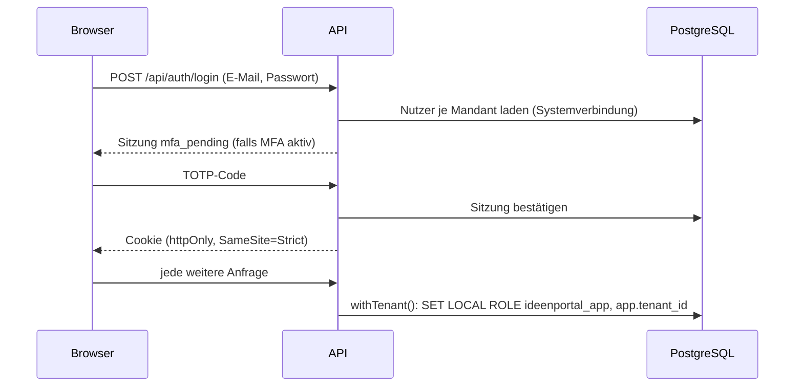

# ADR 0002 – Anmeldung: eigene Konten mit MFA, Firmen-Login (OIDC), SCIM, Einladungslink, Selbstregistrierung und Demo

**Status:** angenommen für den Capstone- und Pilotbetrieb (12.10.2026); ergänzt um Firmen-Login mit OpenID Connect (R3-26, ersetzt R1-08) und SCIM 2.0 (R3-27) am 13.10.2026

## Kontext

Das Umsetzungskonzept sieht OpenID Connect oder SAML je Mandant plus eigene Konten mit MFA vor (Abschnitt 2, R1-08, R1-09). Das Produkt startet als Capstone-Produkt (Product Faculty): Teams sollen es ohne IT-Projekt ausprobieren können. Der Review hat bemängelt, dass ein Start-Paket ohne eigenen Login nicht nutzbar wäre. Die interne IT stellt den Firmen-Login frühestens zum internen Rollout bereit.

## Entscheidung

| Baustein | Wahl | Umsetzung |
| --- | --- | --- |
| Konten | Eigene Konten je Mandant (`users`, eindeutig je `tenant_id` + E-Mail) | `server/src/routes/auth.ts` |
| Passwörter | scrypt mit Salt (`scrypt$salt$key`), Vergleich zeitkonstant | `server/src/lib/crypto.ts` |
| Zweiter Faktor | TOTP (Authenticator-App); Pflicht für Admins (`requireMfaForAdmins`, Standard `true`) | Seiten „Zweiter Faktor“, „Zwei-Faktor-Anmeldung einrichten“ |
| Sperre | Nach 5 Fehlversuchen zeitweise gesperrt, im Audit-Log | `registerFailure` |
| Sitzungen | Zufälliges Token im Cookie (`httpOnly`, `SameSite=Strict`, `Secure` hinter HTTPS); in der Datenbank nur der SHA-256-Hash; Gültigkeit `SESSION_HOURS` (12 h) | Tabelle `sessions` |
| Einladung und Reset | Einmal-Link, Hash in der Datenbank, 24 h gültig, Versand über die Outbox | `issuePasswordToken` |
| Selbstregistrierung | `/registrieren` legt einen neuen Arbeitsbereich an; die Person wird Admin, Triage und Gremium; abschaltbar mit `SIGNUP_ENABLED=false` | `server/src/routes/selfservice.ts` |
| Einladungslink | `/beitreten/<code>` je Mandant; Admin kann neu erzeugen oder abschalten (Audit-Log) | Spalte `tenants.join_code` |
| Mehrere Arbeitsbereiche | Gleiche E-Mail in mehreren Mandanten möglich; Auswahl nach dem Passwort | `/login` |
| Öffentliche Demo | `DEMO_MODE=true` legt den Mandanten `demo` an, Rollenwechsel mit einem Klick, täglicher Neuaufbau | `server/src/main.ts`, `ensureDemoTenant` |
| Firmen-Login | OpenID Connect je Mandant (zuerst Microsoft Entra ID, Okta geht genauso), Gruppen → Rollen, Just-in-time-Anlage, lokale Konten abschaltbar; alternativ SAML 2.0 je Mandant (13.10.2026, `docs/enterprise/saml.md`) | R3-26, `server/src/routes/identity.ts`, `server/src/lib/oidc.ts`, `server/src/routes/saml.ts`, `server/src/lib/saml.ts` |
| Bereitstellung | SCIM 2.0 (Users, Groups) mit Token je Mandant; Deaktivierung sperrt sofort und startet die Anonymisierungsfrist | R3-27, `server/src/routes/scim.ts` |



## Firmen-Login (R3-26)

| Baustein | Wahl | Umsetzung |
| --- | --- | --- |
| Protokoll | OpenID Connect, Authorization Code Flow mit PKCE (S256), `state` und `nonce`; Discovery über `/.well-known/openid-configuration` | `server/src/lib/oidc.ts` |
| ID-Token | Nur RS256; Signatur gegen den JWKS des Anbieters (Cache 1 h, bei unbekannter Key-ID neu laden); Prüfung von `iss` (exakt der Issuer aus der Discovery, der zum eingetragenen passen muss), `aud` (Client-ID; bei mehreren Empfängern `azp`), `exp`, `iat`, `nbf` (2 min Toleranz) und `nonce` | `verifyIdToken` |
| Bibliothek | Keine neue Abhängigkeit: `node:crypto` (JWK-Import, RSA-SHA256). Bewusst nur der kleine Ausschnitt von OIDC, den Entra ID und Okta brauchen; Tests gegen einen Test-Anbieter im Prozess | `server/test/fake-idp.ts` |
| Konfiguration | Je Mandant unter Einstellungen › Anmeldung: Issuer, Client-ID, Client-Geheimnis (verschlüsselt in `tenant_secrets`, AES-256-GCM mit `SECRET_KEY`, nie zurückgegeben), erlaubte E-Mail-Domains, Gruppen → Rollen, Just-in-time an/aus, Claim-Namen, Schalter „lokale Konten abschalten“ | Tabelle `tenant_identity`, `web/src/pages/IdentityAdmin.tsx` |
| Umleitungs-URI | Eine für alle Mandanten: `<PUBLIC_URL>/api/auth/oidc/callback`; der Mandant steckt im gespeicherten `state` | `redirectUri()` |
| Zustand der Anmeldung | `state` nur als Hash in `oidc_login_states` (10 min, einmal verwendbar), gebunden an den Browser über das Cookie `ip_oidc` (`httpOnly`, `SameSite=Lax`, weil der Rücksprung eine Navigation vom Anbieter ist) | Migration `014_identity.sql` |
| Arbeitsbereich finden | Über den Slug (`/login?mandant=…`) oder die E-Mail-Domain; eine Domain gehört höchstens einem Arbeitsbereich (Prüfung beim Speichern) | `GET /api/auth/sso` |
| Konto | Suche über `sub` (gespeichert als `oidc_subject`), sonst über die E-Mail-Adresse (verknüpft ein vorhandenes Konto); sonst Just-in-time-Anlage. Name und Abteilung kommen bei jeder Anmeldung aus den Claims (`name` bzw. `given_name`/`family_name`, `department`); ohne `email` gilt `preferred_username` bzw. `upn`. `email_verified: false` wird abgelehnt | `provision()` |
| Rollen | Ist mindestens eine Zuordnung Gruppe → Rollen eingetragen, bestimmt der Anbieter die Rollen aller verwalteten Konten (`idp_managed`): Ideengeber:in plus alle Rollen der Gruppen aus dem ID-Token und aus SCIM. Ohne Zuordnung bleiben die Rollen unter Personen pflegbar | `syncRoles()` |
| Sitzung | Dieselbe Sitzung wie bei eigenen Konten, mit `auth_method = 'oidc'` | `createSession()` |
| MFA | Sitzungen aus dem Firmen-Login überspringen die eigene Zwei-Faktor-Anmeldung, auch für Admins mit `requireMfaForAdmins`. Der Identitätsanbieter ist für den zweiten Faktor verantwortlich (z. B. Entra-ID-Richtlinie für bedingten Zugriff). Das steht in der Anleitung für die Kunden-IT | `sessionFromRequest()` |
| Lokale Konten abschalten | Dann sind Anmeldung mit Passwort, Passwort-Reset und Beitritt per Link für den Mandanten gesperrt. Der Hinweis „nur Firmen-Login“ (`SSO_REQUIRED`) kommt erst nach richtigem Passwort, verrät also nichts. Abschalten geht nur, wenn der Firmen-Login an ist und die Admin selbst gerade mit dem Firmen-Login angemeldet ist | `auth.ts`, `selfservice.ts` |
| Notfallzugang (Break-Glass) | Der Betrieb schaltet lokale Konten mit `npm run identity -w server -- local-login <slug> on` wieder ein (Systemverbindung, Eintrag `identity.break_glass` im Audit-Log). Danach meldet sich ein lokales Admin-Konto mit Passwort und MFA an | `server/src/db/identity-cli.ts` |

```mermaid
sequenceDiagram
  participant B as Browser
  participant A as API
  participant I as Identitätsanbieter
  B->>A: GET /api/auth/oidc/start?tenant=slug
  A->>A: state, nonce, PKCE-Verifier erzeugen; Hash von state speichern
  A-->>B: 302 zum authorization_endpoint (+ Cookie ip_oidc)
  B->>I: Anmeldung (inkl. MFA des Anbieters)
  I-->>B: 302 /api/auth/oidc/callback?code&state
  B->>A: Callback (Cookie ip_oidc)
  A->>A: state einmalig einlösen, Browserbindung prüfen
  A->>I: POST token_endpoint (code, code_verifier, Client-Geheimnis)
  I-->>A: id_token
  A->>I: JWKS (gecacht)
  A->>A: Signatur, iss, aud, exp, nonce prüfen; Konto finden oder anlegen; Rollen aus Gruppen
  A-->>B: Sitzungs-Cookie, 302 zur Zielseite
```

## SCIM-Bereitstellung (R3-27)

- **Endpunkte** unter `<PUBLIC_URL>/scim/v2`: `Users`, `Groups` (GET, POST, PUT, PATCH, DELETE), `ServiceProviderConfig`, `Schemas`, `ResourceTypes`. Filter `attribut eq "wert"` (userName, externalId, id, displayName, emails), Seiten mit `startIndex` und `count` (höchstens 200), `excludedAttributes=members`. PATCH mit `add`, `replace`, `remove` in Groß- und Kleinschreibung (Entra ID schreibt `Replace` und `"False"`), mit und ohne `path`, Okta-Form `members[value eq "…"]`.
- **Anmeldung** mit Bearer-Token je Mandant (`scim_…`), nur als SHA-256 gespeichert, einmal angezeigt, widerrufbar, `last_used_at`. Das Token bestimmt den Mandanten; jede Operation läuft mit `withTenant()` unter Row-Level-Security.
- **Datensparsamkeit:** Gespeichert werden nur userName, Name, Anzeigename, aktiv, externalId, Abteilung und Gruppenmitglieder. Weitere Attribute aus den Standard-Zuordnungen (Telefon, Titel, Adresse, Personalnummer, Vorgesetzte) werden angenommen, aber verworfen.
- **Konto-Adresse:** userName, wenn es eine E-Mail-Adresse ist (UPN), sonst die Arbeitsadresse aus `emails`. Sie muss zu den erlaubten Domains passen.
- **Deaktivierung** (`active=false` oder DELETE): Konto sofort gesperrt, alle Sitzungen beendet, `deactivated_at` gesetzt. Die Löschfrist-Regel anonymisiert nach `retention.anonymizeDeactivatedAfterDays` (Standard 30 Tage, Einstellungen › Prozess). Ein mit DELETE entferntes Konto ist für SCIM nicht mehr sichtbar; ein erneutes POST vor der Anonymisierung holt es zurück.
- **Gruppen → Rollen** wie beim Firmen-Login; Mitglieder werden im Mandantenkontext geprüft, fremde Konto-IDs werden ignoriert.

## Begründung

- **Ohne IT-Projekt startklar:** Pilotkunden und Capstone-Nutzer:innen brauchen keinen Identitätsanbieter.
- **Sicher genug für den Pilot:** MFA für Admins, Sperre, gehashte Tokens, kurze Sitzungen.
- **Kein externer Identitätsdienst:** keine weitere Auftragsverarbeitung, keine Kosten je Nutzer.
- **Firmen-Login ohne Umbau:** Die Sitzung ist vom Anmeldeweg getrennt; OIDC erzeugt dieselbe Sitzung (R3-26).
- **OIDC statt SAML zuerst:** Entra ID und Okta sprechen beide OIDC; ein Protokoll mit JSON und JWKS ist kleiner und besser testbar. SAML folgte am 13.10.2026 nach der Enterprise-Prüfung (Konzern-IdPs wie ADFS); OIDC bleibt die Empfehlung.
- **Keine neue Bibliothek:** `node:crypto` deckt RS256 und JWK ab; der Code bleibt klein und vollständig getestet (Signatur, Algorithmus, Aussteller, Empfänger, Ablauf, Nonce, PKCE, State).

## Alternativen

| Alternative | Warum nicht jetzt |
| --- | --- |
| Externer Identitätsdienst (Auth0, Keycloak gehostet) | Zusätzlicher Unterauftragnehmer und Betrieb; für den Pilot überdimensioniert |
| Magic-Link ohne Passwort | Abhängig von zuverlässiger Mailzustellung (Bounce-Behandlung offen); später als Option möglich |
| Nur Firmen-Login | Schließt kleine Teams und den Capstone-Betrieb aus; je Mandant abschaltbar (R3-26) |
| Bibliothek `openid-client` oder `jose` | Möglich und bewährt; für RS256 mit JWKS reicht `node:crypto`. Wechsel ist lokal in `lib/oidc.ts`, falls weitere Algorithmen (ES256) oder Funktionen (Logout, PAR) nötig werden |
| Gruppen über Microsoft Graph nachladen (Überschreitung bei mehr als 200 Gruppen) | Braucht Graph-Rechte und Netzwerkzugriff; stattdessen SCIM-Gruppen oder Entra-Option „nur der Anwendung zugewiesene Gruppen“ |

## Folgen

- Passwort-Richtlinie, Sperre und MFA liegen in unserer Verantwortung (Bedrohungsmodell T-S1 bis T-S4).
- Firmen-Login (R3-26) und SCIM (R3-27) sind gebaut; Pilotkunde C kann vor dem Rollout angebunden werden.
- Mit dem Firmen-Login liegt die MFA beim Identitätsanbieter; die Kunden-IT muss sie dort erzwingen (Anleitung in `docs/betrieb.md`).
- Neue Bedrohungen T-S8 bis T-S11, T-I13, T-I14, T-E6, T-D7 im Bedrohungsmodell.
- Selbstregistrierung und Demo brauchen Missbrauchsschutz (Rate-Limit, Captcha-Option) – Bedrohungsmodell T-D2, T-D3.

## Offen

- ~~Rate-Limit für Login, Registrierung und Demo-Login~~ (umgesetzt mit AP-01, R1-44; Firmen-Login und SCIM mit eigenen Grenzen).
- ~~TOTP-Geheimnis verschlüsselt speichern~~ (umgesetzt mit AP-01, R1-45).
- WebAuthn/Passkeys als zweiter Faktor (Release 3).
- ~~Firmen-Login R1-08~~ (umgesetzt als R3-26). Offen: Test mit einem echten Entra-ID- und Okta-Mandanten im Pilot; Domain-Nachweis (DNS-TXT) vor dem SaaS-Betrieb; Single Logout; signierte AuthnRequests und verschlüsselte Assertions bei SAML (`docs/enterprise/saml.md`).
