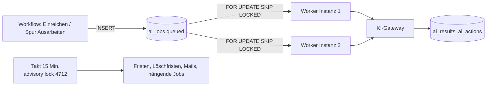

# ADR 0003 – Job-Queue in PostgreSQL ohne eigenen Broker

**Status:** angenommen (12.10.2026)

## Kontext

Fristen, Erinnerungen, Eskalationen, Wiedervorlagen, Löschfristen und Mailversand müssen zuverlässig und genau einmal laufen, auch wenn mehrere App-Instanzen laufen (Umsetzungskonzept Abschnitt 2: „Job-Queue mit Datenbanksperren“). Ab Release 2 kommen lange KI-Aufgaben hinzu (Kurzanalyse unter 3, Vollanalyse unter 15 Minuten, Bewertungsläufe des Testsatzes). Der Betrieb soll mit einer App und einer Datenbank auskommen (Render, VM, Docker Compose).

## Entscheidung

Zwei Mechanismen, beide in PostgreSQL, kein zusätzlicher Broker (kein Redis, RabbitMQ oder SQS).

### 1 Regel-Jobs im Takt (Release 1)

- Jede App-Instanz startet alle `JOB_INTERVAL_MINUTES` (15 Minuten) `runAllJobs()` (`server/src/jobs/deadlines.ts`).
- Eine **transaktionale Advisory-Sperre** `pg_try_advisory_xact_lock(4712)` lässt nur eine Instanz arbeiten; die anderen überspringen den Lauf.
- Je Mandant laufen: Erinnerungen und Eskalationen, Schließen unbeantworteter Rückfragen, Wiedervorlagen, Verzug von Umsetzungen, Löschfristen (`applyRetention`), Mailversand aus der Outbox (`dispatchMail`).
- Die Regeln sind **idempotent**: Spalten wie `reminded_at`, `escalated_at`, `overdue_reminded_at` verhindern doppelte Nachrichten.
- Manuell auslösbar mit `server/src/jobs/run-once.ts`.
- Migrationen nutzen die Sperre 4711.

### 2 Arbeitswarteschlange `ai_jobs` (Release 2)

- Workflow-Haken (`server/src/ai/hooks.ts`) legen nur Zeilen an (`short_analysis` nach Einreichung, `full_analysis` bei Spur „Ausarbeiten“). Der Ideenfluss wartet nie auf ein Modell und scheitert nie an einem.
- Ein eindeutiger Teilindex (`ai_jobs_one_open`) verhindert doppelte offene Jobs je Mandant, Idee und Art.
- Worker holen Jobs mit `SELECT … WHERE status = 'queued' AND run_after <= now() ORDER BY run_after LIMIT n FOR UPDATE SKIP LOCKED`, setzen `running` und `locked_at` und arbeiten außerhalb der Sperrtransaktion.
- Fehler: `attempts + 1`, exponentielles `run_after` (1, 5, 30 Minuten), nach 3 Versuchen `failed` mit Fehlertext. Budget erreicht oder KI abgeschaltet: `skipped`.
- Hängende Jobs (`running`, `locked_at` älter als 30 Minuten) setzt der Regel-Job zurück auf `queued`.
- Worker laufen im App-Prozess mit begrenzter Parallelität (Vorschlag: 2 je Instanz); bei Bedarf als eigener Prozess aus demselben Image.

## Begründung

- Eine Abhängigkeit weniger im Betrieb; Backups und Mandantentrennung decken die Warteschlange mit ab (Row-Level-Security auf `ai_jobs`).
- Transaktionale Sicherheit: Statuswechsel einer Idee und das Anlegen des Jobs geschehen in derselben Transaktion.
- Die erwartete Last (Hunderte bis wenige Tausend Jobs pro Tag je Instanz) ist für PostgreSQL klein.

## Alternativen

| Alternative | Warum nicht |
| --- | --- |
| Redis + BullMQ | Zusätzlicher Dienst, eigene Persistenz und Sicherung; keine Mandantentrennung in der Datenbank |
| Cloud-Queue (SQS, Pub/Sub) | Bindet an einen Anbieter; intern auf der VM nicht verfügbar |
| pg-boss / Graphile Worker | Gute Bibliotheken, aber eigenes Schema ohne Row-Level-Security; Wechsel später möglich |
| Cron im Betriebssystem | Kein Schutz vor Doppelausführung bei mehreren Instanzen |

## Folgen

- Der Takt von 15 Minuten bestimmt die Genauigkeit von Erinnerungen und Mails (ausreichend für Fristen in Arbeitstagen).
- Für KI-Jobs, die schneller starten sollen, weckt der Haken den lokalen Worker direkt (kein Warten auf den Takt).
- Lange Jobs belegen keine Datenbankverbindung, weil die Sperre nur beim Abholen gilt.

## Offen

- Kennzahlen der Warteschlange (Länge, Alter des ältesten Jobs) ins Monitoring (`docs/release-0/technik/betriebshandbuch.md`).
- Wechsel auf eine Bibliothek prüfen, falls die Last deutlich steigt (> 50.000 Jobs pro Tag).
