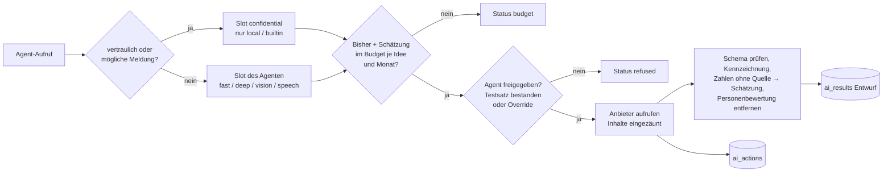

# ADR 0004 – KI-Gateway

**Status:** angenommen (12.10.2026), Bau in Release 2 (R2-09 bis R2-15, R2-20, R2-22)

## Kontext

Ab Release 2 bekommt jede Idee eine Kurzanalyse, ausgearbeitete Ideen eine Vollanalyse mit Wettbewerb, Markt, Patenten und Business Case (Umsetzungskonzept Abschnitt 8). Leitplanken aus CLAUDE.md: KI nur über das Gateway, austauschbare Modelle, Protokoll jeder Aktion, Kostenlimit je Idee und Mandant, keine Bewertung von Personen, KI entscheidet und lehnt nie ab, jede Zahl mit Quelle oder als Schätzung, vertrauliche Ideen und erkannte Meldungen nie an externe Dienste, Agenten mit minimalen Rechten. Kunden haben unterschiedliche Freigaben (eigenes Modell, EU-Anbieter, US-Anbieter mit Vertrag).

## Entscheidung

Ein Gateway im Server (`server/src/ai/`), über das jeder KI-Aufruf läuft. Einstellungen je Mandant in `settings.ai` (`server/src/ai/settings.ts`), Schlüssel getrennt in `tenant_secrets`.

### Anbieter

| Art (`kind`) | Beispiele | Anbindung | Standard-Hosting |
| --- | --- | --- | --- |
| `builtin` | Eingebaut, regelbasiert | keine externen Aufrufe; Standard für neue Mandanten | `local` |
| `anthropic` | Claude | offizielles SDK `@anthropic-ai/sdk`; `claude-opus-5-5` für tiefe Arbeit, `claude-haiku-5-5` für schnelle Aufgaben; serverseitige Modell-Fallbacks eingeschaltet | `other` |
| `openai_compatible` | Mistral (EU), Ollama/vLLM (eigenes Modell), LiteLLM, Azure EU | jeder Dienst mit `/chat/completions` | `eu` bzw. `local` |

Jeder Anbieter hat `hosting`: `local` (eigene Infrastruktur), `eu` oder `other`, und `keySource`: `none`, `tenant` (eigener Schlüssel des Mandanten) oder `platform` (Schlüssel des Betreibers aus der Umgebung).

### Modelle je Aufgabe

| Slot | Zweck | Beispielbelegung |
| --- | --- | --- |
| `fast` | Kurzanalyse, Triage-Vorschlag, Rückmeldungsentwurf, Coach | `claude-haiku-5-5` oder `mistral-small-latest` |
| `deep` | Vollanalyse, Business Case, Steckbrief, Gate-2-Vorlage | `claude-opus-5-5` oder `mistral-large-latest` |
| `vision` | Foto, Screenshot (R2-17) | multimodales Modell |
| `speech` | Transkription (R2-17) | lokales Modell bevorzugt |
| `confidential` | vertrauliche Ideen, Abgrenzungsprüfung | **nur** Anbieter mit `hosting: local` (z. B. Ollama) oder `builtin` |

Je Agent (21 Agenten, `AGENTS`) gilt der Standard-Slot aus `AGENT_DEFAULTS`; ein Admin kann je Agent ein anderes Modell wählen.

### Leitplanken im Gateway

1. **Routing nach Vertraulichkeit:** Ist eine Idee vertraulich oder erkennt die Abgrenzungsprüfung eine mögliche Meldung, wählt das Gateway den Slot `confidential`. Hat der Mandant dafür keinen lokalen Anbieter, nutzt es `builtin` oder lehnt mit Status `blocked` ab. Websuche ist für diese Fälle immer aus.
2. **Schlüssel:** Mandantenschlüssel werden mit AES-256-GCM und dem Server-Schlüssel `SECRET_KEY` verschlüsselt in `tenant_secrets` gespeichert; die API gibt sie nie zurück (nur „gesetzt / nicht gesetzt“). Plattformschlüssel kommen aus Umgebungsvariablen.
3. **Protokoll (R2-10):** Jede Aktion schreibt eine Zeile in `ai_actions`: Agent, Anbieter, Modell, `local`, Status (`ok`, `error`, `blocked`, `budget`, `refused`, `skipped` für Schritte, die die Einstellung je Ideentyp auslässt, R2-45), Eingabe, Ausgabe, Quellen, Werkzeugaufrufe, Warnungen, Tokens, Suchanfragen, Kosten in Euro, Dauer, auslösende Person, Freigabe. Aufbewahrung nach `retention.aiActionsMonths` (Standard 24 Monate), gelöscht vom Regel-Job.
4. **Kosten (R2-09, R3-06):** Preise je Modell in Euro je Million Tokens (`prices`, Standard: Opus 4/20, Sonnet 2/10, Haiku 0,10/0,50; unbekannte Modelle mit `fallbackPrice` 5/25). Budget je Idee (Standard 5 €) und je Monat (Standard 200 €). Vor jedem Aufruf wird die maximale Ausgabe geschätzt; reicht das Budget nicht, Status `budget`. Warnung an Admins bei 80 %. Details der Schätzung siehe Abschnitt „Kostenschätzung und Fairness (R2-49)“.
5. **Minimale Rechte (R2-13):** Agenten haben nur Lesewerkzeuge aus einer Positivliste: interne Ideensuche (nur im eigenen Mandanten, ohne vertrauliche Ideen anderer), Websuche und Patentsuche über den Suchanbieter (ADR 0005). Agenten handeln nie: jedes Ergebnis ist ein Entwurf oder Vorschlag, den eine Person übernimmt (`ai_results`, Freigabe in `ai_actions.approval`).
6. **Prompt-Injection:** Nutzertexte und Webinhalte stehen in klar markierten Blöcken („nicht vertrauenswürdiger Inhalt“) und werden nie als Anweisung behandelt. Muster wie „ignoriere alle vorherigen Anweisungen“, „Systemprompt“, „Zugangsdaten“ werden erkannt und als Warnung protokolliert. Ausgaben werden gegen ein JSON-Schema (zod) geprüft; ungültige Ausgaben werden verworfen.
7. **Kennzeichnung (R2-11):** Jede Aussage ist `fact` (mit Quelle und Abrufdatum), `assumption` oder `estimate` (mit Konfidenz). Zahlen ohne Quelle werden automatisch zu Schätzungen herabgestuft. Die Oberfläche zeigt „KI-Entwurf“ und die Kennzeichnung je Aussage.
8. **Keine Personenbewertung:** Prompts verbieten Aussagen über Personen; die Ausgabeprüfung sucht nach Personenbewertungen (Liste verbotener Muster) und verwirft betroffene Aussagen.
9. **KI lehnt nie ab:** Triage-Vorschläge sind Vorschläge mit Begründung und Konfidenz; die Entscheidung speichert nur ein Mensch.

### Qualitätstor (R2-12)

- Testsatz mit 32 Ideen in `server/testset/ki-testsatz.json` (Beschreibung: `docs/release-0/ki/testsatz.md`).
- Mindestwert je Agent (`AGENT_DEFAULTS.minScore`, z. B. Abgrenzung 0,9, Kurzanalyse 0,7, Triage-Vorschlag 0,6), je Mandant änderbar.
- Ändert sich die Konfiguration (Anbieter, Modell, Prompt-Version), ändert sich der **Konfigurations-Hash**; ein Bewertungslauf startet automatisch (`ai_eval_runs`, Auslöser `config_change`). Bis zum Bestehen bleibt der Agent aus (`requireEval`).
- Ein Admin kann einen Agenten trotzdem freigeben, nur mit schriftlicher Begründung (mind. 10 Zeichen) für genau diesen Hash; das steht in `releaseOverrides` und im Audit-Log.

### Kostenschätzung und Fairness (R2-49)

**Kostenschätzung vor jedem Aufruf.** `estimateCost()` im Gateway schätzt vor jedem Versuch (auch vor der Wiederholung bei Schemafehler):

- Eingabe-Token = (Länge von Systemtext + Prompt in Zeichen) / 4, aufgerundet, plus 1.600 Token je Bild,
- Ausgabe-Token = `maxTokens` des Bausteins (Obergrenze),
- Preis mit `priceFor()`/`costEur()` wie beim echten Aufruf (eingebaut und eigenes Hosting ohne Preis: 0 €).

Würden die bisherigen Kosten der Idee bzw. des Monats plus die Kosten früherer Versuche dieses Aufrufs plus die Schätzung das Budget überschreiten, ruft das Gateway den Anbieter nicht auf. Es schreibt eine Zeile mit Status `budget`, der Meldung (Schätzung, bisher, Limit) und der Schätzung in Token als Warnung, und bricht mit `AI_BUDGET` ab. Die Vollanalyse stoppt dann wie bisher. Die Schätzung ist bewusst eine Obergrenze: Ein Aufruf kann abgelehnt werden, obwohl er tatsächlich ins Budget gepasst hätte. Das ist gewollt, denn ein Budget soll nicht überschritten werden.

**Fairness zwischen Mandanten.** Die KI-Warteschlange (`ai_jobs`, ADR 0003) vergibt Aufträge nicht mehr nur nach Fälligkeit:

1. Qualitätsläufe (`eval_run`) zuerst, weil sie Agenten freigeben.
2. Dann der Mandant, dessen letzter Auftrag am längsten zurück gestartet wurde (`ai_jobs.started_at`, Round-Robin; Mandanten ohne gestarteten Auftrag zuerst).
3. Innerhalb des Mandanten nach Fälligkeit.

Ein Mandant hat nie mehr als `AI_TENANT_CONCURRENCY` (Standard 1) Aufträge gleichzeitig in Arbeit; eine Instanz bearbeitet bis zu `AI_CONCURRENCY` (Standard 2) Aufträge parallel in eigenen „Bahnen“. Die Vergabe ist kurz mit einer Advisory-Sperre serialisiert, damit das Limit je Mandant auch bei mehreren Bahnen und Instanzen hält. Folge: Ein Mandant, der hundert Ideen auf einmal importiert, belegt höchstens einen Platz; jeder andere Mandant kommt beim nächsten freien Platz dran.

Kennzahlen dazu im Health-Endpunkt (R1-05): wartende und laufende Aufträge, ältester fälliger Auftrag, Zahl der Mandanten mit wartenden Aufträgen, längste Warteschlange eines Mandanten und die eingestellte Parallelität (`docs/betrieb.md`).

Getestet in `server/test/ai-quality.test.ts`: Round-Robin mit einem flutenden Mandanten, Limit je Mandant, parallele Bahnen, Abbruch durch die Schätzung.

### Quellenprüfung mit Seitenabruf (R2-46)

Für höchstens 5 Websuchtreffer je Analyse ruft `fetchPages()` (`server/src/ai/sourcecheck.ts`) die Seite ab: nur http und https, keine Zugangsdaten in der Adresse, nie das interne Netz (Prüfung der aufgelösten IP-Adressen bei jedem Sprung einer Weiterleitung, höchstens 3 Weiterleitungen), Zeitlimit je Seite, höchstens `maxChars` Zeichen (Standard und Obergrenze 20.000), nur Text- und HTML-Inhalte. Der sichtbare Text wird ohne Skripte und Stile extrahiert. Ein Auszug von höchstens 1.500 Zeichen geht, um Sätze mit Anweisungsmustern bereinigt, **innerhalb des eingezäunten Quellenblocks** (`<untrusted name="quellen">`) an das Modell; gespeichert wird er nicht. Vertrauliche Ideen rufen nichts ab. Der Abruf läuft über einen austauschbaren Fetcher (Tests ohne Netz; `AI_PAGE_FETCH=false` schaltet ihn für die Instanz ab).

Geprüft wird je Quelle „erreichbar“ (Status 2xx/3xx) und „Zitat enthalten“ (ein Bruchstück des Suchtreffer-Auszugs mit mindestens vier Wörtern steht wörtlich im Seitentext, Zahlen ohne Tausenderpunkt verglichen). Je belegter Aussage (`fact`) prüft das Gateway, ob alle Zahlen und mindestens die Hälfte der längeren Wörter auf einer zitierten Seite stehen (`confirmed` oder `not_found`). Die Qualitätsansicht zeigt je Baustein den Anteil der Zahlen mit Quelle, erreichbare Quellen, gefundene Zitate und bestätigte Belege. Ergänzend zieht der tägliche Regel-Job einmal im Monat eine Stichprobe von 5 Ergebnissen, die der Pate der Idee bewertet (stimmt, kleine Fehler, falsch).

## Alternativen

| Alternative | Warum nicht |
| --- | --- |
| Direkte Anbindung eines Anbieters | Abhängigkeit, keine Steuerung von Kosten und Datenschutz (im Umsetzungskonzept ausgeschlossen) |
| Externes LLM-Gateway als Dienst | Weiterer Unterauftragnehmer; Mandantenregeln müssten doppelt gepflegt werden |
| Nur lokales Modell | Qualität für Wettbewerbs- und Marktanalysen derzeit nicht ausreichend; bleibt als Option je Mandant |

## Folgen

- Neue Mandanten haben KI „an“, aber nur `builtin`: keine Daten verlassen das Haus, bis ein Admin bewusst einen Anbieter einträgt.
- Ausfall eines Anbieters: Fallback auf `builtin` mit Hinweis (Betriebshandbuch).
- `SECRET_KEY` wird zur kritischen Umgebungsvariablen (Sicherung, Rotation; Betriebshandbuch).
- Unterauftragnehmerliste je Mandant muss die gewählten Anbieter enthalten (`docs/release-0/datenschutz/rechtsgrundlagen.md`).

## Offen

- Prompt-Versionierung als Teil des Konfigurations-Hashes festlegen.
- Datenschutzrechtliche Freigabe der konkreten Anbieter je Mandant.
- Zero-Data-Retention-Optionen der Anbieter vertraglich prüfen.
