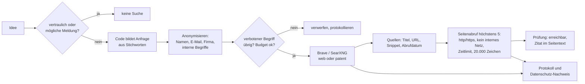

# ADR 0005 – Suchanbieter für Web- und Patentrecherche

**Status:** angenommen (12.10.2026), gebaut in Release 2 (R2-14, R2-22 bis R2-24); an den Code angeglichen mit AP-04 (Review P-22); Seitenabruf und Websuche je Ideentyp mit AP-08 (R2-45, R2-46)

## Kontext

Wettbewerbs- und Marktanalysen brauchen aktuelle Quellen aus dem Web; die Patentrecherche (R2-24) braucht Treffer aus öffentlichen Patentdatenbanken. Websuchen dürfen keinen Firmen- oder Personenbezug haben (R2-14), vertrauliche Ideen und mögliche Meldungen werden nie gesucht. Kosten müssen je Mandant begrenzt sein.

## Entscheidung

### Anbieter (`settings.ai.search.kind`)

| Art | Beschreibung | Datenschutz | Kosten |
| --- | --- | --- | --- |
| `none` (Standard) | Keine Websuche; Agenten nutzen nur interne Ideensuche und Modellwissen (als Annahme gekennzeichnet) | nichts verlässt das Haus | 0 |
| `brave` | Brave Search API | Anfrage geht an Brave; eigener Index, kein Profiling laut Anbieter; AVV prüfen | je Anfrage, konfigurierbar (`costPerQueryEur`, Standard 0,005 €) |
| `searxng` | Selbst betriebene SearXNG-Instanz (`baseUrl`) | Anfrage geht über die eigene Instanz an Suchmaschinen; IP des Betreibers statt Nutzer | Betrieb der Instanz |

Austauschbar über eine Schnittstelle `search(query, { kind: 'web' | 'patent', limit })`. Weitere Anbieter folgen dem gleichen Muster.

### Anonymisierung vor jeder Anfrage

1. Entfernen von Personennamen (Nutzerliste des Mandanten), E-Mail-Adressen, Telefonnummern.
2. Entfernen des Mandantennamens und aller Begriffe aus `settings.ai.internalTerms` (Firmen-, Produkt-, Projektnamen, interne Abkürzungen).
3. **Die Anfrage entsteht im Code, nicht im Modell:** `queriesFor()` in `server/src/ai/pipeline.ts` nimmt bis zu vier Stichworte aus Titel und Lösung und hängt einen festen Zusatz an („Anbieter Wettbewerber“, „Alternative Produkt Preis“, „Marktgröße Studie“ usw.). Das Modell hat kein Suchwerkzeug und sieht die Anfrage nicht vorher. So bleibt die Anonymisierung prüfbar und Prompt-Injection kann keine Anfrage formulieren.
4. Bleiben nach dem Entfernen weniger als zwei Wörter, wird die Anfrage nicht gesendet.
5. Die gesendete Anfrage und die Zahl der entfernten Begriffe stehen im Protokoll (`ai_actions.input.queries`, `input.removedTerms`) und im Datenschutz-Nachweis je Idee (R2-42, PDF). Teile von Namen zählen mit: „erika.mustermann“ sperrt auch „erika“ und „mustermann“.

### Patente

- Patentsuche läuft über denselben Suchanbieter, eingeschränkt auf öffentliche Patentdatenbanken (z. B. Google Patents, Espacenet) per Seitenfilter.
- Ergebnisse sind Hinweise mit Link, nie eine Freigabe („Prüfung durch Patentfachleute“, `KI-PATENT`).
- Für vertrauliche Produktideen keine Patentsuche (mögliche Erfindungen sollen nicht über Suchanfragen offengelegt werden; Prüfschritt R3-25).

### Grenzen und Kosten

| Einstellung | Standard | Zweck |
| --- | --- | --- |
| `maxQueriesPerRun` | 6 | Anfragen je Analyse |
| `perMonthEur` | 20 € | Monatsbudget der Suche je Mandant |
| `costPerQueryEur` | 0,005 € | Kosten je Anfrage (an Vertrag anpassen) |

**Seitenabruf für die Quellenprüfung (R2-46, AP-08):** Genutzt werden Titel, URL und Snippet aus der Trefferliste (höchstens 500 Zeichen je Treffer). Zusätzlich ruft das Portal für höchstens 5 Treffer je Analyse die Seite selbst ab (`server/src/ai/sourcecheck.ts`):

- nur http und https, keine Zugangsdaten in der Adresse, nie interne Adressen (die aufgelösten IP-Adressen werden vor jedem Abruf und bei jeder Weiterleitung geprüft, höchstens 3 Weiterleitungen), unabhängig von `AI_ALLOW_PRIVATE_URLS`;
- Zeitlimit je Seite (Standard 10 Sekunden), höchstens 20.000 Zeichen sichtbarer Text, nur Text- und HTML-Inhalte;
- die Anfrage enthält nur die Adresse aus der Trefferliste, keine Ideentexte und keine Cookies;
- vertrauliche Ideen und mögliche Meldungen rufen nie etwas ab (sie haben schon keine Websuche);
- ein Auszug von höchstens 1.500 Zeichen geht, um Anweisungsmuster bereinigt, im eingezäunten Quellenblock an das Modell (ADR 0004, Prompt-Injection); gespeichert werden nur das Ergebnis der Prüfung („erreichbar“, „Zitat gefunden“) und je belegter Aussage „in der Quelle gefunden“ oder nicht;
- jeder Abruf steht im KI-Protokoll (`page_fetch`, mit den Adressen) und im Datenschutz-Nachweis je Idee.

Einstellbar je Mandant unter Einstellungen › KI › Quellenprüfung (an/aus, Seiten 0–5, Zeichen, Zeitlimit); `AI_PAGE_FETCH=false` schaltet den Abruf für die ganze Instanz ab.

### Websuche je Ideentyp (R2-45)

Je Ideentyp (intern, Produkt/Kunde) ist einstellbar, ob die Kurzanalyse im Web sucht und welche Bausteine der Vollanalyse laufen. Standard: interne Ideen ohne Websuche in der Kurzanalyse; Patente für beide Typen aus, bis eine Patentdatenbank angebunden ist (R2-24). Ist der Baustein „Patente“ aus, entfällt auch die Patentanfrage. Übersprungene Schritte stehen im KI-Protokoll mit Status `skipped` und Grund.

## Alternativen

| Alternative | Warum nicht |
| --- | --- |
| Websuche des KI-Anbieters (Tool des Modells) | Anfragen und Treffer außerhalb unserer Kontrolle; Anonymisierung nicht prüfbar |
| Google/Bing Search API | Teurer, strengere Nutzungsbedingungen; als weiterer Anbieter später möglich |
| Lizenzierte Markt- und Patentdatenbanken | Kostenpflichtig; optional je Kunde (Produktkonzept) |

## Folgen

- Ohne Suchanbieter sind Analysen weniger aktuell; die Kennzeichnung macht das sichtbar (mehr Annahmen und Schätzungen).
- Anonymisierung kann Treffer verschlechtern; Qualität wird über den Testsatz gemessen.

## Offen

- Datenschutzrechtliche Freigabe von Brave Search je Mandant; Alternative SearXNG für streng regulierte Kunden.
- Nutzungsbedingungen der Patentdatenbanken für automatisierte Abfragen prüfen (keine Rechtsberatung).
