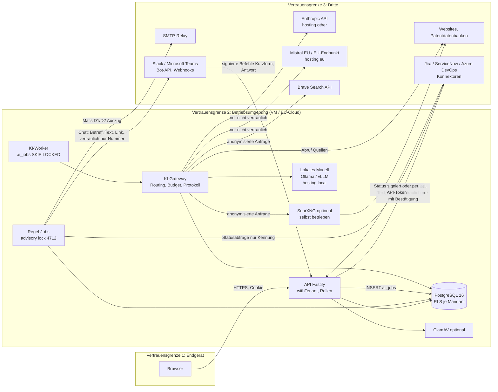

# Datenfluss und Vertrauensgrenzen

Stand 12.10.2026 · Release 0 · Entwurf · Bezug: ADR 0001–0005, Umsetzungskonzept Abschnitt 5 und 6

Das Dokument zeigt, welche Daten an welchen Dienst gehen und unter welcher Bedingung sie das Haus verlassen. „Haus“ meint die Betriebsumgebung des Mandanten: intern die VM bzw. der Container der IT, extern die EU-Cloud (Render, Frankfurt) des Betreibers.

## Datenklassen

| Klasse | Beispiele | Schutzbedarf |
| --- | --- | --- |
| D1 Konten | Name, E-Mail, Organisationseinheit, Rollen, Passwort-Hash, TOTP-Geheimnis, Sitzungen | hoch |
| D2 Ideen | Titel, Problem, Lösung, Nutzen, Anhänge, Kommentare, Unterstützungen | normal |
| D3 Vertrauliche Ideen | wie D2 mit Kennzeichen vertraulich | hoch |
| D4 Mögliche Meldungen | Texte mit Treffer der Abgrenzungsprüfung | sehr hoch (werden nicht gespeichert, wenn abgebrochen) |
| D5 Entscheidungen und Nutzen | Gates, Begründungen, Scorecards, Ist-Nutzen | normal |
| D6 Protokolle | Audit-Log, `ai_actions`, Server-Logs | hoch |
| D7 Geheimnisse | `SECRET_KEY`, Anbieter-Schlüssel, SMTP-Zugang, Datenbankzugang | sehr hoch |
| D8 Abgeleitete KI-Daten | Analysen, Quellen, Korrekturen | normal (vertrauliche Idee → hoch) |

## Übersicht

## Flüsse im Einzelnen

| Nr. | Fluss | Daten | Ziel | Bedingung | Schutz |
| --- | --- | --- | --- | --- | --- |
| F1 | Browser ↔ API | D1–D5, D8 | API | angemeldet; Rolle erlaubt | HTTPS, `httpOnly`-Cookie, `SameSite=Strict`, serverseitige Rechte |
| F2 | API ↔ Datenbank | alle | PostgreSQL | jede Anfrage über `withTenant()` als `ideenportal_app` | Row-Level-Security, `FORCE ROW LEVEL SECURITY` |
| F3 | Anhang → Virenscan | Datei | ClamAV (intern) | `CLAMAV_HOST` gesetzt | Positivliste, Inhaltsprüfung, max. 10 MB |
| F4 | Benachrichtigung → Mail | Betreff (Ideentitel), Text, E-Mail-Adresse | SMTP-Relay | Person hat E-Mail nicht abgeschaltet | TLS (`smtps://`); vertrauliche Ideen nur mit „Idee #Nummer“ im Betreff (AP-01) |
| F5 | KI, nicht vertraulich | Ideentext, Kontext aus ähnlichen Ideen (ohne Namen) | Anbieter des Slots (`eu`/`other`) | KI an, Agent freigegeben, Budget ok, keine Meldung | AVV, Protokoll `ai_actions`, Schlüssel verschlüsselt |
| F6 | KI, vertraulich oder mögliche Meldung | D3, D4 | nur `hosting: local` oder `builtin` | immer | Gateway erzwingt Slot `confidential`; sonst `blocked` |
| F7 | Websuche | Anfrage aus Stichworten der Idee, vom Code gebildet (nicht vom Modell), ohne Namen, Firmen, interne Begriffe | Brave oder SearXNG | Suche an, nicht vertraulich, keine Meldung, Budget ok | Anonymisierung, Protokoll der Anfrage, Datenschutz-Nachweis je Idee (R2-42) |
| F8 | Quellen und Seitenabruf (R2-46) | Titel, URL und Snippet aus der Trefferliste; dazu **Abruf der Seite** für höchstens 5 Treffer je Analyse. Angefragt wird nur die Adresse aus der Trefferliste (HTTP-GET ohne Cookies, ohne Ideentext, eigener User-Agent) | Webseiten der Treffer | Websuche lief (F7), Quellenprüfung an (Einstellungen › KI), `AI_PAGE_FETCH` nicht `false`, **nicht vertraulich, keine Meldung** | nur http/https, nie interne Adressen (IP-Prüfung auch bei Weiterleitungen, höchstens 3), Zeitlimit, höchstens 20.000 Zeichen Text; Auszug (1.500 Zeichen, um Anweisungsmuster bereinigt) nur eingezäunt im Prompt, nicht gespeichert; gespeichert wird je Quelle nur „erreichbar / Zitat gefunden“; Protokoll `page_fetch` mit den abgerufenen Adressen |
| F9 | Abgrenzungsprüfung | Text beim Absenden | lokal (`server/src/lib/boundary.ts`), ab R2 Slot `confidential` | immer | verlässt nie das Haus |
| F10 | Export | alle Daten des Mandanten | Admin (Download) | Admin, MFA | Audit-Log |
| F11 | Logs | Methode und Pfad ohne Query-String, Statuscode, Fehlertyp und -code, Job-Zähler je Arbeitsbereich, maskierte Mail-Empfänger | Logdienst der Plattform | Betrieb | keine Ideentexte, keine Suchbegriffe, keine Tokens; Werte in Fehlermeldungen maskiert; Test `test/ops.test.ts` (AP-03) |
| F12 | Backup | Datenbank | Backup-Speicher (EU) | täglich | Verschlüsselung des Anbieters; Wiederherstellung monatlich testen (erster Test protokolliert, AP-03) |
| F13 | Betriebsalarme | Kennzahlen über alle Arbeitsbereiche (Alter des Job-Laufs, Warteschlangen, Rückstau), keine Namen oder Inhalte | `ALERT_EMAIL`, `ALERT_WEBHOOK_URL` (z. B. Teams- oder Slack-Webhook) | Schwelle überschritten (R1-05) | nur Zahlen und feste Texte |
| F14 | Datenschutz-Nachweis | je KI-Aktion: Dienst, Region, Modell, Kosten, gesendete Suchanfragen; nie Eingaben, Antworten oder Ideentexte; vertrauliche Ideen nur mit Nummer | Browser bzw. PDF für Admin, Betriebsrat (Leserolle), Beteiligte der Idee | auf Abruf (R2-42) | Rechteprüfung je Idee; Leserolle sieht keine Analysen |
| F15 | Benachrichtigung → Chat (R3-16) | Betreff, Text der Benachrichtigung (gekürzt auf 1.500 Zeichen), Link zur Idee; für Slack-Direktnachrichten zusätzlich die E-Mail-Adresse zur Suche des Slack-Kontos (`users.lookupByEmail`, danach nur die Slack-ID gespeichert) | Slack Web API (`chat.postMessage`) oder persönlicher eingehender Webhook (Slack, Teams-Workflows, Teams-Connector) | Person hat Chat eingeschaltet, Kategorie nicht stummgeschaltet, Kanal im Arbeitsbereich aktiv | **vertrauliche Ideen, weitergeleitete Ideen und Texte mit Treffer der Abgrenzungsprüfung nur als „Idee #Nummer“ mit neutralem Satz**; Webhook-Adressen nur zu Hosts von Slack und Microsoft (Positivliste, kein freies Ziel); Bot-Token, Signing Secret und Webhook-Adressen verschlüsselt (`SECRET_KEY`); Logs nur mit maskierter Adresse |
| F16 | Chat → API (R3-16) | Befehl der Person: Kurzform (Titel, Problem, Lösung) oder Antwort auf Rückfrage; Slack-ID bzw. Entra-Objekt-ID | API-Endpunkte `/api/integrations/slack/:id/…` und `/api/integrations/teams/:id/messages` | Kanal aktiv; Person zugeordnet: Slack über die E-Mail-Adresse aus `users.info` im selben Mandanten, Teams über einmaligen Code aus dem Portal | Slack: Signatur v0 (HMAC-SHA256 mit Signing Secret, höchstens 5 Minuten alt) und `team_id`; Teams: HMAC des ausgehenden Webhooks oder Bot-Framework-JWT (Signatur, Aussteller, Zielgruppe, Ablauf); dieselben Servicefunktionen und Rechte wie die API; Antworten wiederholen den Ideentext nicht |
| F17 | Firmen-Login (R3-26) | Weiterleitung zum Identitätsanbieter mit `state`, `nonce`, PKCE; zurück ein ID-Token mit Kennung (`sub`), Name, E-Mail, Abteilung, Gruppen | Identitätsanbieter des Kunden (Entra ID, Okta, eigener OIDC-Dienst) | Anmeldung mit „Mit Firmen-Login anmelden“ | nur https und öffentliche Adressen; Signatur gegen JWKS, Aussteller, Zielgruppe, Ablauf und Nonce geprüft; Client-Secret verschlüsselt; Gruppen nur für die Rollenzuordnung |
| F18 | SCIM-Abgleich (R3-27) | Benutzername, Name, Anzeigename, aktiv, externe ID, Abteilung, Gruppenmitglieder; weitere Attribute werden verworfen | eingehend vom Verzeichnis des Kunden an `/scim/v2/…` | Änderung im Verzeichnis | Bearer-Token je Mandant (nur Hash gespeichert, widerrufbar), Rate-Limit, Deaktivierung sperrt sofort und startet die Anonymisierungsfrist |
| F19 | Webhooks und API-Tokens (R3-17) | Ereignis mit Ideen-ID, Nummer, Status, Gate-Entscheidung; vertrauliche Ideen nur ID, Nummer, Status | vom Kunden eingetragene https-Adresse; API-Aufrufe der Integrationen des Kunden | Statuswechsel, Gate-Entscheidung, Challenge-Phase | HMAC-Signatur mit Zeitstempel, keine privaten Adressen, keine Texte oder Personen; Tokens mit Rollen, Ablauf, Widerruf, Audit |
| F20 | Übergabe an Umsetzungswerkzeuge (R3-13 bis R3-15, R3-18) | Titel, Problem, Lösung, Nutzen bzw. Projektsteckbrief des Umsetzungspakets, Zieltermin, Link zur Idee, Ideen-ID und Nummer, zugeordnete Felder (Nummer, Themenfeld, Aufwand, Plan-Nutzen, Kanal); User Stories als Unterelemente; **keine Personen** (weder Ideengebende noch Owner) | Jira Cloud (REST v3), ServiceNow (Table API), Azure DevOps (Work Items) des Kunden | Klick der verantwortlichen Person der Umsetzung, ihrer Vertretung oder der Triage nach Gate 2; Konnektor vom Admin aktiviert; **vertrauliche Ideen nur nach ausdrücklicher Bestätigung im Dialog** | nur https und öffentliche Adressen (`checkPublicUrl`, vor jedem Aufruf, keine Weiterleitungen); Zugangsdaten verschlüsselt (`SECRET_KEY`), nie zurückgegeben; Audit `connector.handover` mit Kennzeichen vertraulich/bestätigt, Fehlversuche `connector.handover_failed` |
| F21 | Status aus Umsetzungswerkzeugen (R3-13 bis R3-15) | Kennung bzw. Schlüssel des Elements und Statusname; das Portal speichert nur Status und abgeleiteten Fortschritt | eingehend an `/api/integrations/connectors/:id/status` | Konnektor aktiv; Element mit dem Portal verknüpft | Prüfung je Aufruf: API-Token desselben Mandanten mit Rolle Umsetzung, Triage oder Admin (AP-12), oder Geheimnis des Konnektors als HMAC (`X-Hub-Signature`, `X-Ideenportal-Signature` mit 5-Minuten-Fenster) bzw. Basic-Auth-Passwort (Azure DevOps); Audit `connector.status`; Abschluss der Umsetzung bleibt beim Menschen (Ist-Nutzen) |
| F22 | Statusabfrage (Polling) | nur Kennung des Elements; zurück der Status | Zielsystem des Konnektors | Konnektor aktiv, Abfrage eingeschaltet, Umsetzung läuft; im Regel-Job oder per Klick | wie F20 (Adressprüfung, verschlüsselte Zugangsdaten) |
| F23 | Umsetzungspaket (R3-18) | Ideentext, Steckbrief, Zieltermin, Kanal | KI-Gateway, Agent `implementation_package` | Klick der verantwortlichen Person oder Triage | wie F5/F6: vertrauliche Ideen nur an `local`/`builtin`; Protokoll `ai_actions`; Entwurf gekennzeichnet, bis ein Mensch ihn bearbeitet |
| F24 | Import alter Ideen mit KI (R4-12) | Titel, Problem, Lösung, Nutzen und Themenfeld der Importzeilen (keine E-Mail-Adressen), Liste der Themenfelder | KI-Gateway, Agent `import_cleanup` | Admin lädt eine Datei in die Vorschau | Zeilen mit „Vertraulich = ja“ nur an `local`/`builtin` (eigener Aufruf mit `sensitive`); Protokoll `ai_actions` nur mit Zeilenzahl und Länge; Vorschläge gekennzeichnet, angelegt wird erst nach Bestätigung |
| F25 | Kennzahl-Messung über Konnektor (R4-04) | Abfrage der Kennzahl (JQL, ServiceNow-Abfrage, WIQL) mit eingesetzten Datumsgrenzen; zurück **nur eine Anzahl** | Zielsystem des Konnektors (Jira, ServiceNow, Azure DevOps) | Kennzahl an Gate 2 mit Quelle Konnektor festgelegt, Konnektor aktiv, Paket mit Konnektoren; Vorher-Zeitraum vorbei bzw. Umsetzung abgeschlossen; im Regel-Job oder per Klick „Jetzt messen“ | wie F20 (Adressprüfung, verschlüsselte Zugangsdaten); kein Ideentext, keine Personen; gespeichert werden Zahl und Zeitraum (`impact_metric_values`) |
| F26 | Kennzahlwert aus anderen Systemen (R4-04) | Zahl, Zeitraum (vorher/nachher), optionale Notiz | eingehend an `/api/impact-metrics/:id/values` | Kennzahl mit Quelle API oder von Hand | API-Token desselben Mandanten mit Rolle Umsetzung, Triage oder Admin (AP-12), Sichtbarkeit der Idee geprüft, Audit `impact_metric.value` |
| F27 | Trendhinweise (R4-02) | Anfrage aus dem **Namen des Themenfelds** und festen Wörtern („Trends 2026“, „neue Technologien“), vom Code gebildet und anonymisiert (Namen, Mandant, interne Begriffe entfernt); zurück Titel, URL, Snippet | Suchanbieter (Brave oder SearXNG), danach KI-Gateway, Agent `trend_digest` (nur Themenfeld und Treffer, keine Ideen) | wöchentlich im Regel-Job bzw. per Klick der Innovationsleitung; nur mit eingerichteter Websuche | Protokoll `web_search` und `ai_actions`; Treffer nur im Wochenhinweis (`trend_digests`), keine Signal-Datenbank |
| F28 | Wochenmail Trendhinweise (R4-02) | Zusammenfassung, Hinweise, Quellen (Titel, URL), Link zum Radar | SMTP wie F4 (Kategorie `trends`) | Sponsor:in eines Themenfelds oder einer laufenden Challenge im Themenfeld, Kategorie nicht abgewählt | abbestellbar unter Mein Konto; abgewählt = kein Hinweis |
| F29 | Zuordnung zum Trendradar (R4-11) | Titel und Beschreibung der Trends, Titel und Problem **nicht vertraulicher** Ideen (keine Entwürfe, keine möglichen Erfindungen), Treffer der Wochenhinweise | KI-Gateway, Agent `trend_assign` (Slot wie F5) | Klick der Innovationsleitung bzw. nach dem Wochenlauf | Ergebnis nur Vorschläge; Verknüpfung erst nach Bestätigung durch einen Menschen |
| F30 | Tickets für das Problem-Radar (R4-01) | Anfrage mit Filter (JQL, ServiceNow-Abfrage, Arbeitselementtyp) und Zeitraum; zurück **nur Titel und Beschreibung** (Personenfelder werden nicht angefragt und verworfen) | eingehend vom Zielsystem des Konnektors (Jira, ServiceNow, Azure DevOps) | Klick der Innovationsleitung, Triage oder Admin; Paket mit Konnektoren | wie F20/F22: https, URL-Prüfung, keine Umleitung; Rohtickets werden nicht gespeichert |
| F31 | Clusterbildung Problem-Radar (R4-01) | Titel und Beschreibung von Tickets oder CSV-Feedback **nach Schwärzung** (E-Mail, Telefon, Links, Namen der Personen des Arbeitsbereichs, Felder wie „Reporter: …“) | KI-Gateway, Agent `problem_clusters`, **immer Slot `confidential`** (nur `hosting: local` oder `builtin`) | Klick wie F30 bzw. CSV-Upload | gespeichert nur Anzahl, Cluster (Bezeichnung, Häufigkeit, bis zu 3 geschwärzte Beispiele); Cluster unter Mindestgröße verworfen; nie nach Personen gruppiert |

## Was verlässt das Haus? (Kurzfassung)

| Daten | SMTP | Chat (Slack, Teams) | Umsetzungswerkzeuge (Jira, ServiceNow, Azure DevOps) | KI-Anbieter extern | Suchanbieter | Lokales Modell |
| --- | --- | --- | --- | --- | --- | --- |
| Konten (D1) | E-Mail-Adresse, Name | E-Mail-Adresse nur zur Kontosuche (Slack-Bot) | nein | nein | nein | nein |
| Ideen (D2) | Titel im Betreff, kurze Texte | Titel und Text der Benachrichtigung, Link | Titel, Texte bzw. Umsetzungspaket, Link (per Klick nach Gate 2) | ja, wenn eingeschaltet | nur abstrakte, anonymisierte Anfrage; danach Abruf der Trefferseiten nur mit deren Adresse (F8) | ja |
| Vertrauliche Ideen (D3) | nur Nummer im Betreff, Text der Benachrichtigung | nur Nummer und Link, **kein Text** | **nur nach ausdrücklicher Bestätigung** je Übergabe | **nie** | **nie** | ja |
| Mögliche Meldungen (D4) | nein | **nie** (nur „Idee #Nummer“ bzw. neutraler Hinweis) | nein (werden nicht freigegeben) | **nie** | **nie** | ja |
| Entscheidungen (D5) | Rückmeldetext an Ideengebende | Rückmeldetext (nicht bei vertraulichen Ideen) | Zieltermin, Kanal, Plan-Werte (nur zugeordnete Felder) | nur als Kontext für Entwürfe (R2-19) | nein | ja |
| Tickets und Feedback (Problem-Radar, R4-01) | nein | nein | nur eingehend: Titel und Beschreibung (F30) | **nie** (nur eigenes Hosting) | nein | ja, nach Schwärzung |
| Geheimnisse (D7) | SMTP-Zugang | Bot-Token im Aufruf an Slack | Zugangsdaten im Aufruf an das jeweilige Zielsystem | API-Schlüssel des Anbieters | API-Schlüssel | – |

## Demo und Selbstregistrierung

- Die öffentliche Demo ist ein eigener Mandant `demo` mit Beispieldaten; Eingaben werden täglich gelöscht. Hinweis: keine echten Daten eingeben.
- In der Demo ist nur `builtin` als KI-Anbieter erlaubt (Vorschlag), damit keine Kosten und keine Datenabflüsse entstehen.

**Offen (Product Owner):** Bestätigen, dass die Demo keine externen KI-Anbieter nutzt; Logdienst und Backup-Region der gewählten Plattform dokumentieren.
