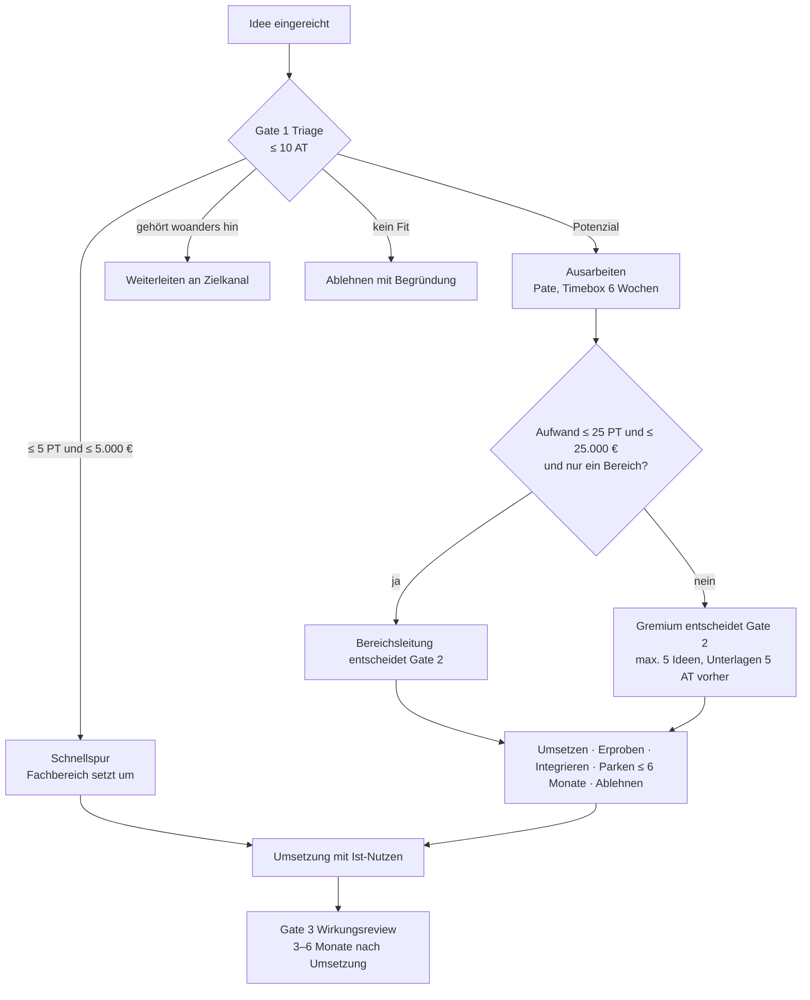

# Schwellen, Fristen und Zielkanäle

Stand 12.10.2026 · Release 0 · Entwurf · Bezug: R1-04, R1-24 bis R1-28, R2-01, R2-04, R2-05, R2-07

Alle Werte sind Einstellungen je Mandant (Leitplanke „Einstellungen statt Code“). Die Standardwerte stehen in `server/src/lib/settings.ts` und gelten für den Pilot, bis sie nach dem ersten Quartal kalibriert werden.

## Schwellen

| Schwelle | Standard | Einstellung | Wirkung |
| --- | --- | --- | --- |
| Schnellspur: Aufwand | ≤ 5 Personentage | `thresholds.fastLaneMaxPersonDays` | Triage darf direkt an den Fachbereich übergeben (R1-29) |
| Schnellspur: Kosten | ≤ 5.000 € | `thresholds.fastLaneMaxEuro` | wie oben; beide Bedingungen müssen erfüllt sein |
| Delegation an Bereichsleitung: Aufwand | ≤ 25 Personentage | `thresholds.delegationMaxPersonDays` | Bereichsleitung (`lead`) entscheidet Gate 2 ohne Gremium (R2-05) |
| Delegation: Kosten | ≤ 25.000 € | `thresholds.delegationMaxEuro` | wie oben; zusätzlich nur ein Bereich betroffen |
| Über Delegationsschwelle oder bereichsübergreifend | – | – | Gremium entscheidet |

## Fristen

| Frist | Standard | Einstellung | Regel |
| --- | --- | --- | --- |
| Gate 1 (erste Rückmeldung) | 10 Arbeitstage | `deadlines.gate1Workdays` | ab Einreichung; Feiertage je Mandant |
| Erinnerung vor Fristende | 2 Arbeitstage | `deadlines.reminderWorkdaysBefore` | eine Erinnerung je Frist |
| Eskalation | erster Tag nach Fälligkeit | – | an Admins und Zuständige, bei Abwesenheit an Vertretung |
| Rückfrage | max. 2 Runden | `deadlines.maxQuestionRounds` | Frist pausiert |
| Schließen ohne Antwort | 15 Arbeitstage | `deadlines.questionTimeoutWorkdays` | Idee wird geschlossen, kann neu eingereicht werden |
| Ausarbeitung bis Gate 2 | 30 Arbeitstage | `deadlines.elaborationWorkdays` | entspricht der Timebox |
| Timebox Ausarbeitung | 6 Wochen | `elaboration.timeboxWeeks` | Warnung ab 2 aktiven Ideen je Pate (`mentorWarnActive`) |
| Parken | max. 6 Monate | `deadlines.maxParkMonths` | automatische Wiedervorlage |
| Gremium: Ideen je Sitzung | max. 5 | `elaboration.meetingMaxIdeas` | |
| Gremium: Unterlagen vorab | 5 Arbeitstage | `elaboration.meetingPackWorkdays` | |
| Experiment: Erinnerung | 2 Arbeitstage vor Ende | `elaboration.experimentReminderWorkdays` | |
| Wirkungsreview (Gate 3) | 3 Monate (Spanne 3–6) | `elaboration.impactReviewMonths` | Aufgabe für Pate und Sponsor |

**Offen (Product Owner):** Sind 10 AT für Gate 1 im Pilotbereich realistisch bei wöchentlicher Triage? Empfehlung: beibehalten, weil es das Hauptversprechen ist; Fristtreue im Pilot messen.

## Zielkanäle für die Abgrenzung

Jeder Mandant hinterlegt seine Zielkanäle unter Einstellungen > Zielkanäle (`targetChannels`, R1-28). Die Abgrenzungsregeln (`boundaryRules`) verweisen über die Art (`kind`) auf einen Kanal. Ohne hinterlegten Kanal zeigt das Portal einen allgemeinen Hinweis.

| Art (`kind`) | Anliegen | Erkennung (Standardbegriffe) | Beispiel-Zielkanal (Vorlage) |
| --- | --- | --- | --- |
| `whistleblowing` | Hinweise auf Rechtsverstöße oder Fehlverhalten (HinSchG) | verstoß, belästigung, korruption, bestechung, betrug, diskriminierung, mobbing | Interne Meldestelle / Ombudsperson, Link zum Hinweisgebersystem |
| `service_desk` | IT-Störungen und Service-Anfragen | störung, ausfall, funktioniert nicht, passwort zurücksetzen, ticket | IT-Service Desk, Self-Service-Portal |
| `complaints` | Kundenbeschwerden | beschwerde, reklamation | Beschwerde- oder Reklamationsmanagement |
| `safety` | Arbeitsschutz, Unfälle, Beinahe-Unfälle, Produktsicherheit | unfall, beinahe-unfall, verletzung, arbeitsschutz | Fachkraft für Arbeitssicherheit, Meldesystem |
| `hr` | Persönliche Anliegen an HR oder Führung | (keine automatische Erkennung; Hinweis in der FAQ) | HR-Business-Partner |
| `project` | Laufende Projektanforderungen und Fehler | (keine automatische Erkennung) | Projekt-Backlog, z. B. Jira |
| `other` | Sonstiges | – | frei |

### Vorlage je Pilot

| Pilot | `whistleblowing` | `service_desk` | `complaints` | `safety` | `hr` | `project` |
| --- | --- | --- | --- | --- | --- | --- |
| Intern | Meldestelle: {Name, Link} | IT-Service: {Link} | Kundenservice: {Kontakt} | Arbeitssicherheit: {Kontakt} | HR: {Kontakt} | Jira: {Link} |
| Pilotkunde A | {vom Kunden} | {vom Kunden} | {vom Kunden} | {vom Kunden} | {vom Kunden} | {vom Kunden} |
| Pilotkunde B | {vom Kunden} | {vom Kunden} | {vom Kunden} | – | {vom Kunden} | {vom Kunden} |

**Offen (Product Owner):** Zielkanäle intern mit Link und Ansprechperson einsammeln (Meldestelle, IT, Arbeitssicherheit, HR); beim Kick-off jedes Pilotkunden ausfüllen lassen.

### Regeln

1. Erkannte Meldungen werden nicht gespeichert, wenn die Person abbricht; Inhalte gehen nie an externe KI- oder Suchdienste.
2. Das Portal wird nie als Meldekanal beschrieben. „Anonym“ heißt nur: anonym gegenüber der Community.
3. Begriffe sind je Mandant erweiterbar (Einstellungen > Abgrenzung). Fehlalarme im Pilot sammeln und Begriffe nachschärfen.
