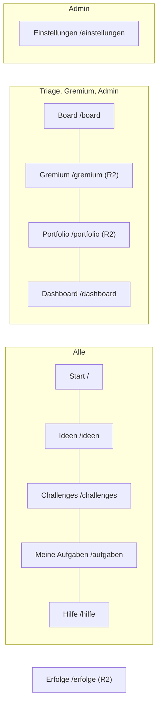

# Navigationsstruktur

Stand 13.10.2026 · an den gebauten Stand angeglichen (AP-04, Review P-22; AP-07: Steckbrief-Seite, Erststart je Rolle, Antwortgarantie; AP-19: Rollen je Bereich)

Die Struktur folgt den echten Routen in `web/src/App.tsx` (Release 1) und ergänzt die Bereiche aus Release 2. Neue Bereiche nutzen dieselbe API wie die Oberfläche (Leitplanke „API zuerst“).

## Öffentliche Seiten (ohne Anmeldung)

| Route | Seite | Inhalt |
| --- | --- | --- |
| `/` | Landingpage | Versprechen, „So geht’s“, „Was drin ist“, „Demo ansehen“, „Arbeitsbereich anlegen“, „Anmelden“ |
| `/registrieren` | Arbeitsbereich anlegen | Name des Teams, Name, E-Mail, Passwort; abschaltbar (`SIGNUP_ENABLED=false`) |
| `/beitreten/:code` | Einladung annehmen | Name, E-Mail, Passwort |
| `/login` | Anmelden | E-Mail, Passwort; bei mehreren Arbeitsbereichen Auswahl |
| `/passwort` | Passwort festlegen | Einladung und Passwort-Reset über Einmal-Link |
| – | Zweiter Faktor / MFA einrichten | Zwischenschritt nach dem Passwort |

## Hauptnavigation (angemeldet)

| Menüpunkt | Route | Sichtbar für | Release | Zweck |
| --- | --- | --- | --- | --- |
| Start | `/` | alle | 1 | Antwortgarantie mit Erfüllungsquote der letzten 90 Tage (R1-46), Meine Ideen, aktive Challenges, neue Ideen, Erfolge |
| Ideen | `/ideen`, `/ideen/:id` | alle (vertrauliche nur Berechtigte) | 1 | Liste mit Filter und Suche; Idee mit Status, Verlauf, Diskussion, Gates |
| Steckbrief | `/ideen/:id/steckbrief/:reiter` (Reiter `zusammenfassung`, `analysen`, `scorecard`, `experimente`, `wirkung`) | wer die Idee sehen darf; bearbeiten Pate, Triage, Gremium | 2 | Eigene Seite mit Reitern (R2-47): Pate, Timebox, Schätzungen und Abschnitte; KI-Analysen; Scorecard; Experimente; Wirkungsreview und Erfolgsgeschichte. Jeder Reiter hat eine eigene Adresse. Erreichbar über „Steckbrief öffnen“ auf der Idee und über den Titel in der Gate-2-Vorlage. Alte Anker auf `/ideen/:id` (`#h-dossier`, `#h-score`, `#h-exp`, `#h-impact`, `#ai-…`) leiten auf den passenden Reiter um |
| Challenges | `/challenges`, `/challenges/:id` | alle | 1 | Challenges mit Leitfrage, Zeitraum; ab R2 Jury und Teams (R2-35) |
| Meine Aufgaben | `/aufgaben` | alle | 1 | Checkliste „Deine erste Woche“ je Rolle (R2-48), Rückfragen, Urheberschaft bestätigen, Umsetzungen; ab R2 Patenschaften, Experimente, Wirkungsreviews |
| Board | `/board` | `triage`, `committee`, `admin` | 1 | Spalten je Status, Fristen-Ampel; mit Rolle für einzelne Bereiche nur die Ideen dieser Bereiche, mit Hinweis über dem Board (R3-29) |
| Gremium | `/gremium`, `/gremium/:id` | `triage`, `committee`, `admin` | 2 | Sitzungen, Agenda (max. 5), Vergleichsansicht, Gate-2-Vorlage (R2-04, R2-33) |
| Portfolio | `/portfolio` | `triage`, `committee`, `lead`, `admin` | 2 | Board nach Phase, Themenfeld, Horizont; Plan- und Ist-Nutzen (R2-08) |
| Dashboard | `/dashboard` | `triage`, `committee`, `lead`, `admin` | 1 | Kennzahlen ab 5 Personen, Durchlaufzeiten mit Ausgangswert, Challenge-Bericht, CSV (R1-37, R2-41); Filter „Bereich“, mit Rolle für einzelne Bereiche nur deren Zahlen (R3-29) |
| KI-Nachweise | `/ki-nachweise` | `admin`, `works_council` (Betriebsrat, lesend) | 2 | Datenschutz-Nachweis je Idee mit KI-Aktionen, PDF (R2-42) |
| Erfolge | `/erfolge` | alle | 2 | Erfolgsgeschichten, Nennung (abschaltbar; R2-37, R2-38) |
| Einstellungen | `/einstellungen` | `admin` | 1 | siehe unten |
| Hilfe | `/hilfe` | alle | 1 | Abgrenzung, FAQ, Ablauf, Datenschutz |

**Rechte oben rechts:** „Idee einreichen“ (`/einreichen`, `/einreichen/:id` für Entwürfe), Glocke (Benachrichtigungen), „Mein Konto“ (`/konto`: Meine Daten, Abwesenheit und Vertretung, Benachrichtigungen), „Abmelden“. In der Demo zusätzlich das Band „Rolle wechseln“.

**Mobil (gebauter Stand):** Die Hauptnavigation bricht auf schmalen Bildschirmen in mehrere Zeilen um; ein zusammenklappbares Menü gibt es noch nicht. **Offen:** Mobiles Menü (Review P-06) wird erst gebaut, wenn der Klicktest (AP-05) es bestätigt; der Klicktest hat noch nicht stattgefunden. Die Reiter des Steckbriefs brechen ebenfalls um, die Seite bleibt bei 320 px ohne waagerechtes Scrollen. „Idee einreichen“ bleibt sichtbar. „Zum Inhalt springen“ ist der erste fokussierbare Link.

## Einstellungen (Reiter)

| Reiter | Release | Inhalt | Einstellungsschlüssel |
| --- | --- | --- | --- |
| Prozess | 1 | Fristen, Schwellen, Datenschutz und Sicherheit, Antwortgarantie (an/aus, Arbeitstage, Hinweisschwelle; R1-46), Ausgangswerte vor dem Pilot, Löschfristen | `deadlines`, `thresholds`, `minGroupSize`, `requireMfaForAdmins`, `guarantee`, `baselines`, `retention` |
| Themen und Kalender | 1 | Themenfelder, Feiertage, Zeitzone | `topics`, `holidays`, `timezone` |
| Zielkanäle | 1 | Meldestelle, Service Desk, Beschwerden, Arbeitssicherheit, HR, Projekt | `targetChannels` |
| Abgrenzung | 1 | Begriffe je Kategorie | `boundaryRules` |
| Texte | 1 | Rückmeldevorlagen, Datenschutzhinweis, FAQ | `texts` |
| Personen | 1 | Rollen (mandantenweit), Einladungslink, Auskunft, Anonymisieren; Rollen mit Bereich stehen je Person unter dem Namen | – |
| Bereiche | 3 | Bereiche als Stammdatum (Name, Beschreibung, Themenfelder, Organisationseinheiten) und Rollen je Bereich: Triage, Gremium, Bereichsleitung für einzelne Bereiche vergeben und entziehen (R3-29) | Tabellen `areas`, `role_assignments` |
| Import | 1 | CSV/Excel | – |
| Protokoll | 1 | Audit-Log, CSV | – |
| Daten | 1 | Vollexport, Arbeitsbereich löschen | – |
| Ausarbeitung und Gremium | 2 | Timebox, Warnschwelle Paten, Sperrzeit, Sitzungen, Wirkungsreview | `elaboration` |
| Scorecard | 2 | Kriterien, Gewichte, Anker | `scorecard` |
| KI | 2 | Anbieter, Modelle je Aufgabe, Agenten, Preise, Budget, Websuche, interne Begriffe, Tonalität | `ai` |
| KI-Qualität | 2 | Testsatz-Läufe, Mindestwerte, Freigabe mit Begründung | `ai.requireEval`, `ai.releaseOverrides` |
| KI-Protokoll | 2 | Alle KI-Aktionen mit Filter, Kosten je Monat, Link zum Datenschutz-Nachweis je Idee | Tabelle `ai_actions` |

## Rollen je Bereich (R3-29)

Rollen gelten mandantenweit (`users.roles`) oder für einzelne Bereiche (`role_assignments`). Ein **Bereich** ist ein Stammdatum je Mandant, zum Beispiel ein Geschäftsbereich, ein Standort oder ein Themenfeld. Eine Idee gehört zu jedem Bereich, dessen Themenfelder ihr Themenfeld enthalten **oder** dessen Organisationseinheiten die Einheit der einreichenden Person enthalten (Groß- und Kleinschreibung egal). Eine Idee kann zu mehreren Bereichen gehören oder zu keinem; Ideen ohne Bereich bearbeiten nur Personen mit mandantenweiter Rolle.

| Rolle | mit Bereich möglich | Wirkung des Bereichs |
| --- | --- | --- |
| Triage | ja | Board, Gate 1, Rückfragen, Pate, vertrauliche Ideen, Erinnerungen und Eskalationen nur für Ideen des Bereichs |
| Gremium | ja | Gate 2, Sitzungseinladungen in „Meine Aufgaben“ (Sitzungen mit Ideen des Bereichs), Bestätigung des Wirkungsreviews ohne Sponsor, Erinnerungen nur für Ideen des Bereichs |
| Bereichsleitung | ja | Delegierte Gate-2-Entscheidung und Dashboard nur für Ideen des Bereichs |
| Admin, Betriebsrat (lesend), Pate, Umsetzung, Einreichende | nein | mandantenweit bzw. aus der Beziehung zur Idee |

- Menüpunkte richten sich nach der Rolle, egal ob mandantenweit oder mit Bereich; die Inhalte sind gefiltert.
- Hat eine Person dieselbe Rolle mandantenweit und mit Bereich, gilt die mandantenweite.
- Sitzungen, Challenges und Einstellungen sind nicht an Bereiche gebunden; Entscheidungen in einer Sitzung prüfen den Bereich je Idee.
- Gruppen des Identitätsanbieters können auf Rolle plus Bereich abgebildet werden (Einstellungen › Anmeldung, Spalte „Bereich“).
- Die Seite Mitbestimmung zeigt die Bereiche mit der Zahl der Personen je Rolle.

## Ideen-Detailseite (Reihenfolge)

1. Titel, Statusleiste (Eingereicht → Gate 1 → Gate 2 → Umgesetzt), Restfrist, nächster Schritt
2. Aufgaben für mich (Rückfrage, Urheberschaft, Zufriedenheit)
3. Problem, Idee, Erwarteter Nutzen
4. **KI-Analysen** (R2, aufklappbar, gekennzeichnet; Triage-Vorschlag nur für Triage, Gremium und Pate; Link „Datenschutz-Nachweis als PDF“) – solange die Idee keinen Steckbrief hat. Ab der Ausarbeitung stehen hier stattdessen die Eckdaten (Pate, Timebox, Schätzungen) und die Karte „Steckbrief“ mit Füllstand und Links auf alle Reiter; die Analysen liegen dann im Reiter „Analysen“ (R2-47)
5. Gate 1: Triage / Gate 2: Entscheidung (nur Berechtigte)
6. Umsetzung und Ist-Nutzen
7. Verlauf
8. Diskussion

## Erster Start und Leerzustände (R2-48)

- Rundgang mit drei Schritten bei der ersten Anmeldung (R1-38).
- Beim ersten Aufruf je drei Schritte für die Rolle, die dort arbeitet: Board (`triage`, `admin`: Ampel, Spuren, KI-Vorschläge), Steckbrief (`mentor` sowie Pate und Sponsor der Idee: Reiter, Abschnitte mit Sperre, Timebox und Gate 2), Gremium (`committee`: Sitzungen, Vorlage lesen, Entscheidung mit Begründung). „Überspringen“ oder „Los geht’s“ merkt sich der Server je Person und Bildschirm (`users.intros_seen`); unter „Meine Aufgaben“ lassen sich die Schritte erneut zeigen.
- Leerzustände nennen den nächsten Schritt mit Knopf je Rolle: Start („Erste Idee einreichen“), Meine Aufgaben (Admin: Arbeitsbereich einrichten, Triage: Board, Gremium: Gremium, Pate: Ideen, alle anderen: Idee einreichen), Board (Admin: Import und Einladung, Triage: Challenge anlegen), Gremium (Triage: Ideen in Ausarbeitung, Gremium: Portfolio).

## Offene Punkte

- **Offen (AP-05/AP-07):** Mobiles Menü (Review P-06) nach dem Klicktest entscheiden.

- **Offen (Product Owner):** Soll „Portfolio“ für Ideengebende sichtbar sein (Transparenz) oder nur für Innovationsleitung? Vorschlag: nur Leserechte für Triage, Gremium, Admin.
- Release 3 ergänzt: Rolle „Externe:r“ mit reduzierter Navigation (Start, Meine Ideen, Einreichen, Hilfe), öffentliche Status-Seite je Mandant (R3-20).
